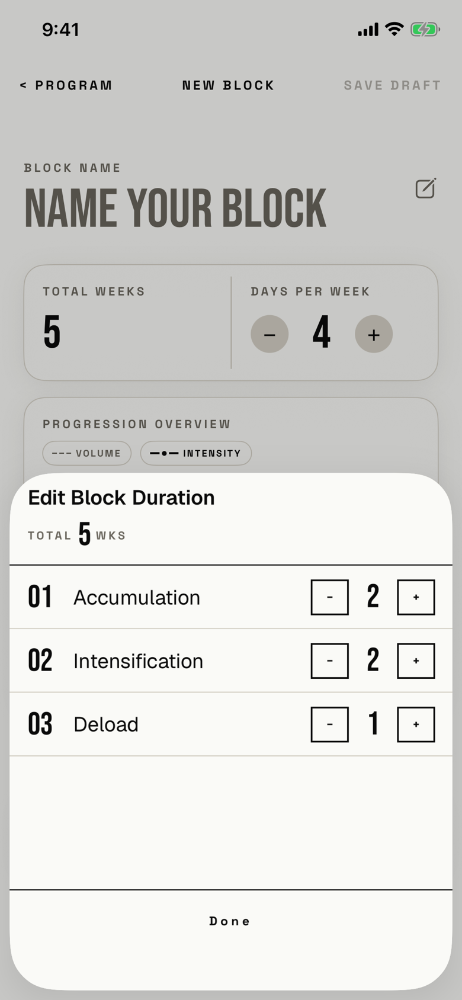

The lifter changes how many weeks each phase lasts, and so the block's total length.

## Entry points

| From | Tap | Kind |
|---|---|---|
| [new-block](new-block.md) | The TOTAL WEEKS cell (read as "Total weeks, …") | sheet |

## Exits

| Control | Goes to | Kind | Closes with |
|---|---|---|---|
| Done | [new-block](new-block.md) | sheet | done |
| Swipe down | [new-block](new-block.md) | sheet | none |

Every − and + writes to the draft at once, so Done and a swipe both keep the changes; the sheet has no cancel.

## States

| State | How to reach it | Screenshot |
|---|---|---|
| Three phases | Main tour, active-block seed: a blank New Block, then the TOTAL WEEKS cell | [17e light](img/17e-default-light-new-block-duration.png) |
| A phase at 1 week | The − of a 1-week phase does nothing (not captured; the Deload row in the main shot is at 1) | - |
| AX3 | Same walk at AX3; the sheet opens at full height, and each row puts its stepper under the phase name with 48 pt buttons, on both phones | [17e AX3](img/17e-ax3-light-new-block-duration.png), [Pro Max AX3](img/17promax-ax3-light-new-block-duration.png) |

Dark mode and the Pro Max at default text change only colour and size: [17e dark](img/17e-default-dark-new-block-duration.png), [Pro Max](img/17promax-default-light-new-block-duration.png).

## Compared with the mock-up

No mock-up was drawn for this sheet; the May builder mock-up shows TOTAL WEEKS as a read-only number "FROM PHASES".

## VoiceOver order

1. "Edit Block Duration"
2. "TOTAL", "5", "WKS" as three separate elements
3. "01", "Accumulation"
4. "−", "2", "+"
5. "02", "Intensification", "−", "2", "+"
6. "Done"

The steppers read only "−" and "+", without the phase or the stat they change (T120).
The steppers are 32 by 30 pt at default text (T38), and Done answers taps only on its 37 by 14 pt word.

## Findings

<!-- findings are linked after the audit -->
