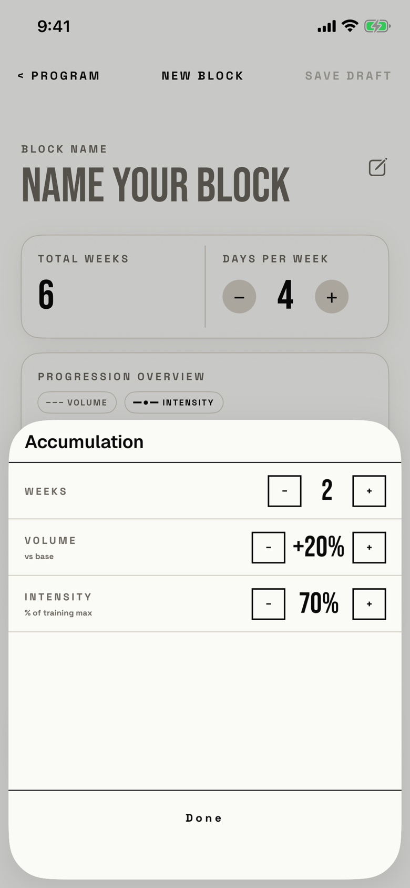

The lifter sets one phase's weeks, its volume against base and its intensity as a share of training max.
The header names the phase type, such as "Accumulation".

## Entry points

| From | Tap | Kind |
|---|---|---|
| [new-block](new-block.md) | A phase card, such as "Phase 1: Accumulation" | sheet |
| [new-block](new-block.md) in Edit block, from Program or Today | A phase card | sheet |

## Exits

| Control | Goes to | Kind | Closes with |
|---|---|---|---|
| Done | [new-block](new-block.md) | sheet | done |
| Swipe down | [new-block](new-block.md) | sheet | none |

Every − and + writes to the phase at once, so Done and a swipe both keep the changes, and there is no way to cancel them.

## States

| State | How to reach it | Screenshot |
|---|---|---|
| New block, first phase | Main tour, active-block seed: a blank New Block, then the Phase 1 card | [17e light](img/17e-default-light-new-block-phase-editor.png) |
| Edit block, live block's phase | W08, active-block seed: Today's LIVE BLOCK band, EDIT BLOCK ▸, then the Phase 1 card; it shows HOLD and 100% | [17e light edit](img/17e-default-light-new-block-phase-editor--edit.png) |
| Values at their limits | Weeks 1 to 52, volume -60% to +60%, intensity 50% to 100%; the − or + at a limit does nothing and does not look disabled (not captured) | - |
| AX3 | Same walk at AX3; the sheet opens at full height, and each stepper sits under its label with 48 pt buttons, on both phones | [17e AX3](img/17e-ax3-light-new-block-phase-editor.png), [Pro Max AX3](img/17promax-ax3-light-new-block-phase-editor.png) |

Dark mode and the Pro Max at default text change only colour and size: [17e dark](img/17e-default-dark-new-block-phase-editor.png), [Pro Max](img/17promax-default-light-new-block-phase-editor.png), [Pro Max edit](img/17promax-default-light-new-block-phase-editor--edit.png).

## Compared with the mock-up

| In the mock-up | In the app | Difference |
|---|---|---|
| Header: phase number badge "01", "EDIT PHASE", and a signal DONE on the right | Header: the phase name in sentence case, no number, no header action | The title names the type, not the slot, so two Accumulation phases look the same |
| DONE at the top right | "Done" in small tracked type in a bar at the bottom | Close control moved and made quieter |
| TYPE row with a phase-type menu | No type row | The type cannot be changed once added |
| DELETE PHASE button at the bottom | No delete in the sheet; delete is a swipe on the card | Delete moved out of the editor |
| 44 pt square steppers | 32 by 30 pt steppers at default text | Targets shrank |

## VoiceOver order

1. "Accumulation"
2. "WEEKS"
3. "Decrease weeks", value "2 weeks"
4. "2"
5. "Increase weeks", value "2 weeks"
6. "VOLUME", "vs base", "Decrease volume", "+20%", "Increase volume"
7. "INTENSITY", "% of training max", "Decrease intensity", "70%", "Increase intensity"
8. "Done"

The value between each pair of steppers is read again as its own element after the stepper already read it.
The steppers are 32 by 30 pt at default text (T38), and Done answers taps only on its 37 by 14 pt word.

## Findings

<!-- findings are linked after the audit -->
