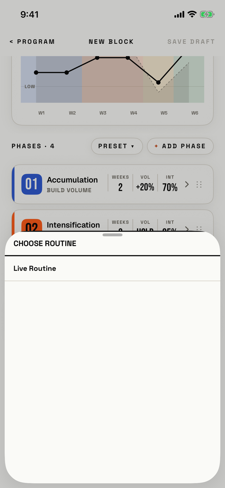

The lifter picks the routine the new block will run.

## Entry points

| From | Tap | Kind |
|---|---|---|
| [new-block](new-block.md) | + ATTACH ▸ in the Routine row, when no routine is picked | sheet |
| [new-block](new-block.md) | SWAP ▸ in the Routine row, when a routine is picked | sheet |

## Exits

| Control | Goes to | Kind | Closes with |
|---|---|---|---|
| A routine row, such as Live Routine | [new-block](new-block.md), with that routine in the Routine row | sheet | verb |
| Swipe down | [new-block](new-block.md) | sheet | none |

The sheet has no CANCEL, close or Done; a swipe down is the only way out without a pick.
The other New Block sheets close with CANCEL ([new-block-template](new-block-template.md), [new-block-add-phase-type](new-block-add-phase-type.md)) or Done ([new-block-duration](new-block-duration.md), [new-block-phase-editor](new-block-phase-editor.md)).
The overview's routine picker, [split-picker](split-picker.md), has the same gap.

## States

| State | How to reach it | Screenshot |
|---|---|---|
| One routine, none picked | Main tour, active-block seed: a blank New Block, then + ATTACH ▸ | [17e light](img/17e-default-light-new-block-split-picker.png) |
| No routines | W16, fresh store: + ATTACH ▸; the sheet shows only its title and an empty page | [17e light fresh](img/17e-default-light-new-block-split-picker--fresh.png) |
| A routine picked | SWAP ▸ after a pick; that row shows ✓ in signal text (not captured; W16 picks a routine but does not reopen the sheet) | - |
| AX3 | Same walk at AX3; the title and row grow, and the half-height sheet still fits, on both phones | [17e AX3](img/17e-ax3-light-new-block-split-picker.png), [Pro Max AX3](img/17promax-ax3-light-new-block-split-picker.png) |

Dark mode and the Pro Max at default text change only colour and size: [17e dark](img/17e-default-dark-new-block-split-picker.png), [Pro Max](img/17promax-default-light-new-block-split-picker.png), [Pro Max fresh](img/17promax-default-light-new-block-split-picker--fresh.png).
The sheet opens at half height and can be dragged to full height by its grabber.

## Compared with the mock-up

No mock-up was drawn for this sheet.

## VoiceOver order

1. "Sheet Grabber", value "Half screen"
2. "Choose Routine"
3. "Live Routine"

Rows give only the routine's name, without the session count the overview's picker shows.
The ✓ on a picked routine is a plain "✓" text with no selected trait (from code, `fitbod/Periodization/BlockBuilderView.swift:2800`).
With no routines, VoiceOver finds nothing after the title.

## Findings

- Major: [D-05](../audit.md#d-05).
- Minor: [D-102](../audit.md#d-102).
- Polish: [D-285](../audit.md#d-285).
