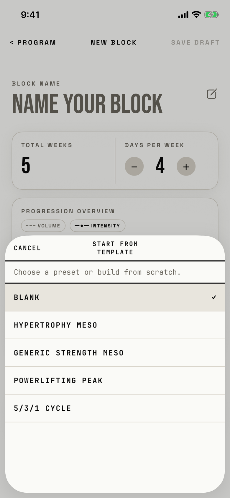

The lifter picks a preset to fill New Block's phases, or keeps Blank to build from scratch.

## Entry points

| From | Tap | Kind |
|---|---|---|
| [new-block](new-block.md) | PRESET ▾ beside + ADD PHASE | sheet |

## Exits

| Control | Goes to | Kind | Closes with |
|---|---|---|---|
| CANCEL | [new-block](new-block.md) | sheet | cancel |
| A preset row, such as HYPERTROPHY MESO, on a builder with untouched phases | [new-block](new-block.md), with the preset's phases and name | sheet | verb |
| A preset row on a builder whose phases were edited | [dialog-replace-phases](dialog-replace-phases.md) | dialog | verb |
| BLANK | [new-block](new-block.md) | sheet | verb |
| Swipe down | [new-block](new-block.md) | sheet | none |

The sheet opens at half height only, so the confirmation for edited phases appears after the sheet closes (`fitbod/Periodization/BlockBuilderView.swift:156`).

## States

| State | How to reach it | Screenshot |
|---|---|---|
| Blank selected | Main tour, active-block seed: Program, + NEW, + New block, Blank Block, then PRESET ▾ | [17e light](img/17e-default-light-new-block-template.png) |
| A preset selected | Pick a preset, then open the sheet again; that row is filled and shows ✓ (not captured, because it looks like the main state with the mark on another row) | - |
| AX3 | Same walk at AX3; the header title moves above CANCEL, the help wraps to two lines, GENERIC STRENGTH MESO wraps, and the half-height sheet shows three and a half rows | [17e AX3](img/17e-ax3-light-new-block-template.png) |
| Pro Max, AX3 | Same walk at AX3; the title fits one line above CANCEL, GENERIC STRENGTH MESO fits one line, and the taller half-height sheet shows all five presets | [Pro Max AX3](img/17promax-ax3-light-new-block-template.png) |

Dark mode and the Pro Max at default text change only colour and size: in dark mode the selected row is a darker slab and the rules turn light ([17e dark](img/17e-default-dark-new-block-template.png), [Pro Max](img/17promax-default-light-new-block-template.png)).

## Compared with the mock-up

No mock-up was drawn for this sheet; the May builder mock-ups have no preset picker.

## VoiceOver order

1. "Cancel"
2. "Start From Template"
3. "Choose a preset or build from scratch."
4. "BLANK", selected
5. "HYPERTROPHY MESO"
6. "GENERIC STRENGTH MESO"
7. "POWERLIFTING PEAK"
8. "5/3/1 CYCLE"

The ✓ is hidden from VoiceOver, and the selected row carries the selected trait instead.
The title is the only place that says "template"; the chip that opens the sheet and the help line both say "preset".

## Findings

<!-- findings are linked after the audit -->
