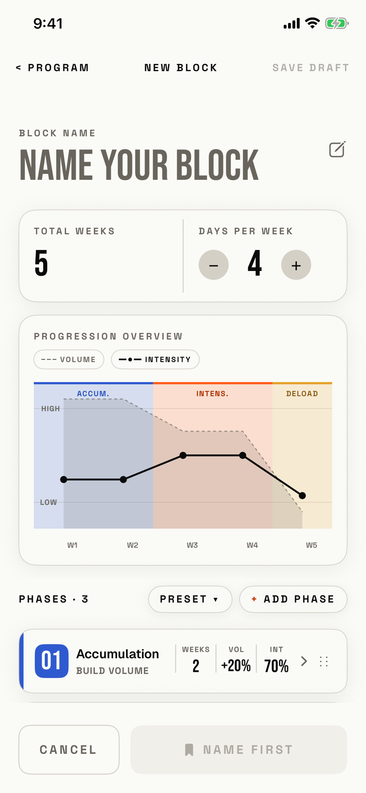

The lifter names a block, lays out its phases, attaches a routine and training days, and saves it as a draft or as ready to start.

## Entry points

| From | Tap | Kind |
|---|---|---|
| [start-choice](start-choice.md) | Blank Block | cover |
| [preset-picker](preset-picker.md) | Any preset row, or FROM SCRATCH | cover |
| [program](program.md) | A template row under "Or start from a template" (empty program only) | cover |
| [today](today.md) | Start a block (opens with no phases and the name "BLANK BLOCK", back label "< TODAY") | sheet |
| [block-overview](block-overview.md) | EDIT in the header or EDIT BLOCK ▸; opens as EDIT BLOCK, a cover from Program and a sheet from Today | cover |
| [block-review](block-review.md) | Start next ▸ | sheet |

The same view is drawn in two modes.
NEW BLOCK has SAVE DRAFT at the top right and PRESET ▾ beside + ADD PHASE.
EDIT BLOCK hides both, its primary button reads SAVE CHANGES, and an active block hides SWAP ▸ on its routine.

## Exits

| Control | Goes to | Kind | Closes with |
|---|---|---|---|
| < PROGRAM or < TODAY, with nothing changed | Back to the screen that opened it | cover | cancel |
| < PROGRAM, < TODAY or CANCEL, after a change | [dialog-discard-block](dialog-discard-block.md) ("Discard this block?" or, when editing, "Discard changes?") | dialog | cancel |
| CANCEL, with nothing changed | Back to the screen that opened it | cover | cancel |
| SAVE DRAFT (needs a name) | Back to the opener, with a DRAFT block saved | cover | verb |
| SAVE AS READY or SAVE CHANGES | Back to the opener, with the block saved as READY or updated | cover | verb |
| The TOTAL WEEKS cell | [new-block-duration](new-block-duration.md) | sheet | none |
| PRESET ▾ | [new-block-template](new-block-template.md); a pick over edited phases then asks [dialog-replace-phases](dialog-replace-phases.md) | sheet | none |
| + ADD PHASE | [new-block-add-phase-type](new-block-add-phase-type.md) | sheet | none |
| A phase card | [new-block-phase-editor](new-block-phase-editor.md) | sheet | none |
| A swipe left on a phase card, then Delete | The same screen, with the "Phase deleted" toast and UNDO for 4 seconds | none | none |
| A long press on ⋮⋮, then a drag | The same screen, with the phase moved | none | none |
| + ATTACH ▸ or SWAP ▸ | [new-block-split-picker](new-block-split-picker.md) | sheet | none |

A swipe down does not close the cover or sheet once anything has changed (`interactiveDismissDisabled`).
While a piece is missing, the primary button names it (NAME FIRST, ADD A PHASE, PICK A ROUTINE, ROUTINE IS EMPTY, PICK N DAYS) and a tap on it does nothing.

## States

| State | How to reach it | Screenshot |
|---|---|---|
| Blank block from Program | `-fitbod-seed-active-block`, + NEW, + New block, Blank Block; three default phases, no name, NAME FIRST | [main](img/17e-default-light-new-block.png) |
| Days gate | W16 demo seed, a routine attached, FIXED WEEKLY with too few days; the button reads PICK 2 DAYS while DAYS PER WEEK shows 4 | [days-gate](img/17e-default-light-new-block--days-gate.png) |
| Edit from Today | Today, the block overview, EDIT BLOCK ▸; a sheet titled EDIT BLOCK with "< TODAY" | [edit-from-today](img/17e-default-light-new-block--edit-from-today.png) |
| Edit from Program | Program, the ACTIVE card, EDIT BLOCK ▸; a cover with SAVE CHANGES and no SAVE DRAFT or PRESET ▾ | [edit](img/17e-default-light-new-block--edit.png) |
| Empty routine gate | W16, attach a routine that has no sessions; ROUTINE IS EMPTY | [empty-routine-gate](img/17e-default-light-new-block--empty-routine-gate.png) |
| Fixed weekly | A ready block's overview, EDIT, FIXED WEEKLY; the weekday chips and the amber days hint show | [fixed-weekly](img/17e-default-light-new-block--fixed-weekly.png) |
| From a block review | Program then Today reopens the block review, Start next ▸ | [from-review](img/17e-default-light-new-block--from-review.png) |
| From Today | Fresh store, Today, Start a block; a sheet with no phases, the name BLANK BLOCK and "< TODAY" | [from-today](img/17e-default-light-new-block--from-today.png) |
| Name gate | W16 demo seed, Today, Start a block, name cleared; NAME FIRST | [name-gate](img/17e-default-light-new-block--name-gate.png) |
| Phase deleted | Swipe left on Phase 2, Delete; the undo toast shows "Phase deleted" and UNDO | [phase-deleted](img/17e-default-light-new-block--phase-deleted.png) |
| Phase gate | W16, every phase deleted; ADD A PHASE and the empty chart text "Add phases to preview progression" | [phase-gate](img/17e-default-light-new-block--phase-gate.png) |
| Ready gate | W16, name, phases, routine and days all set; SAVE AS READY | [ready-gate](img/17e-default-light-new-block--ready-gate.png) |
| Routine gate | W16, name and phases set, no routine; PICK A ROUTINE | [routine-gate](img/17e-default-light-new-block--routine-gate.png) |
| Save failed | A save that throws shows "Couldn't save block. Try again." above the bottom bar | not captured: no seed makes the save fail |
| Phase drag in progress | A long press on ⋮⋮ lifts the card | not captured: a still shot cannot show a drag |
| AX3 | The top bar stacks (< PROGRAM above SAVE DRAFT), the bottom bar stacks two 52 pt buttons, and each phase card grows to about 200 pt; the first screen shows only the name, the metrics and part of the chart | [ax3](img/17e-ax3-light-new-block.png) |
| Pro Max | Same as the main state, and the same in every other state. The VOLUME and INTENSITY legend sits on the PROGRESSION OVERVIEW line instead of below it, and the first screen shows all three phase cards, the third cut by the bottom bar, where the 17e shows only the first | [Pro Max](img/17promax-default-light-new-block.png), [Pro Max from-review](img/17promax-default-light-new-block--from-review.png) |
| Pro Max, routine gate | Same as the Routine gate state. The Routine band with + ATTACH shows above the bottom bar, so the piece PICK A ROUTINE asks for is on the first screen; on the 17e it is below the fold | [Pro Max routine-gate](img/17promax-default-light-new-block--routine-gate.png) |
| Pro Max, AX3 | Same as the AX3 state. The top bar puts < PROGRAM and SAVE DRAFT on one line with NEW BLOCK below, instead of three lines, PROGRESSION OVERVIEW fits on one line, and the whole chart shows on the first screen; still no phase card shows without scrolling | [Pro Max ax3](img/17promax-ax3-light-new-block.png) |

Dark mode changes only colour and size: [dark](img/17e-default-dark-new-block.png).

## Compared with the mock-up

| In the mock-up | In the app | Difference |
|---|---|---|
| A round ‹ back button and the title PROGRAM | "< PROGRAM" in text and the title NEW BLOCK | The app uses an ASCII "<" and names the screen, not the tab |
| SAVE in signal at the top right | SAVE DRAFT, muted until the block has a name | The app splits saving into SAVE DRAFT at the top and SAVE AS READY at the bottom |
| A calendar icon in the weeks card | TOTAL WEEKS with no icon, and a tap opens the duration sheet | The app adds a tap target the mock-up did not draw |
| A plain Volume and Intensity legend | VOLUME and INTENSITY in capitals, HIGH and LOW labels, ACCUM., INTENS. and DELOAD under the bars | The app adds axis labels and phase names |
| Phase cards with no handle | Phase cards with a chevron and a ⋮⋮ drag handle | The app adds reordering and a swipe to delete |
| No PRESET control | PRESET ▾ beside + ADD PHASE | The app adds the preset sheet |
| No Routine or Scheduling band | A Routine row with + ATTACH ▸ and ROTATION or FIXED WEEKLY chips | The app adds the routine and training days |
| CANCEL and SAVE TEMPLATE at the bottom | CANCEL and a gate button such as NAME FIRST or SAVE AS READY | The primary button changes its label with what is missing |
| Rounded cards and buttons | Rounded cards, shadows, capsule buttons and round steppers | The mock-up and the app both break the BRU square, no-shadow rule |

## VoiceOver order

1. < PROGRAM
2. NEW BLOCK
3. SAVE DRAFT, dimmed
4. BLOCK NAME, NAME YOUR BLOCK, text field
5. Compose
6. Total weeks, 5, edit phase durations
7. Decrease days per week, 4, Increase days per week
8. Progression overview, 5 weeks, 3 phases
9. PHASES · 3, Preset, + ADD PHASE
10. Delete, Phase 1: Accumulation

Gaps:

- The pencil beside the name is read as the image "Compose", and every phase card's chevron as "Forward".
- Each phase card's hidden swipe Delete button is read before the card itself (already recorded by the orchestrator).
- The ⋮⋮ handle is read as text and has no action of its own; the card's Move Up and Move Down actions are the VoiceOver path (from code).
- The Routine band reads "Routine" twice, then "None - saves as draft", whose app copy uses an em dash.
- + ADD PHASE measures 115 by 29 pt and the ROTATION and FIXED WEEKLY chips 110 by 23 pt, under 44 pt.
- The bottom bar's CANCEL and NAME FIRST sit after the whole scroll content, so they are hard to reach from the top.
- The chart's ten bar and area elements read raw ranges such as "0.5 to 2.5, 39.5 to 130.5".

## Findings

- Major: [D-05](../audit.md#d-05), [D-13](../audit.md#d-13), [D-22](../audit.md#d-22).
- Minor: [D-47](../audit.md#d-47), [D-95](../audit.md#d-95), [D-96](../audit.md#d-96), [D-97](../audit.md#d-97), [D-98](../audit.md#d-98), [D-99](../audit.md#d-99), [D-100](../audit.md#d-100), [D-101](../audit.md#d-101).
- Polish: [D-275](../audit.md#d-275), [D-276](../audit.md#d-276), [D-277](../audit.md#d-277), [D-278](../audit.md#d-278), [D-279](../audit.md#d-279), [D-280](../audit.md#d-280), [D-281](../audit.md#d-281), [D-302](../audit.md#d-302).
