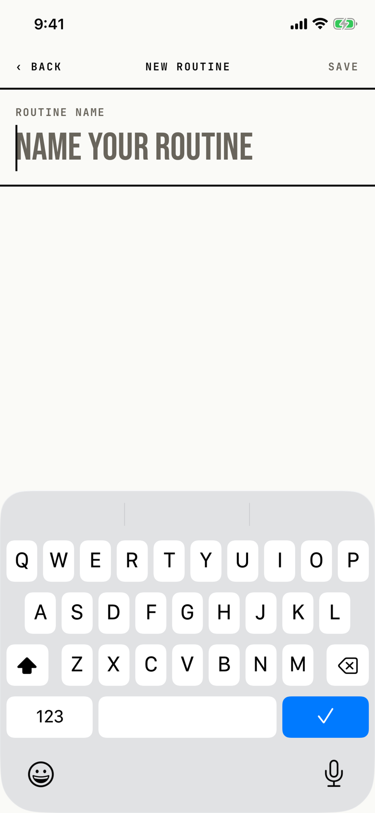

The lifter types a name for a new routine and saves it, which creates the routine and opens it.

## Entry points

| From | Tap | Kind |
|---|---|---|
| [dialog-program-new](dialog-program-new.md) | + New routine in Program's + NEW menu | push |
| [program](program.md) | + NEW ROUTINE under the ROUTINES list | push |
| [today](today.md) | + New routine in the start-a-workout picker, or + NEW ROUTINE in "No workout scheduled" (`fitbod/Views/TodayView.swift:196`, `fitbod/Views/TodayView.swift:415`) | push |

## Exits

| Control | Goes to | Kind | Closes with |
|---|---|---|---|
| ‹ BACK, or an edge swipe | the screen it came from; nothing is saved | push | back |
| SAVE | [routine-editor](routine-editor.md), which takes this screen's place on the stack | push | verb |
| A failed save | [dialog-couldnt-save](dialog-couldnt-save.md) | alert | done |

SAVE stays muted and disabled until the trimmed name is not empty.
Return on the keyboard only ends editing; it does not save.

## States

| State | How to reach it | Screenshot |
|---|---|---|
| Empty, keyboard up | W13 progress seed: Program, + NEW, + New routine | [main](img/17e-default-light-new-routine.png) |
| Empty on a fresh store | W15: the same path with only the catalog in the store; it looks the same as the main state | [fresh](img/17e-default-light-new-routine--fresh.png) |
| AX3 | The title moves above ‹ BACK and SAVE; the placeholder shrinks to stay on one line, on both phones | [ax3](img/17e-ax3-light-new-routine.png), [Pro Max AX3](img/17promax-ax3-light-new-routine.png) |
| A typed name with SAVE enabled | not captured: the tour types the name and saves in one step | - |

Dark mode and the Pro Max at default text change only colour and size: [dark](img/17e-default-dark-new-routine.png), [Pro Max](img/17promax-default-light-new-routine.png), [Pro Max fresh](img/17promax-default-light-new-routine--fresh.png).

## Compared with the mock-up

The mock-up `BruNewRoutineScreen` draws what is now a session; the app builds only the routine's name here.

| In the mock-up | In the app | Difference |
|---|---|---|
| ‹ PROGRAM | ‹ BACK | The back label does not name the screen it returns to. |
| Quick-name chips: Push A, Pull A, Legs A, Upper, Lower, Full body | none | No name suggestions. |
| Session intent and Progression cells, DAYS · 1 with + ADD DAY | none | Those belong to a session, which the app edits in the session editor. |
| "No exercises yet" with + ADD FIRST EXERCISE ▸ | an empty page under the name | The routine's sessions are added on the routine screen after SAVE. |
| A CANCEL and SAVE ROUTINE ▸ footer | SAVE in the header | The one save action moves to the header. |

## VoiceOver order

1. Back
2. New routine
3. Save, dimmed
4. Routine name, text field, placeholder "Name your routine", keyboard focused

Gaps:

- The visible "ROUTINE NAME" label is hidden from VoiceOver on purpose, and the field carries the same words, so nothing is lost.
- No gaps found beyond that.

## Findings

<!-- findings are linked after the audit -->
