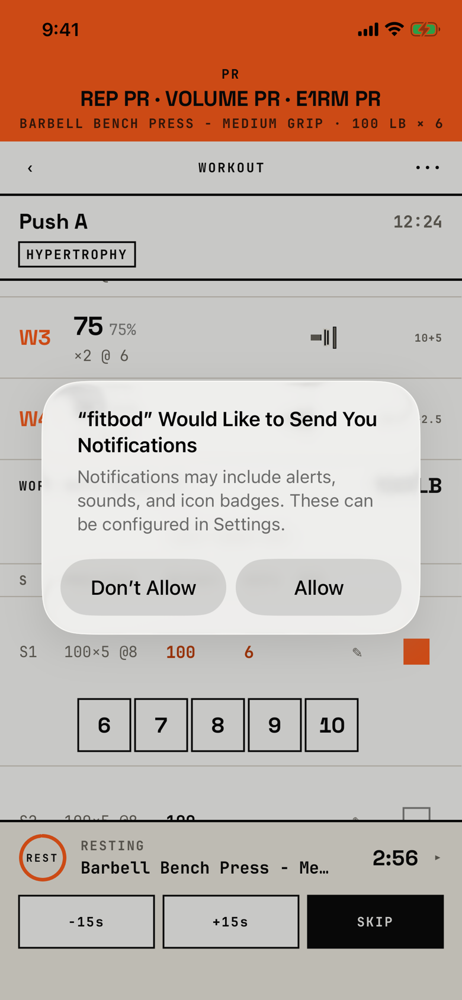

The lifter allows or refuses notifications, so that the end of a rest can reach them when the app is in the background.

## Entry points

| From | Tap | Kind |
|---|---|---|
| [logger](logger.md) | Mark set complete on the first set that starts a rest, once per install | system |

iOS draws this alert, not the app.
The app asks for it at the first rest that starts after install, while the permission is still undecided (`fitbod/Sessions/RestTimer/RestTimerNotificationScheduler.swift:85`).
The app shows no screen of its own before or after the alert to say why it asks.
In the capture the set was a record, so the alert sits over the logger with the PR banner across the top and the rest dock already counting down at the bottom.

## Exits

| Control | Goes to | Kind | Closes with |
|---|---|---|---|
| Allow | [logger](logger.md); the end of each rest is now also sent as a notification | system | verb |
| Don't Allow | [logger](logger.md); the rest timer works only inside the app, and nothing says so | system | verb |

## States

| State | How to reach it | Screenshot |
|---|---|---|
| Asking | W03 demo: Today, RESUME, set 1 at 6 reps, Mark set complete | [main](img/17e-default-light-notification-permission.png) |
| Refused earlier | Not captured: iOS never shows the alert again, and the app shows no sign that rest alerts are off | - |
| Dark and AX3 | Not captured: the alert appears once per install, and the tour shot it only in light default | - |
| Pro Max | Not captured as its own screenshot; the same alert shows over the logger's Pro Max set-logged capture, where iOS draws it at the same width, centred, so the layout matches the 17e | [Pro Max, on logger](img/17promax-default-light-logger--set-logged.png) |

## Compared with the mock-up

No mock-up exists for this alert.

## VoiceOver order

1. "fitbod" Would Like to Send You Notifications
2. Notifications may include alerts, sounds, and icon badges. These can be configured in Settings.
3. Don't Allow
4. Allow

Gaps:

- iOS owns the alert, so its order and labels are the system's.
- The alert names the app "fitbod" in lower case, from the bundle name, where the app calls itself Fitbod elsewhere.

## Findings

<!-- findings are linked after the audit -->
