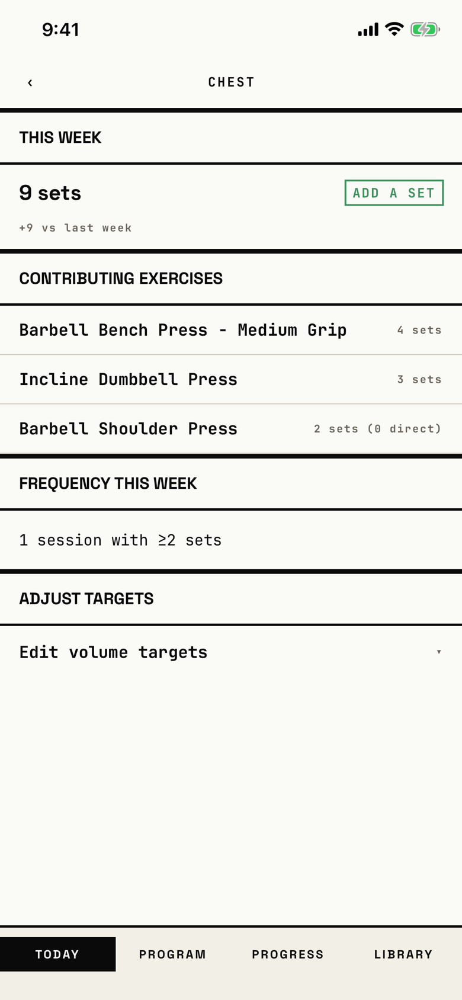

The lifter checks one muscle's working sets this week, which exercises fed it, and its volume targets.

The title is the muscle's name; the screenshot shows Chest.

## Entry points

| From | Tap | Kind |
|---|---|---|
| [today](today.md) | a muscle's volume bar, or a muscle on the body heatmap | push |

## Exits

| Control | Goes to | Kind | Closes with |
|---|---|---|---|
| ‹ (header, left) | [today](today.md) | push | back |

Edit volume targets opens steppers in place, and CREATE TARGET ROW adds a target row in place; neither leaves the screen.

## States

| State | How to reach it | Screenshot |
|---|---|---|
| Chest after one workout | main tour, demo seed, Today, tap Chest on the heatmap | [main](img/17e-default-light-per-muscle-detail.png) |
| Edit volume targets open | not captured: the tour does not expand the section | none |
| Muscle with no target row (CREATE TARGET ROW) | not captured: every seeded muscle has a target row | none |
| Muscle not found | not captured: only reachable with a bad muscle id; shows "Muscle '…' not found." | none |
| AX3 | Same as the main state at AX3; on both phones the title sits on its own line above the "‹" and exercise names wrap over two or three lines beside their set counts; on the 17e CONTRIBUTING EXERCISES wraps and the list is cut by the tab bar, while on the Pro Max the head fits one line and "2 sets (0 direct)" wraps | [ax3](img/17e-ax3-light-per-muscle-detail.png), [Pro Max AX3](img/17promax-ax3-light-per-muscle-detail.png) |

Dark mode and the Pro Max at default text change only colour and size: [dark](img/17e-default-dark-per-muscle-detail.png), [Pro Max](img/17promax-default-light-per-muscle-detail.png).

## Compared with the mock-up

No mock-up was drawn for one muscle; the May volume mock-up `phase-5--volume.png` lists every muscle with the same ADD A SET and HOLD chips.

## VoiceOver order

1. "Back" (button)
2. "Chest"
3. "This Week"
4. "9 sets"
5. "ADD A SET"
6. "+9 vs last week"
7. "Contributing Exercises"
8. "Barbell Bench Press - Medium Grip", "4 sets"

Gaps: the back button is a bare "‹" glyph on screen.
"ADD A SET" is read as plain text, though it is drawn like a button.
Each exercise row is read as two loose texts.

## Findings

- Minor: [D-108](../audit.md#d-108), [D-109](../audit.md#d-109).
- Polish: [D-289](../audit.md#d-289), [D-290](../audit.md#d-290), [D-291](../audit.md#d-291).
