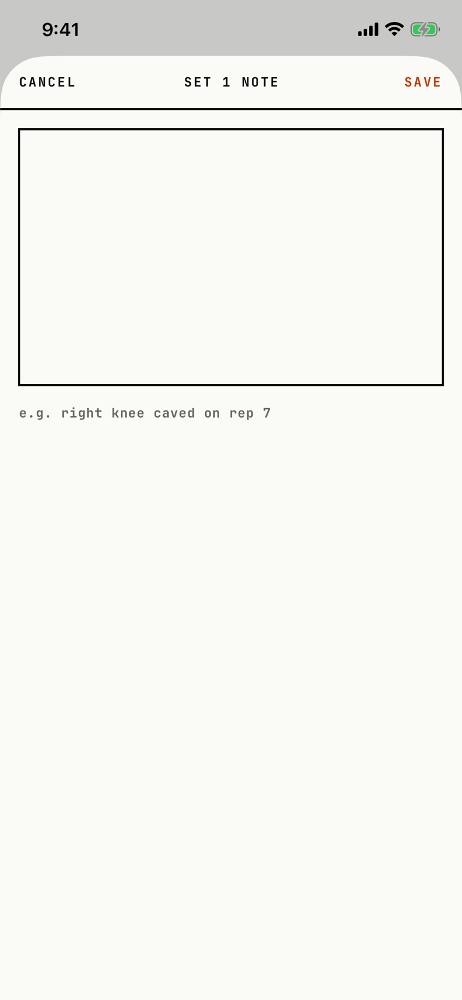

The lifter writes a note about one set, such as how a rep went.
The header names the set, such as "Set 1 note".

## Entry points

| From | Tap | Kind |
|---|---|---|
| [logger](logger.md) | ✎ (Note for set n) on a set row | sheet |

## Exits

| Control | Goes to | Kind | Closes with |
|---|---|---|---|
| CANCEL | [logger](logger.md), with any typed text thrown away and no question asked | sheet | cancel |
| SAVE | [logger](logger.md), with the note saved on that set | sheet | verb |
| A swipe down | [logger](logger.md), with any typed text thrown away, as CANCEL | sheet | cancel |

The sheet is full height: a CANCEL, title, SAVE header, a ruled text box, and a muted hint under the box that reads "e.g. right knee caved on rep 7".
SAVE stores empty text as no note.

## States

| State | How to reach it | Screenshot |
|---|---|---|
| Empty | W03 demo: Today, RESUME, ✎ on set 1 | [main](img/17e-default-light-per-set-note.png) |
| With a note | Not captured: the tour saved no set note | - |
| AX3 | On both phones the header puts the title above CANCEL and SAVE, and the hint wraps to two lines under the box | [ax3](img/17e-ax3-light-per-set-note.png), [Pro Max ax3](img/17promax-ax3-light-per-set-note.png) |

Dark mode and the Pro Max at default text change only colour and size: [dark](img/17e-default-dark-per-set-note.png), [Pro Max](img/17promax-default-light-per-set-note.png).

## Compared with the mock-up

No mock-up exists for this sheet.

## VoiceOver order

1. CANCEL
2. SET 1 NOTE
3. SAVE
4. The text box
5. e.g. right knee caved on rep 7

Gaps:

- CANCEL, SAVE and the title are strings typed in capitals and are read as written.
- The hint under the box is a separate text, not the text box's label or placeholder, so VoiceOver reads the box with no name first.
- The header is drawn in a safe-area inset and comes last in the tree.

## Findings

<!-- findings are linked after the audit -->
