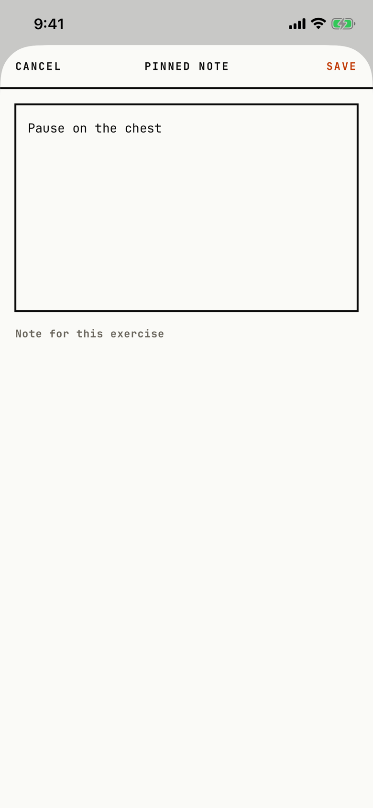

The lifter writes a note that stays pinned to an exercise in this workout, such as a cue.

## Entry points

| From | Tap | Kind |
|---|---|---|
| [logger](logger.md) | A long press on the exercise name, then Edit Pinned Note | sheet |
| [logger](logger.md) | The pinned note capsule under the exercise name | sheet |

## Exits

| Control | Goes to | Kind | Closes with |
|---|---|---|---|
| CANCEL | [logger](logger.md), with any typed text thrown away and no question asked | sheet | cancel |
| SAVE | [logger](logger.md), with the note shown as a capsule under the exercise name | sheet | verb |
| A swipe down | [logger](logger.md), with any typed text thrown away, as CANCEL | sheet | cancel |

The sheet is full height: a CANCEL, title, SAVE header, a ruled text box, and a muted hint under the box that reads "Note for this exercise".
SAVE stores empty text as no note.

## States

| State | How to reach it | Screenshot |
|---|---|---|
| With a note | W03 demo: Edit Pinned Note, type "Pause on the chest", SAVE, then tap the capsule | [main](img/17e-default-light-pinned-note.png) |
| Empty | Not captured: the tour shot the sheet only after it pinned a note | - |
| AX3 | On both phones the header puts the title above CANCEL and SAVE; the hint wraps to two lines under the box on the 17e, while on the Pro Max "Note for this exercise" fits on one line | [ax3](img/17e-ax3-light-pinned-note.png), [Pro Max ax3](img/17promax-ax3-light-pinned-note.png) |

Dark mode and the Pro Max at default text change only colour and size: [dark](img/17e-default-dark-pinned-note.png), [Pro Max](img/17promax-default-light-pinned-note.png).

## Compared with the mock-up

No mock-up exists for this sheet.

## VoiceOver order

1. CANCEL
2. PINNED NOTE
3. SAVE
4. The text box
5. Note for this exercise

Gaps:

- CANCEL, SAVE and the title are strings typed in capitals and are read as written.
- The hint under the box is a separate text, not the text box's label or placeholder, so VoiceOver reads the box with no name first.
- The header is drawn in a safe-area inset and comes last in the tree.

## Findings

- Minor: [D-112](../audit.md#d-112).
