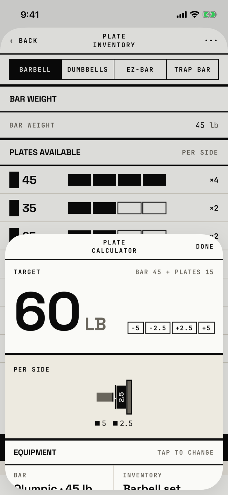

The lifter steps a target weight up or down and reads which plates go on each side of the bar.

## Entry points

| From | Tap | Kind |
|---|---|---|
| [plate-inventory](plate-inventory.md) | ••• in the header (VoiceOver "More") | sheet |

This is the only way into the calculator; the workout logger draws its own plate stack under a set instead.

## Exits

| Control | Goes to | Kind | Closes with |
|---|---|---|---|
| DONE | [plate-inventory](plate-inventory.md) | sheet | done |
| A swipe down | [plate-inventory](plate-inventory.md) | sheet | done |
| −5, −2.5, +2.5, +5 | this sheet, with the target changed | none | none |

The target always starts at 60 and changes only through the four chips; there is no field to type it.
The bar weight comes from the open tab of Plate Inventory and cannot be changed here.
The EQUIPMENT head says "TAP TO CHANGE", but the BAR and INVENTORY cells under it do nothing.
The PLATES AVAILABLE rows at the bottom look like Plate Inventory's rows but are read-only.
The sheet opens at half height at every text size.

## States

| State | How to reach it | Screenshot |
|---|---|---|
| 60 lb on the barbell: 5 and 2.5 per side | Plate Inventory > ••• | [main](img/17e-default-light-plate-calculator.png) |
| AX3 | DONE drops under the title, BAR 45 + PLATES 15 moves under TARGET, and the chips sit under 60 LB; the half-height sheet shows only the header and the target, so PER SIDE must be scrolled to | [ax3](img/17e-ax3-light-plate-calculator.png) |
| "Bar weight exceeds target. Check the bar weight." | Step the target below the bar weight; not captured, because the tour does not tap a chip | not captured |
| "No combination found. Adjust inventory." | A target the inventory cannot make; not captured | not captured |
| Pro Max | Same as the main state, on the Pro Max; the titles "PLATE INVENTORY" and "PLATE CALCULATOR" fit one line, and the taller half-height sheet also shows the EQUIPMENT cells and the PLATES AVAILABLE head | [Pro Max](img/17promax-default-light-plate-calculator.png) |
| Pro Max, AX3 | Same as the AX3 state, on the Pro Max; the layout is the same as on the 17e, and only the PER SIDE head peeks in above the sheet's bottom edge | [Pro Max AX3](img/17promax-ax3-light-plate-calculator.png) |

Dark mode changes only colour: [dark](img/17e-default-dark-plate-calculator.png).

## Compared with the mock-up

| In the mock-up | In the app | Difference |
|---|---|---|
| Opened from a workout ("‹ PUSH A"), with the set's target, 205 | Opened from Plate Inventory's •••, always at 60 | The calculator is not reachable from a workout, and the target is not the lifter's |
| Header "‹ PUSH A", PLATE CALCULATOR, ••• | PLATE CALCULATOR and DONE only, with the title on two lines | Back and ••• removed |
| Full-height screen | Half-height sheet | The equipment and plate rows sit below the fold |
| INVENTORY "HOME GYM" | INVENTORY "Barbell set" | The inventory has no name of its own |
| SAVE INVENTORY and DONE ▸ footer | No footer | Footer removed; the rows here are read-only |
| Each plate's label readable in the stack | At 60 lb the 2.5 plate is drawn over the 5's label, which is 7 pt tall in the tree | Labels overlap |

## VoiceOver order

1. Plate calculator
2. Done
3. TARGET
4. BAR 45 + PLATES 15
5. 60, LB
6. SUBTRACT 5 LB, SUBTRACT 2.5 LB, ADD 2.5 LB, ADD 5 LB
7. PER SIDE, then the plate labels 5 and 2.5, then the legend 5 and 2.5
8. Equipment, Tap to change

Gaps:

- The four chips measure 28 to 43 by 21.3 pt at default text, under 44 pt, and sit 4 pt apart.
- DONE measures 54.3 by 42.2 pt, just under 44 pt.
- "Tap to change" is read, but nothing under it can be tapped.
- The chips' labels are read in capitals, so "LB" may be spelled out.
- The plate inventory behind the half-height sheet stays in the tree.

## Findings

<!-- findings are linked after the audit -->
