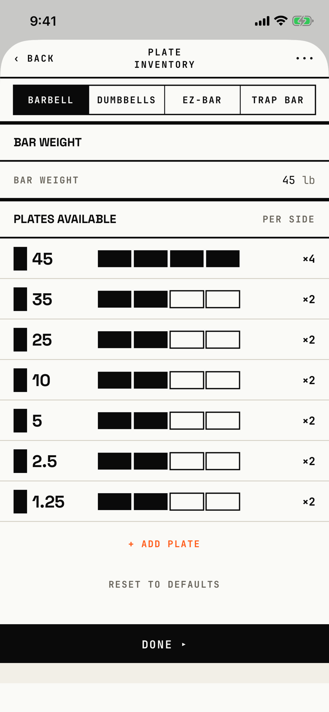

The lifter sets the bar weight and how many plates of each size they own per side, for the barbell, dumbbells, EZ-bar and trap bar.

## Entry points

| From | Tap | Kind |
|---|---|---|
| [settings](settings.md) | The Plate Inventory row under Units & calibration | push |

## Exits

| Control | Goes to | Kind | Closes with |
|---|---|---|---|
| ‹ BACK | [settings](settings.md) | push | back |
| DONE ▸ | [settings](settings.md) | push | back |
| ••• (VoiceOver "More") | [plate-calculator](plate-calculator.md) | sheet | none |
| + ADD PLATE | [add-plate](add-plate.md) | sheet | none |
| RESET TO DEFAULTS | [dialog-reset-plate-inventory](dialog-reset-plate-inventory.md) | dialog | none |
| BARBELL, DUMBBELLS, EZ-BAR, TRAP BAR | this screen, showing that equipment's inventory | none | none |
| A swipe left on a plate row, then Delete | this screen, with the plate removed | none | none |

Every change saves as it is made, so BACK and DONE ▸ do the same thing.
A tap on a tally box sets that plate's count per side, from 0 to 4.
The bar weight is a number field with a decimal pad.

## States

| State | How to reach it | Screenshot |
|---|---|---|
| Barbell, default lb set | Settings > Plate Inventory on a fresh store; 45 lb bar, 45 x4 and the smaller plates x2 | [main](img/17e-default-light-plate-inventory.png) |
| AX3 | The title moves above ‹ BACK and •••, the tabs grow to three lines and break inside words ("BARB / ELL", "DUMB / BELL / S"), and only the first three plates fit above DONE ▸ | [ax3](img/17e-ax3-light-plate-inventory.png) |
| Dumbbells, EZ-bar or trap bar | Tap the tab; not captured, because the tour shoots only the barbell tab | not captured |
| A plate swiped open | Swipe a plate row left; not captured, because the tour does not swipe here | not captured |
| No plates configured | Delete every plate of the open tab; the screen shows "No plates configured", "Add plates to use the plate calculator." and + ADD PLATE; not captured, because the tour does not delete plates | not captured |
| Bar weight field focused | Tap the bar weight; a decimal pad opens with no DONE key; not captured | not captured |
| Pro Max | Same as the main state, on the Pro Max; the title "PLATE INVENTORY" fits one line | [Pro Max](img/17promax-default-light-plate-inventory.png) |
| Pro Max, AX3 | Same as the AX3 state, on the Pro Max; the tabs grow to two lines and still break inside words, at other points ("BARBE / LL", "DUMBB / ELLS"), and five plates show above DONE ▸ | [Pro Max AX3](img/17promax-ax3-light-plate-inventory.png) |

Dark mode changes only colour: [dark](img/17e-default-dark-plate-inventory.png).
Under DONE ▸ a 24 pt band in the background colour shows above the home indicator in both appearances.

## Compared with the mock-up

The mock-up draws no separate inventory screen; its tally rows sit at the bottom of the plate calculator, and the app moved them here.

| In the mock-up | In the app | Difference |
|---|---|---|
| PLATES AVAILABLE rows under the calculator | A screen of its own under Settings, with an equipment tab strip | The inventory is edited away from the calculator |
| One inventory, named HOME GYM | One inventory per equipment, chosen with four tabs | Tabs added |
| A 35 row with "NONE" when its count is zero | A row at count 0 is drawn at 40% opacity with "NONE" | Same idea |
| SAVE INVENTORY and DONE ▸ in the footer | DONE ▸ only; edits save as they are made | SAVE INVENTORY removed |
| No bar weight row | A BAR WEIGHT section head over a BAR WEIGHT row with a number field | Bar weight added, and its label is shown twice |

## VoiceOver order

1. Back
2. Plate Inventory
3. More
4. BARBELL, Selected
5. Bar weight
6. 45 lb plate, 4 per side
7. + ADD PLATE
8. Done ▸

Gaps:

- "More" does not say that it opens the plate calculator.
- The four equipment tabs measure about 89 by 34.7 pt at default text, under 44 pt tall.
- The bar weight field measures 80 by 19 pt, and the BAR WEIGHT label beside it does not focus it.
- Each plate row is one adjustable element ("45 lb plate", "4 per side"), so its four tally boxes are not separate targets; the boxes are drawn 20 pt tall.
- The section head "Bar weight" and the row label "BAR WEIGHT" are both read, one after the other.

## Findings

<!-- findings are linked after the audit -->
