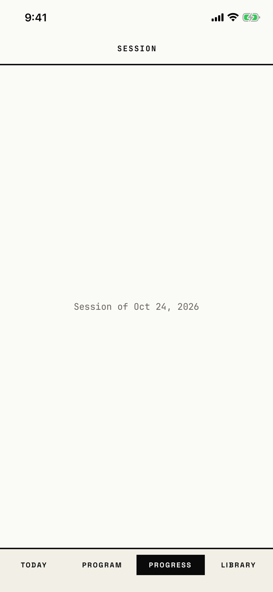

The lifter lands here after tapping a record, on a placeholder that names only the workout's date.
Its header reads "Session", although the app calls a logged workout a workout elsewhere.

## Entry points

| From | Tap | Kind |
|---|---|---|
| [prs](prs.md) | any PR row | push |

## Exits

| Control | Goes to | Kind | Closes with |
|---|---|---|---|
| Edge swipe from the left (no control on screen) | [prs](prs.md) | push | none |

## States

| State | How to reach it | Screenshot |
|---|---|---|
| Placeholder | W13 seed, Personal Records > the first "Barbell Squat, Weight PR" row | [main](img/17e-default-light-pr-session.png) |
| AX3 | The header grows and the date line wraps; nothing else changes | [ax3](img/17e-ax3-light-pr-session.png) |
| Pro Max, AX3 | same as the main state; the date line "Session of Oct 25, 2026" stays on one line, where the 17e at AX3 wraps it | [Pro Max, AX3](img/17promax-ax3-light-pr-session.png) |

Dark mode and the Pro Max at default text change only colour and size: [dark](img/17e-default-dark-pr-session.png), [Pro Max](img/17promax-default-light-pr-session.png).

## Compared with the mock-up

No mock-up was drawn for this screen.

## VoiceOver order

1. "Session" (header)
2. "Session of Oct 24, 2026"

Gaps: there is no back button for VoiceOver or touch; only the two-finger scrub or the edge swipe leaves.
The words call a logged workout a session.

## Findings

- Major: [D-15](../audit.md#d-15).
- Polish: [D-296](../audit.md#d-296).
