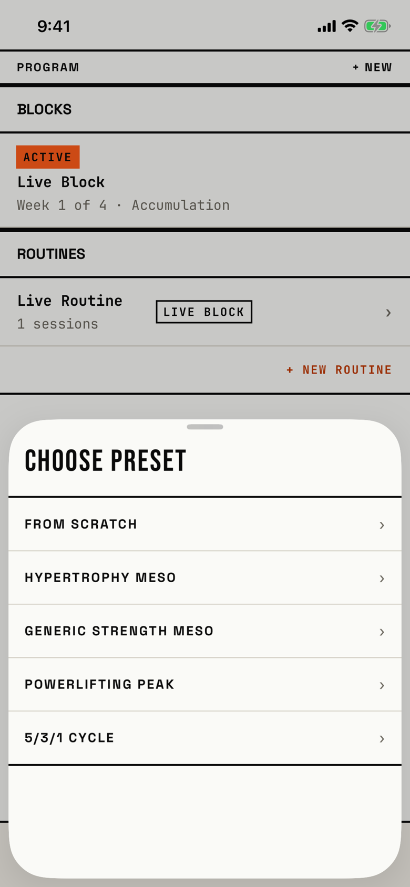

The lifter picks the preset that a new block starts from.

## Entry points

| From | Tap | Kind |
|---|---|---|
| [start-choice](start-choice.md) | Use Preset | sheet |

## Exits

| Control | Goes to | Kind | Closes with |
|---|---|---|---|
| FROM SCRATCH | [new-block](new-block.md), with the default three phases | cover | verb |
| HYPERTROPHY MESO, GENERIC STRENGTH MESO, POWERLIFTING PEAK or 5/3/1 CYCLE | [new-block](new-block.md), filled with that preset's name and phases | cover | verb |
| A swipe down | [start-choice](start-choice.md), which stays open underneath | sheet | none |

The sheet has no CANCEL or close button.
A pick closes both sheets and then opens New Block as a full-screen cover.
FROM SCRATCH does the same as Blank Block on the sheet below it.

## States

| State | How to reach it | Screenshot |
|---|---|---|
| Over a program with an active block | `-fitbod-seed-active-block`, + NEW, + New block, Use Preset | [main](img/17e-default-light-preset-picker.png) |
| Over an empty program | Fresh store, the same taps | [fresh](img/17e-default-light-preset-picker--fresh.png) |
| AX3 | On both phones: full height; the rows keep a fixed 52 pt height, so the names stay on one line and shrink to fit (`fitbod/Periodization/ProgramView.swift:904`) | [ax3](img/17e-ax3-light-preset-picker.png), [Pro Max ax3](img/17promax-ax3-light-preset-picker.png) |

Dark mode and the Pro Max at default text change only colour and size: [dark](img/17e-default-dark-preset-picker.png), [Pro Max](img/17promax-default-light-preset-picker.png), [Pro Max fresh](img/17promax-default-light-preset-picker--fresh.png).
At the same half height as CREATE BLOCK, this sheet covers the one beneath it completely, so nothing shows that a second sheet is open.

## Compared with the mock-up

No mock-up was drawn for this sheet.

## VoiceOver order

1. Sheet Grabber, Half screen
2. CHOOSE PRESET
3. FROM SCRATCH, ›
4. HYPERTROPHY MESO, ›
5. GENERIC STRENGTH MESO, ›
6. POWERLIFTING PEAK, ›
7. 5/3/1 CYCLE, ›

Gaps:

- Every row ends with the "›" glyph read aloud.
- The rows give only a name, with no weeks or phases, so a VoiceOver user cannot tell the presets apart without opening each one.
- No control is labelled Cancel or Close.
- The rows are 49.9 pt tall at default text and 52 pt at AX3; the Sheet Grabber is 72.9 by 24 pt.

## Findings

- Minor: [D-123](../audit.md#d-123), [D-124](../audit.md#d-124), [D-150](../audit.md#d-150).
- Polish: [D-297](../audit.md#d-297).
