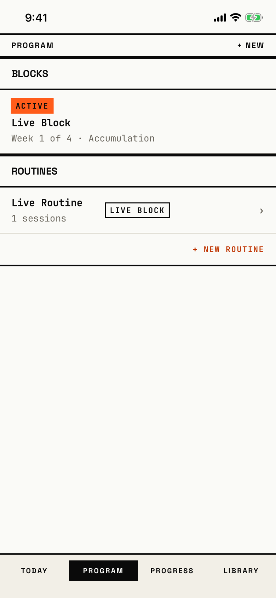

The lifter sees every block and routine they own, opens one to work on it, or starts a new block or routine.

## Entry points

| From | Tap | Kind |
|---|---|---|
| Tab bar | PROGRAM, from any tab root; a second tap leaves the tab's stack as it is | tab switch |

The tab bar is not a screen, so a tab switch is not a navigation edge.
‹ back, or the edge swipe, returns here from [block-overview](block-overview.md), [routine-editor](routine-editor.md) and [archived-routines](archived-routines.md).
The tab keeps its own navigation stack, so a tap on PROGRAM returns to the screen the lifter last left in this tab.

## Exits

| Control | Goes to | Kind | Closes with |
|---|---|---|---|
| + NEW in the header | [dialog-program-new](dialog-program-new.md), a popover with + New block and + New routine | dialog | none |
| + DEFINE BLOCK ▶ in the empty hero | [start-choice](start-choice.md) | sheet | none |
| + DEFINE BLOCK ▶ under "No blocks yet." | [start-choice](start-choice.md) | sheet | none |
| A template row under "Or start from a template" (empty program only) | [new-block](new-block.md), filled from that preset | cover | none |
| A block card (ACTIVE, READY, DRAFT or DONE) | [block-overview](block-overview.md) | push | none |
| ALL HISTORY ▸ (four or more finished blocks) | The same list, showing every finished block | none | none |
| A routine row | [routine-editor](routine-editor.md) | push | none |
| + NEW ROUTINE | [new-routine](new-routine.md) | push | none |
| Archived routines (shown when an archived routine exists) | [archived-routines](archived-routines.md) | push | none |
| Resume on the resume banner | [logger](logger.md) | push | none |
| Discard on the resume banner | [dialog-discard-active](dialog-discard-active.md); its confirm deletes the workout | dialog | none |
| The Today, Progress and Library tabs | [today](today.md), [progress](progress.md), [library](library.md) | none | none |

The template rows skip [start-choice](start-choice.md) and open New Block directly.
Once any block exists, even one that has ended, the BLOCKS section drops the "No blocks yet." row and its + DEFINE BLOCK ▶ button, so + NEW is the only way to start a new block from this screen.

## States

| State | How to reach it | Screenshot |
|---|---|---|
| One active block and its routine | `-fitbod-seed-active-block`, Program tab | [main](img/17e-default-light-program.png) |
| Active block (W08 shot) | Same seed, shot again for the W08 walk; looks the same as the main state | [active](img/17e-default-light-program--active.png) |
| Archived routines entry | W15: archive a routine, then return to Program; an Archived routines row shows under ROUTINES | [archived-entry](img/17e-default-light-program--archived-entry.png) |
| Only a finished block | W09 `-fitbod-seed-ended-block-recap -fitbod-start-program`; one DONE card and no define-block row | [block-done](img/17e-default-light-program--block-done.png) |
| A draft block, no routine | Fresh store, New Block, name "Draft Block", SAVE DRAFT; ROUTINES shows only + NEW ROUTINE | [draft](img/17e-default-light-program--draft.png) |
| Empty program | Fresh store, Program tab: NO PROGRAM hero, feature chips, + DEFINE BLOCK ▶ and four template rows | [empty](img/17e-default-light-program--empty.png) |
| Long and repeated names | W12 `-fitbod-seed-powerbuilding`; two blocks both named "Powerbuilding" | [long-name](img/17e-default-light-program--long-name.png) |
| Active block past its planned weeks | W11 `-fitbod-seed-block-states-past-plan`; the ACTIVE card for Spring Block | [plan-complete](img/17e-default-light-program--plan-complete.png) |
| A ready block | W16: save a block with a routine and days, SAVE AS READY | [ready](img/17e-default-light-program--ready.png) |
| Workout in progress | W03 `-fitbod-seed-demo-workout`; the resume banner sits above BLOCKS | [resume-banner](img/17e-default-light-program--resume-banner.png) |
| Active, ready and draft blocks | W10 `-fitbod-seed-block-states`; one card per status | [states](img/17e-default-light-program--states.png) |
| All history | Needs four finished blocks; ALL HISTORY ▸ then shows every DONE card | not captured: no seed has four finished blocks (see `assumptions.md`) |
| AX3 | On both phones the block card grows to 194 pt and the routine row to 160 pt; the tab bar stacks in two rows of two; + NEW stays beside the title | [ax3](img/17e-ax3-light-program.png), [Pro Max ax3](img/17promax-ax3-light-program.png) |
| AX3, empty | The NO PROGRAM hero fills the first screen, with a wide gap between NO and PROGRAM, and + DEFINE BLOCK ▶ starts below the fold | [ax3 empty](img/17e-ax3-light-program--empty.png) |
| Pro Max, active, ready and draft blocks | Same as the Active, ready and draft blocks and Active block past its planned weeks states. The routine row's SPRING BLOCK and SUMMER BLOCK tags sit side by side on one line instead of stacking | [Pro Max states](img/17promax-default-light-program--states.png), [Pro Max plan-complete](img/17promax-default-light-program--plan-complete.png) |
| Pro Max, empty program | Same as the Empty program, Workout in progress and Archived routines entry states. The four feature chips fit on one line, where the 17e wraps CUSTOM onto a second line, and the Archived routines row shows on the first screen without scrolling | [Pro Max empty](img/17promax-default-light-program--empty.png), [Pro Max resume-banner](img/17promax-default-light-program--resume-banner.png), [Pro Max archived-entry](img/17promax-default-light-program--archived-entry.png) |
| Pro Max, AX3, empty | Same as the AX3, empty state. NO PROGRAM fits on one line, so the paragraph, + DEFINE BLOCK ▶ and the first row of chips show on the first screen, where the 17e AX3 shows only the hero | [Pro Max ax3 empty](img/17promax-ax3-light-program--empty.png) |

Dark mode, and the Pro Max at default text in the other states, change only colour and size: [dark](img/17e-default-dark-program.png), [dark empty](img/17e-default-dark-program--empty.png), [Pro Max](img/17promax-default-light-program.png), [Pro Max active](img/17promax-default-light-program--active.png), [Pro Max block-done](img/17promax-default-light-program--block-done.png), [Pro Max draft](img/17promax-default-light-program--draft.png), [Pro Max long-name](img/17promax-default-light-program--long-name.png), [Pro Max ready](img/17promax-default-light-program--ready.png).

## Compared with the mock-up

| In the mock-up | In the app | Difference |
|---|---|---|
| Empty state: NO PROGRAM hero, chips and + DEFINE BLOCK (`bru-screens/Program/empty-state.png`) | The same hero, chips and button | Matches in layout; the hero paragraph and chip wording differ slightly |
| Template rows with a second line such as "4 / WK · INTERMEDIATE" and a POPULAR tag | Template rows with a name and a phase summary such as "ACCUM 5 · INTNS 2 · DELOAD 1" | The app drops the days-per-week line and the POPULAR tag, and lists other presets |
| A populated program with a black active-block hero, a W1-W5 week strip and a THIS WEEK day list | A plain ACTIVE card with the week and phase on two lines | The app has no week strip and no day list on Program; they live on [block-overview](block-overview.md) |
| A ROUTINES LIBRARY with search and swipe actions DUPE, MOVE and DELETE | Routine rows with no search and no swipe actions | The app has none of these; archive lives inside [routine-editor](routine-editor.md) |

## VoiceOver order

1. Blocks
2. ACTIVE block: Live Block. Week 1 of 4, Accumulation.
3. Routines
4. Live Routine, 1 sessions, Live Block, ›
5. + NEW ROUTINE
6. PROGRAM
7. + NEW
8. Today, Program, Progress, Library

Gaps:

- The header title PROGRAM and + NEW come after the list, so VoiceOver reads the content before the screen's name.
- The routine row reads "1 sessions" and ends with the "›" glyph read aloud.
- + NEW is read with "plus" and gives no hint that it opens a choice of block or routine.
- The section heads "Blocks" and "Routines" are plain text with no heading trait, so the rotor cannot jump between them (from code).
- At AX3, + NEW measures 96 by 48 pt and every row is at least 44 pt; no target is too small.

## Findings

<!-- findings are linked after the audit -->
