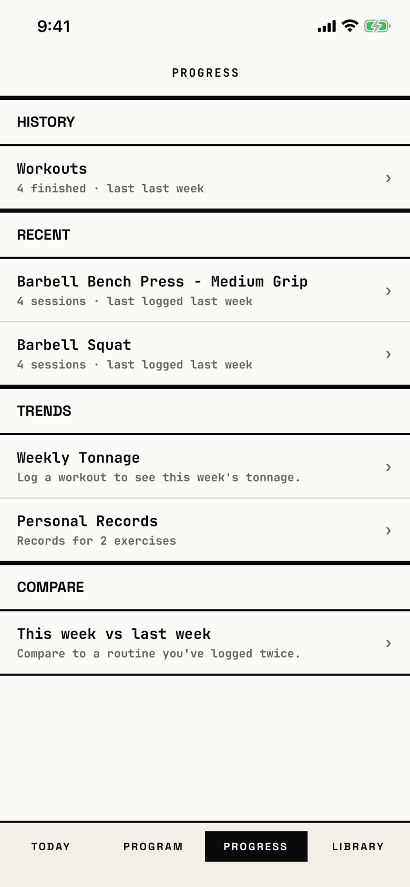

The lifter picks what to look back on: past workouts, one exercise's trend, weekly tonnage, records or a comparison.

## Entry points

| From | Tap | Kind |
|---|---|---|
| Tab bar | PROGRESS, from any tab root; a second tap clears the tab's stack | tab switch |

The tab bar is not a screen, so a tab switch is not a navigation edge.

## Exits

| Control | Goes to | Kind | Closes with |
|---|---|---|---|
| Workouts row | [history](history.md) | push | back |
| An exercise row under Recent | [exercise-progress](exercise-progress.md) | push | back |
| Weekly Tonnage row | [weekly-tonnage](weekly-tonnage.md) | push | back |
| Personal Records row | [prs](prs.md) | push | back |
| This week vs last week row | [compare](compare.md) | push | back |

## States

| State | How to reach it | Screenshot |
|---|---|---|
| Four weekly workouts | W13 seed, Progress tab | [main](img/17e-default-light-progress.png) |
| Empty | W01 fresh store, Progress tab | [empty](img/17e-default-light-progress--empty.png) |
| Scrolled to Trends and Compare | W13, scroll down; with two exercises nothing moves, so it matches the main state | [lower](img/17e-default-light-progress--lower.png) |
| One workout this week | W03 demo seed: five Recent rows, tonnage for this week, Compare empty | [recent](img/17e-default-light-progress--recent.png) |
| AX3 | On both phones the rows grow to three or four lines, the header title sits alone, and the tab bar uses two columns; on the Pro Max the bench press name breaks so its second line starts with "- Medium Grip" | [ax3](img/17e-ax3-light-progress.png), [Pro Max, AX3](img/17promax-ax3-light-progress.png) |
| Ten recent exercises | not captured: no seed logs more than five exercises | none |

Dark mode and the Pro Max at default text change only colour and size: [dark](img/17e-default-dark-progress.png), [Pro Max](img/17promax-default-light-progress.png).

## Compared with the mock-up

No mock-up was drawn for the Progress home; the May mock-up `phase-6--progress.png` shows one exercise's chart, which is [exercise-progress](exercise-progress.md).

## VoiceOver order

1. "Progress" (header)
2. "History"
3. "Workouts, 4 finished · last last week" (button)
4. "Recent"
5. "Barbell Bench Press - Medium Grip, 4 sessions · last logged last week" (button)
6. "Weekly Tonnage, Log a workout to see this week's tonnage." (button)
7. "Personal Records, Records for 2 exercises" (button)
8. "This week vs last week, Compare to a routine you've logged twice." (button)

Gaps: every row is one button of at least 59 pt, and the "›" glyphs are hidden.
The labels repeat the copy problems "last last week" and "sessions" for workouts.

## Findings

- Minor: [D-130](../audit.md#d-130), [D-131](../audit.md#d-131), [D-132](../audit.md#d-132).
- Polish: [D-305](../audit.md#d-305), [D-306](../audit.md#d-306), [D-307](../audit.md#d-307), [D-308](../audit.md#d-308), [D-309](../audit.md#d-309), [D-310](../audit.md#d-310), [D-311](../audit.md#d-311).
