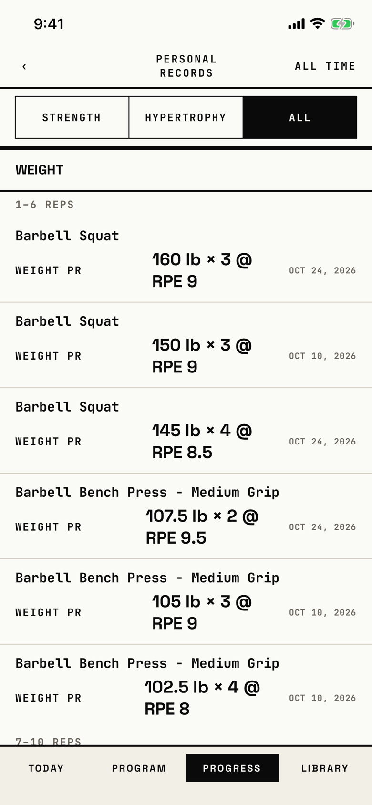

The lifter reads the best sets of every exercise by weight, reps, volume and e1RM, in rep ranges, filtered by intent.

## Entry points

| From | Tap | Kind |
|---|---|---|
| [progress](progress.md) | Personal Records | push |

## Exits

| Control | Goes to | Kind | Closes with |
|---|---|---|---|
| ‹ (read as "Back") | [progress](progress.md) | push | back |
| Any PR row | [pr-session](pr-session.md) | push | none |
| STRENGTH, HYPERTROPHY and ALL | this screen, filtered | none | none |

## States

| State | How to reach it | Screenshot |
|---|---|---|
| ALL | W13 seed, Progress > Personal Records | [main](img/17e-default-light-prs.png) |
| STRENGTH | the STRENGTH segment; the seeded weight records are all strength sets, so the first screen looks the same | [intent](img/17e-default-light-prs--intent.png) |
| AX3 | The header stacks the title and ALL TIME over the back control, the intent toggle stacks into three rows, and each row stacks name, kind, value and date | [ax3](img/17e-ax3-light-prs.png) |
| Empty | not captured: "No PRs yet" and "Complete a working set to set your first record." need a store with no working sets, and the W01 walk does not open this screen | none |
| A record set today | not captured: no seed logs a set today; its row would get a signal tint and a signal kind label | none |
| One exercise's records | not captured: the per-exercise list has a route that nothing opens | none |
| Pro Max | same as the main state; each value fits on one line ("160 lb × 3 @ RPE 9"), where the 17e breaks it after "@", so every row is one line shorter | [Pro Max](img/17promax-default-light-prs.png) |
| Pro Max, STRENGTH | the STRENGTH segment; with one-line values the first screen reaches the REPS section | [Pro Max, intent](img/17promax-default-light-prs--intent.png) |

Dark mode and the Pro Max at AX3 change only colour and size: [dark](img/17e-default-dark-prs.png), [Pro Max, AX3](img/17promax-ax3-light-prs.png).

## Compared with the mock-up

| In the mock-up | In the app | Difference |
|---|---|---|
| A PERSONAL RECORDS strip under one exercise's chart, ALL TIME at its right | A screen of its own for every exercise, ALL TIME in the header | Moved to its own screen |
| One row per kind: e1RM PR, TOP WEIGHT, TOP REPS, VOLUME PR | Sections WEIGHT, REPS, VOLUME and E1RM, each split by rep range, up to three rows per exercise, each called a PR | More rows, and lesser sets carry the PR label |
| "+4" and "+200" gains beside each record | No gain shown | The change since the last record is gone |
| No intent filter | STRENGTH, HYPERTROPHY and ALL toggle | Added |

## VoiceOver order

1. "Back" (button)
2. "Personal Records" (header)
3. "ALL TIME"
4. "STRENGTH", "HYPERTROPHY", "ALL" (selected)
5. "Weight", then "1–6 REPS"
6. "Barbell Squat, Weight PR, 160 lb × 3 @ RPE 9", value "Oct 24, 2026" (button)
7. "Barbell Squat, Weight PR, 150 lb × 3 @ RPE 9" (button)

Gaps: "ALL TIME" is read like a header action but does nothing; the dates are 9 pt micro labels.

## Findings

<!-- findings are linked after the audit -->
