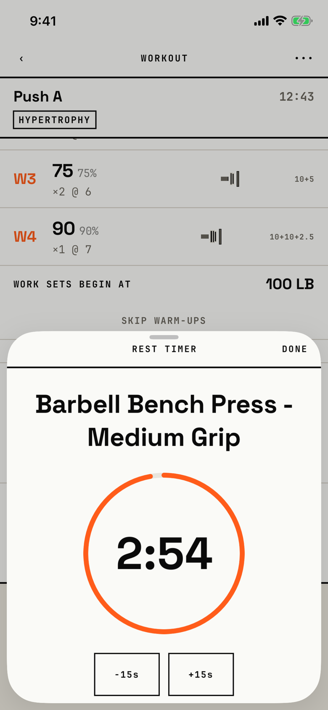

The lifter watches the rest countdown in large type and adds, removes or skips rest time.

## Entry points

| From | Tap | Kind |
|---|---|---|
| [logger](logger.md) | The rest dock's countdown row (Rest timer: n minutes n seconds) | sheet |

## Exits

| Control | Goes to | Kind | Closes with |
|---|---|---|---|
| DONE | [logger](logger.md), with the rest still running in the dock | sheet | done |
| SKIP REMAINING REST | [logger](logger.md), with the rest ended | sheet | verb |
| A swipe down | [logger](logger.md), with the rest still running | sheet | none |

The sheet opens at half height and can be dragged to full height; at accessibility sizes it opens at full height (`fitbod/Sessions/RestTimer/RestTimerOverlay.swift:62`).
It shows a REST TIMER header with DONE, the exercise name in large type, the countdown in a ring, -15s and +15s, a full-width SKIP REMAINING REST, and "PRESCRIBED · 180S".
At half height the ring and the ±15s buttons fill the view, and SKIP and the prescribed line sit below the fold; the open ticket covers this.
The rest dock under the sheet keeps its own -15s, +15s and SKIP.

## States

| State | How to reach it | Screenshot |
|---|---|---|
| Resting | W03 demo: log set 1 at 5 reps, then tap the dock's countdown | [main](img/17e-default-light-rest-timer.png) |
| Rest complete | Not captured in the sheet: the countdown turns to REST COMPLETE and SKIP becomes DONE; the dock's version is on [logger](logger.md) | - |
| AX3 | On both phones the sheet opens at full height and the exercise name wraps over three lines above the ring | [ax3](img/17e-ax3-light-rest-timer.png), [Pro Max ax3](img/17promax-ax3-light-rest-timer.png) |
| Pro Max | Same as the main state; the taller half sheet shows the top half of the SKIP button, cut by the sheet's bottom edge, where the 17e stops below -15s and +15s | [Pro Max](img/17promax-default-light-rest-timer.png) |

Dark mode changes only colour: [dark](img/17e-default-dark-rest-timer.png).

## Compared with the mock-up

| In the mock-up | In the app | Difference |
|---|---|---|
| Rest takes over the logger's hero slab, inverted, with "RESTING · AUTO RESUME" | Rest is a dock at the bottom of the logger and this separate sheet | Rest is a layer, not a mode of the screen |
| +30 and SKIP → | -15s, +15s and SKIP REMAINING REST | Smaller steps, and a way to shorten rest |
| The next set is named under the countdown | The current exercise is named above the ring | The next set is not shown |

## VoiceOver order

1. Sheet Grabber
2. REST TIMER
3. DONE
4. Barbell Bench Press - Medium Grip
5. 2:54
6. Subtract 15 seconds
7. Add 15 seconds
8. SKIP REMAINING REST

Gaps:

- SKIP REMAINING REST and REST TIMER are strings typed in capitals and are read as written, where the dock's same control reads "Skip remaining rest".
- The countdown is read as "2:54" here, where the dock reads "2 minutes 54 seconds".

## Findings

<!-- findings are linked after the audit -->
