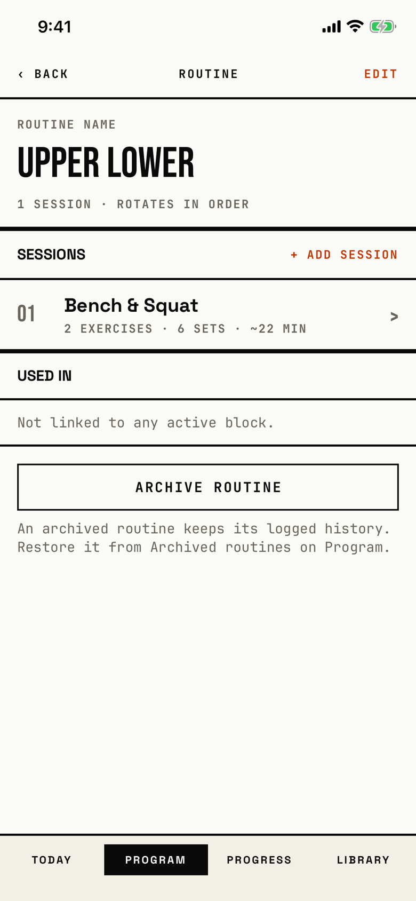

The lifter names a routine, puts its sessions in rotation order, sees which blocks use it, and archives it.

## Entry points

| From | Tap | Kind |
|---|---|---|
| [program](program.md) | a routine row in ROUTINES | push |
| [new-routine](new-routine.md) | SAVE, which puts this screen in the name step's place on the stack | push |
| [today](today.md) | the fix-it action shown when the active block's routine has no sessions (`fitbod/Views/TodayView.swift:438`) | push |

## Exits

| Control | Goes to | Kind | Closes with |
|---|---|---|---|
| ‹ BACK | the screen it came from ([program](program.md) or [today](today.md)) | push | back |
| + ADD SESSION (section head, or the empty state's button) | [slot-picker](slot-picker.md) | sheet | cancel |
| A session row | [session-template-detail](session-template-detail.md) | push | back |
| EDIT, then REMOVE on a row | [dialog-remove-session](dialog-remove-session.md) | dialog | verb |
| ARCHIVE ROUTINE, when a live block uses the routine | [dialog-cannot-archive-routine](dialog-cannot-archive-routine.md) | alert | done |
| ARCHIVE ROUTINE, otherwise | [dialog-archive-routine](dialog-archive-routine.md) | dialog | verb |
| A failed save of a rename, reorder, removal or archive | [dialog-couldnt-save](dialog-couldnt-save.md) | alert | done |

Remove Session never works today.
The save after Remove Session always fails and shows "Couldn't Save", and the refused delete stays pending, so later saves elsewhere fail too until the app restarts.
That is the orchestrator's blocker row for [dialog-archive-session](dialog-archive-session.md) and [dialog-couldnt-start-workout](dialog-couldnt-start-workout.md); the lifter starts it here, with EDIT, REMOVE and Remove Session (`fitbod/Periodization/SplitDetailView.swift:503`).

A saved archive closes this screen, and every other open copy of it, and returns to the list.
A long press of a quarter second on a row starts a drag that reorders the sessions; Reduce Motion and edit mode turn the drag off.

## States

| State | How to reach it | Screenshot |
|---|---|---|
| One session | W13 progress seed: Program, + NEW, + New routine, "Upper Lower", SAVE, + Add session, Bench & Squat | [main](img/17e-default-light-routine-editor.png) |
| Editing | EDIT in the main state; rows show ▲, ▼ and REMOVE, and DONE replaces EDIT | [editing](img/17e-default-light-routine-editor--editing.png) |
| On an active block | W12 powerbuilding seed: Program, the "Upper Lower" row; the live-edit banner shows and Used in lists Powerbuilding as ACTIVE | [long-name](img/17e-default-light-routine-editor--long-name.png) |
| No sessions | W15 fresh store: Program, + NEW, + New routine, "Push Pull Legs", SAVE | [new](img/17e-default-light-routine-editor--new.png) |
| AX3 | The header title moves above ‹ BACK and EDIT, + ADD SESSION wraps to two lines, and only the first session row fits above the tab bar | [ax3](img/17e-ax3-light-routine-editor.png) |
| AX3 editing | ▲, ▼ and REMOVE move under the session's name and summary, on both phones | [ax3 editing](img/17e-ax3-light-routine-editor--editing.png), [Pro Max AX3 editing](img/17promax-ax3-light-routine-editor--editing.png) |
| Dragging a row | not captured: a drag cannot be held still for a screenshot | - |
| Used in with a ready or draft block | not captured: the W10 block-states seed reaches it, but no walk opens the routine there | - |
| Pro Max, editing | Same as the editing state; "Bench & Squat" fits one line beside ▲, ▼ and REMOVE, and the summary breaks after "6 SETS ·" instead of inside it | [Pro Max editing](img/17promax-default-light-routine-editor--editing.png) |
| Pro Max, AX3 | Same walk at AX3; + ADD SESSION fits one line beside SESSIONS, and the whole session row and the Used in section show above the tab bar, with ARCHIVE ROUTINE under it | [Pro Max AX3](img/17promax-ax3-light-routine-editor.png) |

Dark mode and the Pro Max at default text in the other states change only colour and size: [dark](img/17e-default-dark-routine-editor.png), [dark editing](img/17e-default-dark-routine-editor--editing.png), [Pro Max](img/17promax-default-light-routine-editor.png), [Pro Max long-name](img/17promax-default-light-routine-editor--long-name.png), [Pro Max new](img/17promax-default-light-routine-editor--new.png).

## Compared with the mock-up

No mock-up was drawn for this screen; the May mock-ups have no routine screen, and its layout comes from the program graph spec.

## VoiceOver order

1. BACK
2. Routine
3. Edit
4. Routine name, text field, "Upper Lower"
5. 1 SESSION · ROTATES IN ORDER
6. Sessions, then + ADD SESSION
7. Session 1: Bench & Squat, button, with Move up, Move down and Remove actions
8. Used in, Not linked to any active block., Archive routine

Gaps:

- The back button reads "BACK" in capitals, while other headers read "Back".
- In edit mode REMOVE is read as "REMOVE BENCH & SQUAT", in capitals.
- The section heads read as plain text in the tree, although `BRUSectionHead` adds the header trait; check this on a device.

## Findings

- Blocker: [D-01](../audit.md#d-01).
- Major: [D-20](../audit.md#d-20).
- Minor: [D-36](../audit.md#d-36), [D-136](../audit.md#d-136), [D-137](../audit.md#d-137), [D-138](../audit.md#d-138), [D-139](../audit.md#d-139).
- Polish: [D-216](../audit.md#d-216), [D-315](../audit.md#d-315), [D-316](../audit.md#d-316), [D-317](../audit.md#d-317), [D-318](../audit.md#d-318).
