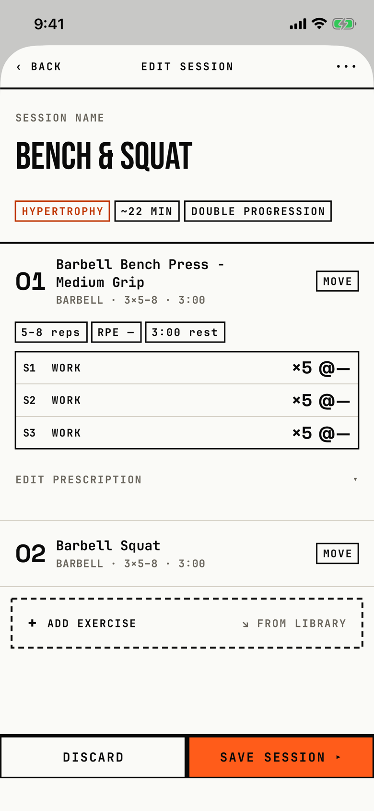

The lifter names a session, sets its intent and progression, and adds, orders and prescribes its exercises.

## Entry points

| From | Tap | Kind |
|---|---|---|
| [session-template-detail](session-template-detail.md) | EDIT; opens "Edit session" | sheet |
| [slot-picker](slot-picker.md) | + New session; opens "New session" | sheet |

## Exits

| Control | Goes to | Kind | Closes with |
|---|---|---|---|
| ‹ BACK or DISCARD, with no changes | the screen it came from | sheet | back |
| ‹ BACK or DISCARD, with changes | [dialog-discard-changes-session](dialog-discard-changes-session.md) | dialog | verb |
| SAVE SESSION ▸, when valid | the screen it came from; from the slot picker, the new session joins the routine | sheet | verb |
| SAVE SESSION ▸, without a name or an exercise | stays here and shows the errors | none | none |
| ••• (edit only) | [dialog-session-menu](dialog-session-menu.md) | dialog | none |
| + ADD EXERCISE ↘ FROM LIBRARY | [library-picker](library-picker.md) | sheet | verb |
| Long press on an exercise's title row, Edit warm-up… | [warmup-config](warmup-config.md) | sheet | verb |
| Long press, Move to superset… or Make superset, in a saved session | [superset-assignment](superset-assignment.md) | sheet | cancel |
| Long press, Move to superset… or Make superset, in a new session | [dialog-save-routine-first](dialog-save-routine-first.md) | alert | done |
| A failed save, duplicate or archive | [dialog-couldnt-save](dialog-couldnt-save.md) | alert | done |

Other controls stay on this screen: the intent and progression chips open system menus, MOVE opens a Move up and Move down menu, a tap on an exercise's title row opens or closes its prescription, and the long-press menu also offers Duplicate exercise, Move up, Move down and Remove.
Remove in the long-press menu acts at once, with no confirmation.
A swipe down is blocked while there are unsaved changes, so the discard dialog always shows.

## States

| State | How to reach it | Screenshot |
|---|---|---|
| Editing a saved session, first exercise open | W13 progress seed: the "Upper Lower" routine, Session 1: Bench & Squat, EDIT, a tap on the first exercise | [main](img/17e-default-light-session-editor.png) |
| On an active block | W12 powerbuilding seed: Upper Lower, Session 1: Upper A, EDIT; the live-edit banner shows under the header | [long-name](img/17e-default-light-session-editor--long-name.png) |
| New and empty | W15: a new routine, + Add session, + New session; no ••• and no duration chip | [new](img/17e-default-light-session-editor--new.png) |
| Prescription details open | W15: name "Push A", add the bench press, tap it, then EDIT PRESCRIPTION; the Sets, Min reps and Max reps steppers and the Target RPE chips show | [prescription](img/17e-default-light-session-editor--prescription.png) |
| Validation errors | W15: SAVE SESSION ▸ on the empty new session; "! NAME THIS SESSION" and "! ADD AT LEAST ONE EXERCISE" show | [validation](img/17e-default-light-session-editor--validation.png) |
| AX3 | The name block scrolls with the list, chips wrap one per line, the exercise row stacks number, name and MOVE, and SAVE SESSION ▸ wraps to two lines | [ax3](img/17e-ax3-light-session-editor.png) |
| A superset bracket | not captured: the tour cancels the superset sheet, so no exercise joins a superset | - |
| The prescription scrolled at AX3 | not captured: the editor hangs when scrolled at AX3 on the 390 pt phone (T115), so the tour never scrolls it | - |
| Linked → Block chip | not captured: no seed links a session to a block through the editor's draft | - |
| Pro Max, exercise rows | Same as the main, active-block and prescription states; "Barbell Bench Press - Medium Grip" fits one line, and with the prescription open the Target RPE chips and the Rest stepper show above the footer | [Pro Max](img/17promax-default-light-session-editor.png), [Pro Max long-name](img/17promax-default-light-session-editor--long-name.png), [Pro Max prescription](img/17promax-default-light-session-editor--prescription.png) |
| Pro Max, AX3 | Same walk at AX3; HYPERTROPHY and ~22 MIN share a line, the exercise summary fits one line, and 5-8 reps and RPE share a line under MOVE, so the first set row shows above the footer; SAVE SESSION ▸ still wraps to two lines | [Pro Max AX3](img/17promax-ax3-light-session-editor.png) |

Dark mode and the Pro Max at default text in the other states change only colour and size: [dark](img/17e-default-dark-session-editor.png), [Pro Max new](img/17promax-default-light-session-editor--new.png), [Pro Max validation](img/17promax-default-light-session-editor--validation.png).

## Compared with the mock-up

The mock-up's "Routine" is today's session.

| In the mock-up | In the app | Difference |
|---|---|---|
| ‹ ROUTINES, EDIT ROUTINE, ••• and a SAVE in the status area | ‹ BACK, EDIT SESSION, ••• | The back label names nothing, and SAVE lives only in the footer. |
| LINKED → BLOCK 03 · W3 chip under the name | Linked → Block chip only when a block is linked | The chip no longer names the block and week. |
| Two large cells, SESSION INTENT and PROGRESSION, with › | Two small chips, HYPERTROPHY and DOUBLE PROGRESSION, plus a ~22 MIN chip | Intent and progression shrink to chips that open menus. |
| Day tabs PUSH A, PULL A, PUSH B, PULL B, + | none | One session per editor; the routine screen orders sessions. |
| A ⋮⋮ drag handle on each exercise | a MOVE chip with a menu | Reordering is a menu, not a drag. |
| W/UP, WORK, TOP and BACK set rows with per-set RPE, TOP in signal | Every set reads WORK with the exercise's reps and RPE | Set intents are not shown; warm-ups come from the warm-up ramp. |
| A PLATE ½ LB chip | none | No plate chip. |
| An ink SAVE ROUTINE ▸ | a signal SAVE SESSION ▸ | The primary button uses the signal fill. |

## VoiceOver order

1. Back
2. Edit session
3. More
4. Session name, text field, "Bench & Squat"
5. Hypertrophy, button; ~22 min; Double Progression, button
6. 01, Barbell Bench Press - Medium Grip, barbell · 3×5–8 · 3:00, Move exercise 1
7. 5–8 reps, RPE -, 3:00 rest, then S1 WORK ×5 No target RPE for each set
8. EDIT PRESCRIPTION, Add exercise, Discard, Save session ▸

Gaps:

- An exercise's name reads as plain text, not as a button that opens its prescription (T111).
- The chip "RPE -" reads its dash as "em dash".
- "↘ FROM LIBRARY" and the "+" of Add exercise are read as separate texts.
- The long-press menu, the only way to reach warm-up, superset, duplicate and remove, has no VoiceOver action on the row.
- In the tree, the header reads after the list, because the header is a top safe-area inset.

## Findings

- Major: [D-08](../audit.md#d-08), [D-09](../audit.md#d-09), [D-16](../audit.md#d-16), [D-17](../audit.md#d-17), [D-18](../audit.md#d-18).
- Minor: [D-85](../audit.md#d-85), [D-139](../audit.md#d-139), [D-140](../audit.md#d-140), [D-141](../audit.md#d-141), [D-142](../audit.md#d-142).
- Polish: [D-288](../audit.md#d-288), [D-319](../audit.md#d-319), [D-320](../audit.md#d-320), [D-321](../audit.md#d-321), [D-322](../audit.md#d-322), [D-323](../audit.md#d-323).
