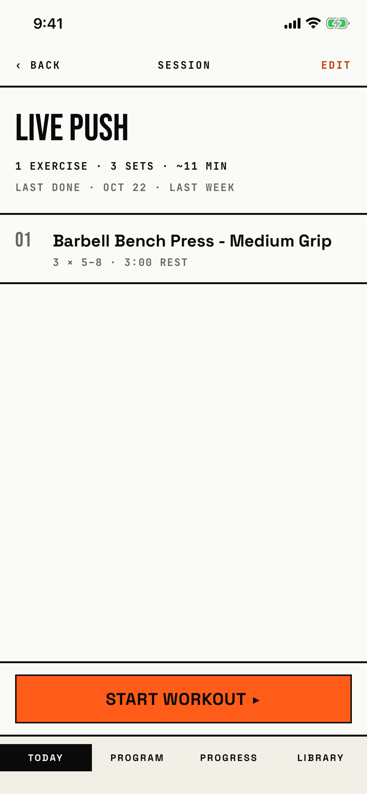

The lifter reads one session's exercises and prescription, then starts a workout from it or opens it to edit.

## Entry points

| From | Tap | Kind |
|---|---|---|
| [today](today.md) | A session row in the Start-a-workout picker, shown when no block is active, such as "Live Push" | push |
| [routine-editor](routine-editor.md) | A session row in the routine's Sessions list, such as "Session 1: Push A" | push |

## Exits

| Control | Goes to | Kind | Closes with |
|---|---|---|---|
| ‹ BACK | [today](today.md) or [routine-editor](routine-editor.md), whichever opened it | push | back |
| EDIT | [session-editor](session-editor.md) | sheet | verb |
| START WORKOUT ▸ | [logger](logger.md), with a new workout | push | verb |
| START WORKOUT ▸ while another workout is in progress | [dialog-workout-in-progress](dialog-workout-in-progress.md) | dialog | verb |
| START WORKOUT ▸ when the start fails | [dialog-couldnt-start-workout](dialog-couldnt-start-workout.md) | dialog | verb |

The exercise rows are not buttons; nothing on the list opens an exercise or its prescription.
The tab bar stays visible, and the START WORKOUT ▸ bar sits above it.

## States

| State | How to reach it | Screenshot |
|---|---|---|
| Done before | W09 ended block: Today's Start-a-workout picker, "Live Push"; the line reads "Last done · Oct 22 · last week" | [main](img/17e-default-light-session-template-detail.png) |
| Not done yet | W15 routines: a new Push A saved in a routine, then its row on the routine screen; the line reads "Not done yet" | [populated](img/17e-default-light-session-template-detail--populated.png) |
| No exercises | Not captured: a session cannot be saved without an exercise, so the "No exercises yet" state with its Add exercises button cannot be reached | - |
| AX3 | On both phones the header puts SESSION above ‹ BACK and EDIT, the summary and "Last done" lines wrap, and the tab bar uses two columns; on the 17e the pinned START WORKOUT ▸ bar and tab bar leave about 190 pt, so the exercise row is cut after "3 × 5-8 ·", while on the Pro Max the whole row fits | [ax3](img/17e-ax3-light-session-template-detail.png), [Pro Max ax3](img/17promax-ax3-light-session-template-detail.png) |

Dark mode and the Pro Max at default text change only colour and size: [dark](img/17e-default-dark-session-template-detail.png), [Pro Max](img/17promax-default-light-session-template-detail.png), [Pro Max populated](img/17promax-default-light-session-template-detail--populated.png).

## Compared with the mock-up

No mock-up was drawn for this screen.

## VoiceOver order

1. BACK
2. Session
3. Edit
4. Live Push
5. 1 exercise · 3 sets · ~11 min
6. Last done · Oct 22 · last week
7. 01, Barbell Bench Press - Medium Grip, 3 × 5–8 · 3:00 rest
8. Start workout ▸

Gaps:

- The back button's label is the uppercase string "BACK", where the logger's back button reads "Back".
- The exercise rows look like list rows but do nothing when tapped, and VoiceOver gives them no button trait.

## Findings

<!-- findings are linked after the audit -->
