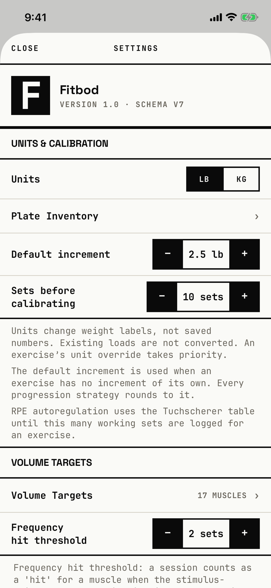

The lifter sets units, plate and increment defaults, volume targets, and exports or backs up their data.

## Entry points

| From | Tap | Kind |
|---|---|---|
| [today](today.md) | Settings (header, left) | sheet |

## Exits

| Control | Goes to | Kind | Closes with |
|---|---|---|---|
| Close (header, left) | [today](today.md) | sheet | close |
| Plate Inventory › | [plate-inventory](plate-inventory.md) | push | back |
| Volume Targets 17 MUSCLES › | [volume-targets](volume-targets.md) | push | back |
| Export CSV, Export JSON, CREATE (backup) | [share-sheet](share-sheet.md) | system | none |
| RESTORE (backup) | [file-importer](file-importer.md) | system | close |
| Component gallery (DEVELOPER section, Debug builds only) | [component-gallery](component-gallery.md) | push | back |

Picking a backup in the file importer leads to [dialog-restore-confirm](dialog-restore-confirm.md).

## States

| State | How to reach it | Screenshot |
|---|---|---|
| Fresh store, lb | main tour, reset launch, Today > Settings | [main](img/17e-default-light-settings.png) |
| Backup card in view | W02, scroll to Backup | [backup](img/17e-default-light-settings--backup.png) |
| Units set to kg | W02, tap kg | [kg](img/17e-default-light-settings--kg.png) |
| Library still loading | not captured: the fallback text "Settings are not ready yet. The exercise library is still loading." shows only while the first seed runs, and the tour waits for Today | none |
| AX3 | On both phones the header title sits on its own line above Close; each stepper drops below its label; the "F" avatar is clipped in its box; tabs use two columns behind the sheet | [ax3](img/17e-ax3-light-settings.png), [Pro Max AX3](img/17promax-ax3-light-settings.png) |
| Pro Max, every state | Same as each state above, on the Pro Max; "Sets before calibrating" and "Frequency hit threshold" fit one line beside their steppers, and the help texts wrap a word or two later | [Pro Max](img/17promax-default-light-settings.png), [Pro Max backup](img/17promax-default-light-settings--backup.png), [Pro Max kg](img/17promax-default-light-settings--kg.png) |

Dark mode changes only colour: [dark](img/17e-default-dark-settings.png).

## Compared with the mock-up

| In the mock-up | In the app | Difference |
|---|---|---|
| Pushed screen with "‹" and SETTINGS on the right, tab bar visible | Sheet with Close and Settings centred | Opened as a sheet, not a push |
| Profile band "JAMES M." with "42 SESSIONS · BLOCK 03 · WEEK 3" | "Fitbod" with "Version 1.0 · Schema V7" | The app shows the app version, not the lifter's progress |
| Units, Plate inventory, Per-exercise increment, RPE calibration window as rows with values and › | Units as an lb/kg toggle, Plate Inventory row, Default increment and Sets before calibrating as − / + steppers, plus help paragraphs | Values are edited in place in the app |
| TRAINING DEFAULTS: Rest defaults, Auto-start rest timer, Live activity, Stall threshold | No such section | Not built |
| VOLUME TARGETS: MEV / MAV / MRV thresholds, Stimulus weights | Volume Targets row and Frequency hit threshold stepper | Stimulus weights row is missing; a threshold stepper is added |
| EXPORT with "LAST · MAY 18" and CSV / JSON cards | CSV / JSON cards with no last-export date | No date in the app |
| No backup section | Backup card with CREATE and RESTORE | Added in the app |

## VoiceOver order

1. "Close" (button)
2. "Settings"
3. "F"
4. "Fitbod"
5. "Version 1.0 · Schema V7"
6. "Units & Calibration"
7. "lb" (button), "kg" (button)
8. "Default increment", value "2.5 lb", with "−" and "+" buttons

Gaps: the avatar letter "F" is decorative and is read out.
The − and + buttons are labelled only with the symbol; the value comes from the row around them.
The section heads are read as plain text, not headings.

## Findings

- Blocker: [D-03](../audit.md#d-03).
- Minor: [D-144](../audit.md#d-144), [D-145](../audit.md#d-145), [D-146](../audit.md#d-146).
- Polish: [D-326](../audit.md#d-326), [D-327](../audit.md#d-327), [D-328](../audit.md#d-328), [D-329](../audit.md#d-329).
