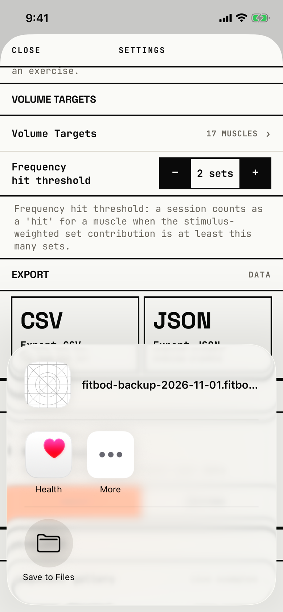

The lifter sends a backup or an export file somewhere, most often Save to Files.

## Entry points

| From | Tap | Kind |
|---|---|---|
| [settings](settings.md) | CREATE in the Backup panel (the captured case) | sheet |
| [settings](settings.md) | The CSV card, "Export CSV" (`fitbod/Settings/SettingsView.swift:300`) | sheet |
| [settings](settings.md) | The JSON card, "Export JSON" (`fitbod/Settings/SettingsView.swift:310`) | sheet |

iOS draws this sheet; each entry is a `ShareLink`, so one tap opens it at once.
The app puts one file in it and builds that file only when the chosen activity asks for it.
The backup is named `fitbod-backup-<date>.fitbodbackup` and the exports `fitbod-export-<date>.csv` and `.json`.
The date in the backup's name is the UTC date, so the tour's backup on the evening of Oct 31 is named 2026-11-01; the orchestrator's findings record this under Settings.

## Exits

| Control | Goes to | Kind | Closes with |
|---|---|---|---|
| Save to Files | iOS's Files save sheet, then back to [settings](settings.md) | sheet | verb |
| Health, More or another app | that app or iOS's full activity list | sheet | verb |
| A tap outside the sheet, or a swipe down | [settings](settings.md) | sheet | none |

The sheet has no close button of its own.
If building the file fails, the sheet stops and Settings shows "Couldn't create backup. Try again." (or "Couldn't prepare export. Try again.") under the cards.

## States

| State | How to reach it | Screenshot |
|---|---|---|
| Backup ready to share | Settings > Backup > CREATE | [main](img/17e-default-light-share-sheet.png) |
| AX3 | The file name wraps onto two lines in full, and the app icons sit in rows with their names beside them | [ax3](img/17e-ax3-light-share-sheet.png) |
| CSV or JSON export | Settings > Export > CSV or JSON; not captured, because the tour shares only the backup | not captured |
| Backup failed | A failure while building the archive; not captured, because every backup the tour makes succeeds | not captured |
| Pro Max, AX3 | Same as the AX3 state, on the Pro Max; the file name fits one line in full | [Pro Max AX3](img/17promax-ax3-light-share-sheet.png) |

Dark mode and the Pro Max at default text change only colour and size: [dark](img/17e-default-dark-share-sheet.png), [Pro Max](img/17promax-default-light-share-sheet.png).

## Compared with the mock-up

No mock-up was drawn for this sheet; the May Settings mock-up shows only the CREATE and RESTORE buttons that lead to it.

## VoiceOver order

1. dismiss popup (the area outside the sheet)
2. fitbod-backup-2026-11-01.fitbodbackup
3. Health
4. More
5. Save to Files

Gaps:

- The file's preview is iOS's blank placeholder grid, because the app gives the share preview a name and no image.

## Findings

<!-- findings are linked after the audit -->
