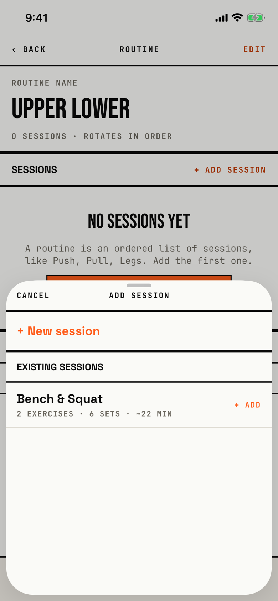

The lifter picks a saved session to add to the end of the routine, or starts a new one.

## Entry points

| From | Tap | Kind |
|---|---|---|
| [routine-editor](routine-editor.md) | + ADD SESSION in the Sessions head, or the empty state's + ADD SESSION button | sheet |

## Exits

| Control | Goes to | Kind | Closes with |
|---|---|---|---|
| CANCEL | [routine-editor](routine-editor.md) | sheet | cancel |
| A session row (+ ADD) | [routine-editor](routine-editor.md), with the session appended | sheet | verb |
| + New session | [session-editor](session-editor.md) | sheet | verb |
| A swipe down | [routine-editor](routine-editor.md) | sheet | cancel |

A session saved in the new session editor is added to the routine as soon as that editor closes, and the picker closes with it.
The sheet opens at half height and can be dragged to full height.

## States

| State | How to reach it | Screenshot |
|---|---|---|
| With saved sessions | W13 progress seed: a new "Upper Lower" routine, + Add session; EXISTING SESSIONS lists Bench & Squat | [main](img/17e-default-light-slot-picker.png) |
| No saved sessions | W15 fresh store: a new "Push Pull Legs" routine, + Add session; only + New session shows | [new](img/17e-default-light-slot-picker--new.png) |
| AX3 | The title moves above CANCEL, and a session's name and summary wrap over five lines beside + ADD | [ax3](img/17e-ax3-light-slot-picker.png) |
| Pro Max, AX3 | Same walk at AX3; the session's name fits one line and its summary wraps over two lines beside + ADD | [Pro Max AX3](img/17promax-ax3-light-slot-picker.png) |

Dark mode and the Pro Max at default text change only colour and size: [dark](img/17e-default-dark-slot-picker.png), [Pro Max](img/17promax-default-light-slot-picker.png), [Pro Max new](img/17promax-default-light-slot-picker--new.png).

## Compared with the mock-up

No mock-up was drawn for this sheet.

## VoiceOver order

1. Sheet Grabber, Half screen
2. Cancel
3. Add session
4. + New session
5. Existing sessions
6. Bench & Squat, 2 exercises · 6 sets · ~22 min, + Add

Gaps:

- Each session row reads "+ Add" at the end of its label, so the glyph and the verb are read as part of the row's name.
- CANCEL measures 69.7 by 42.2 pt at default text, under 44 pt.
- The routine screen behind the half-height sheet stays in the tree, so VoiceOver can move behind the sheet (not checked by hand).

## Findings

- Major: [D-20](../audit.md#d-20).
- Minor: [D-141](../audit.md#d-141), [D-147](../audit.md#d-147), [D-148](../audit.md#d-148).
- Polish: [D-318](../audit.md#d-318).
