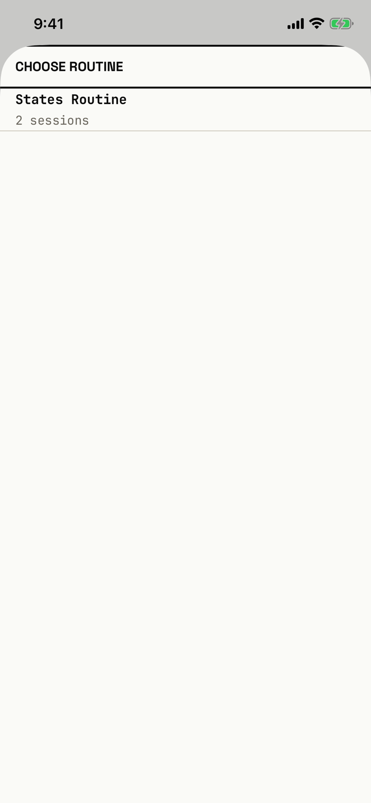

The lifter attaches a routine to a draft block, or swaps the routine of a ready block, from its overview.

## Entry points

| From | Tap | Kind |
|---|---|---|
| [block-overview](block-overview.md), draft block | + ATTACH ROUTINE ▸ | sheet |
| [block-overview](block-overview.md), ready block | SWAP ▸ in the Routine band | sheet |

## Exits

| Control | Goes to | Kind | Closes with |
|---|---|---|---|
| A routine row, such as States Routine | [block-overview](block-overview.md), with the routine attached or swapped and saved | sheet | verb |
| CANCEL | [block-overview](block-overview.md) | sheet | cancel |
| Swipe down | [block-overview](block-overview.md) | sheet | none |

CANCEL in the header closes the sheet without a pick (T38). It is the same sheet as New Block's routine picker, [new-block-split-picker](new-block-split-picker.md), since the two were merged into `RoutinePickerSheet`.
A pick saves at once; if the save fails, it is undone and an alert says so once the sheet has gone.

## States

| State | How to reach it | Screenshot |
|---|---|---|
| Ready block, one routine | Main tour, block-states seed: Program, the READY Summer Block card, then SWAP ▸ | [17e light](img/17e-default-light-split-picker.png) |
| Draft block | + ATTACH ROUTINE ▸ on the draft Autumn Block opens the same list (not captured; it looks the same) | - |
| No routines | An empty page under the title (not captured; a draft block with no routine in the store needs a store no seed makes) | - |
| AX3 | Same walk at AX3; the title and the two-line row grow, and the row becomes 82 pt tall, on both phones | [17e AX3](img/17e-ax3-light-split-picker.png), [Pro Max AX3](img/17promax-ax3-light-split-picker.png) |

Dark mode and the Pro Max at default text change only colour and size: [17e dark](img/17e-default-dark-split-picker.png), [Pro Max](img/17promax-default-light-split-picker.png).
The sheet opens at half height and can be dragged to full height.

## Compared with the mock-up

No mock-up was drawn for this sheet.

## VoiceOver order

1. "Choose Routine"
2. "States Routine"

The routine already on the block shows a ✓, a plain text with no selected trait.
Rows give no session count.

## Findings

- Minor: [D-34](../audit.md#d-34), [D-149](../audit.md#d-149), [D-155](../audit.md#d-155).
- Polish: [D-331](../audit.md#d-331), [D-332](../audit.md#d-332).
