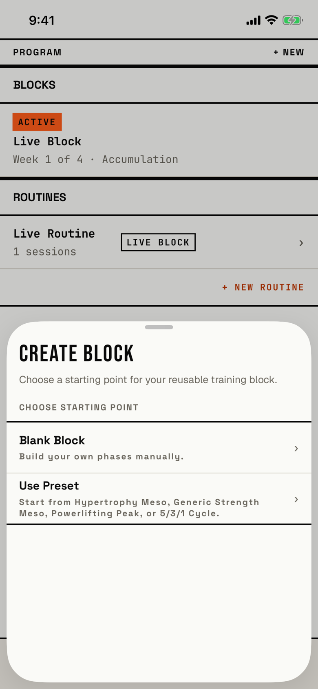

The lifter chooses whether a new block starts blank or from a preset.

## Entry points

| From | Tap | Kind |
|---|---|---|
| [dialog-program-new](dialog-program-new.md) | + New block | sheet |
| [program](program.md) | + DEFINE BLOCK ▶ in the empty hero, or under "No blocks yet." | sheet |

## Exits

| Control | Goes to | Kind | Closes with |
|---|---|---|---|
| Blank Block | [new-block](new-block.md), with the default three phases | cover | verb |
| Use Preset | [preset-picker](preset-picker.md), a second sheet on top of this one | sheet | none |
| A swipe down, or a tap above the sheet | [program](program.md) | sheet | none |

The sheet has no CANCEL or close button; the grabber, a swipe down and a tap outside are the only ways to leave without choosing.
It opens at half height, and at accessibility text sizes it opens at full height (`fitbod/Periodization/ProgramView.swift:278`).
Blank Block closes the sheet first and then opens New Block as a full-screen cover.

## States

| State | How to reach it | Screenshot |
|---|---|---|
| Over a program with an active block | `-fitbod-seed-active-block`, Program, + NEW, + New block | [main](img/17e-default-light-start-choice.png) |
| Over an empty program | Fresh store, Program, + NEW, + New block | [fresh](img/17e-default-light-start-choice--fresh.png) |
| AX3 | Full height; the title and description wrap, and the Use Preset row grows to 261 pt because its description lists all four presets | [ax3](img/17e-ax3-light-start-choice.png) |
| Pro Max, AX3 | Same as the AX3 state. The description wraps to two lines instead of three, CHOOSE STARTING POINT fits on one line, and the Use Preset description takes four lines instead of five, so both rows end higher on the sheet | [Pro Max ax3](img/17promax-ax3-light-start-choice.png) |

Dark mode and the Pro Max at default text change only colour and size: [dark](img/17e-default-dark-start-choice.png), [Pro Max](img/17promax-default-light-start-choice.png), [Pro Max fresh](img/17promax-default-light-start-choice--fresh.png).
At default text the two rows end about halfway down the sheet, so the lower half of the sheet is empty paper.

## Compared with the mock-up

No mock-up was drawn for this sheet; `bru-screens/New-modal` draws the + NEW popover before it.

## VoiceOver order

1. Sheet Grabber, Half screen
2. CREATE BLOCK
3. Choose a starting point for your reusable training block.
4. CHOOSE STARTING POINT
5. Blank Block, Build your own phases manually., ›
6. Use Preset, Start from Hypertrophy Meso, Generic Strength Meso, Powerlifting Peak, or 5/3/1 Cycle., ›

Gaps:

- Both rows end with the "›" glyph read aloud.
- No control is labelled Cancel or Close; a VoiceOver user must find the grabber or use the escape gesture.
- The Program screen behind the half-height sheet stays in the tree, so VoiceOver can move behind the sheet (not checked by hand).
- The Sheet Grabber is 72.9 by 24 pt; both rows are 61 pt tall and pass.

## Findings

<!-- findings are linked after the audit -->
