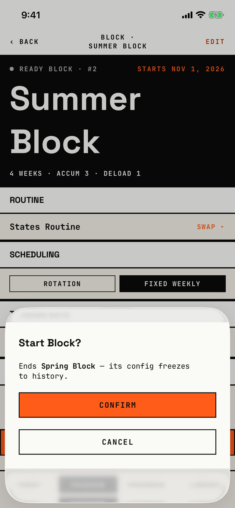

The lifter confirms starting a ready block, which ends the block that is active now.

## Entry points

| From | Tap | Kind |
|---|---|---|
| [block-overview](block-overview.md), ready block while another block is active | START BLOCK ▸ | sheet |

When no other block is active, START BLOCK ▸ starts the ready block at once, with no sheet (`fitbod/Periodization/BlockOverviewScreen.swift:1334`).
A draft block has no START BLOCK ▸, so this sheet never shows for one.

## Exits

| Control | Goes to | Kind | Closes with |
|---|---|---|---|
| CONFIRM | [block-overview](block-overview.md), now showing the started block as active | sheet | verb |
| CANCEL | [block-overview](block-overview.md) | sheet | cancel |
| Swipe down | [block-overview](block-overview.md) | sheet | none |

CONFIRM ends the active block and starts this one in one save; if the save fails, the sheet closes and nothing tells the lifter (`fitbod/Periodization/BlockOverviewScreen.swift:1380`).

## States

| State | How to reach it | Screenshot |
|---|---|---|
| Another block active | Main tour, block-states seed: Program, the READY Summer Block card, then START BLOCK ▸ while Spring Block is active | [17e light](img/17e-default-light-swap-confirm.png) |
| AX3 | Same walk at AX3; the sheet keeps its fixed 40% height on both phones, so the message is cut and the consequence is hidden: to "Ends Spring Block…" on the 17e and to "Ends Spring Block - its config freezes to…" on the Pro Max | [17e AX3](img/17e-ax3-light-swap-confirm.png), [Pro Max AX3](img/17promax-ax3-light-swap-confirm.png) |
| Pro Max | Same as the main state; the message fits one line instead of two | [Pro Max](img/17promax-default-light-swap-confirm.png) |

Dark mode changes only colour and size: [17e dark](img/17e-default-dark-swap-confirm.png).
In every configuration the sheet's paper stops short of its top and bottom edges, so the page behind shows through as blurred bands.

## Compared with the mock-up

No mock-up was drawn for this sheet.

## VoiceOver order

1. "Start Block?"
2. "Ends Spring Block - its config freezes to history." (the app's copy has an em dash here)
3. "Confirm"
4. "Cancel"

"Confirm" does not say what it does.
Unlike the End block alert, this is a custom sheet with two full-width buttons rather than a system alert.

## Findings

<!-- findings are linked after the audit -->
