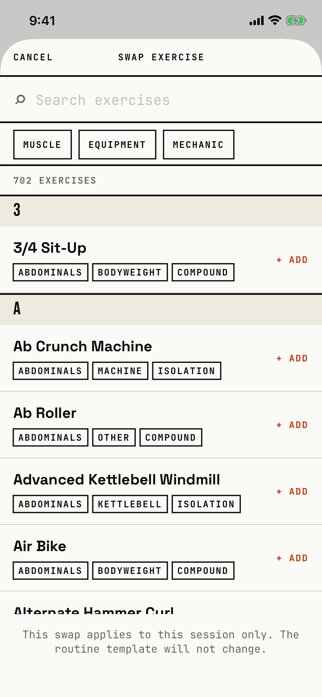

The lifter picks another exercise to take the place of one in this workout only.

## Entry points

| From | Tap | Kind |
|---|---|---|
| [logger](logger.md) | A long press on the exercise name, then Swap Exercise… | sheet |

## Exits

| Control | Goes to | Kind | Closes with |
|---|---|---|---|
| CANCEL | [logger](logger.md) | sheet | cancel |
| Any exercise row, which reads "+ ADD" | [logger](logger.md), with the exercise swapped at once and its sets and warm-up ramp rebuilt | sheet | verb |
| MUSCLE, EQUIPMENT or MECHANIC | [filter-picker](filter-picker.md) | sheet | done |

The sheet is the library list with its own header; the library's "+ New" is hidden here (`fitbod/Sessions/SwapExerciseSheet.swift:44`).
A footer note under the list reads "This swap applies to this session only. The routine template will not change."; the orchestrator's table holds the problem with that copy.
The swap happens on the first tap, with no confirmation.

## States

| State | How to reach it | Screenshot |
|---|---|---|
| Open, all 702 exercises | W03 demo: long press Barbell Bench Press, Swap Exercise… | [main](img/17e-default-light-swap-exercise.png) |
| Searched or filtered | Not captured: the tour shot search only in the add-exercise picker, see [library-picker](library-picker.md) | - |
| AX3 | The header puts SWAP EXERCISE above CANCEL, the MECHANIC chip is cut off at the right edge, and the footer note grows to four lines, about 180 pt, so only one exercise row fits; this holds on both phones, and on the Pro Max the chip is cut to "MEC" | [ax3](img/17e-ax3-light-swap-exercise.png), [Pro Max ax3](img/17promax-ax3-light-swap-exercise.png) |

Dark mode and the Pro Max at default text change only colour and size: [dark](img/17e-default-dark-swap-exercise.png), [Pro Max](img/17promax-default-light-swap-exercise.png).

## Compared with the mock-up

| In the mock-up | In the app | Difference |
|---|---|---|
| "PICK EXERCISES" with check boxes and a SELECTED footer for several picks | One tap swaps one exercise | Single pick, as a swap needs |
| Filter chips ALL, CHEST, BACK, + EQUIPMENT, CUSTOM | MUSCLE, EQUIPMENT and MECHANIC chips that open pickers | Filters sit one step deeper |
| Each row shows how often the exercise was used | Each row shows muscle, equipment and mechanic tags | No usage count |
| CANCEL and a signal ADD 2 EXERCISES ▸ footer | CANCEL at the top left, no right action, and a muted note at the bottom | No confirm button |

## VoiceOver order

1. CANCEL
2. SWAP EXERCISE
3. Search exercises
4. MUSCLE
5. 702 EXERCISES
6. 3/4 Sit-Up, Abdominals, Bodyweight, Compound
7. This swap applies to this session only. The routine template will not change.

Gaps:

- Each row's visible "+ ADD" is not part of its label, so VoiceOver gives no hint that a tap swaps the exercise.
- The header is drawn in a safe-area inset and comes last in the tree (`screens/tree/swap-exercise.txt:220`).
- CANCEL is a string typed in capitals and is read as written.

## Findings

<!-- findings are linked after the audit -->
