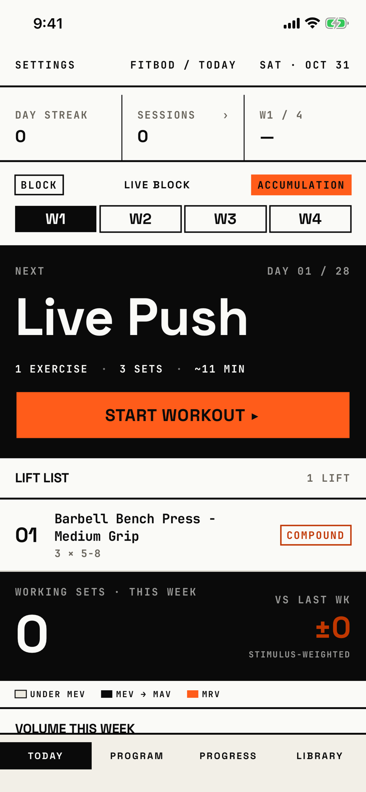

The lifter sees where they are in the block, starts or resumes today's workout, and checks this week's volume per muscle.

## Entry points

| From | Tap | Kind |
|---|---|---|
| App launch | every launch after the first | launch |
| [preparing-library](preparing-library.md) | the library is ready | replace |
| Tab bar | TODAY, from any tab root; a second tap leaves the tab's stack as it is | tab switch |

The tab bar is not a screen, so a tab switch is not a navigation edge.

## Exits

| Control | Goes to | Kind | Closes with |
|---|---|---|---|
| Settings (header, left) | [settings](settings.md) | sheet | close |
| SESSIONS stat | [history](history.md) | push | back |
| Block band (BLOCK, block name, phase chip, week cells) | [block-overview](block-overview.md) | push | back |
| Start workout ▸ | [logger](logger.md) | push | back |
| RESUME on the workout-in-progress slab | [logger](logger.md) | push | back |
| DISCARD on the workout-in-progress slab | [dialog-discard-workout-slab](dialog-discard-workout-slab.md) | alert | cancel |
| A session row in the picker (no block running) | [session-template-detail](session-template-detail.md) | push | back |
| START ▸ on a session row, while another workout is open | [dialog-workout-in-progress](dialog-workout-in-progress.md) | alert | cancel |
| START ▸ when the workout cannot be built | [dialog-couldnt-start-workout](dialog-couldnt-start-workout.md) | alert | cancel |
| + New routine (empty picker), + NEW ROUTINE (no workout scheduled) | [new-routine](new-routine.md) | push | back |
| GO TO ROUTINE ▸ (routine has no sessions) | [routine-editor](routine-editor.md) | push | back |
| Start a block (No active block band) | [new-block](new-block.md) | cover | cancel |
| Shown on its own when an ended block has not been reviewed | [block-review](block-review.md) | sheet | back |
| Shown on its own on the first open of a new week, after the block review | [weekly-recap](weekly-recap.md) | sheet | back |
| ▲ CONSIDER DELOAD banner body | [fatigue-signals](fatigue-signals.md) | sheet | done |
| A volume bar or a muscle on the heatmap | [per-muscle-detail](per-muscle-detail.md) | push | back |

## States

| State | How to reach it | Screenshot |
|---|---|---|
| Block running, day 1 | `-fitbod-seed-active-block` | [main](img/17e-default-light-today.png) |
| Block running (W08 run) | W08, active block seed; matches the main state | [active-block](img/17e-default-light-today--active-block.png) |
| Block running, scrolled to volume | W08, scroll down | [active-block-lower](img/17e-default-light-today--active-block-lower.png) |
| Block just ended | W08, Block overview, END BLOCK, back to Today: No active block band and session picker | [block-ended](img/17e-default-light-today--block-ended.png) |
| Deload week | W16, demo seed with a block in its deload week: DL badge and deload banner | [deload-week](img/17e-default-light-today--deload-week.png) |
| Fresh store | W01, reset launch: Build your first routine, No active block | [empty](img/17e-default-light-today--empty.png) |
| Plan over, block still active | W11, past-plan seed: header reads W1 / 4 and DAY 08 / 28 | [plan-complete](img/17e-default-light-today--plan-complete.png) |
| After the weekly recap closed | W07, recap-with-empty seed, close the recap | [recap-seen](img/17e-default-light-today--recap-seen.png) |
| Workout in progress | W03a, demo seed, start a workout and go back | [resume](img/17e-default-light-today--resume.png) |
| Workout in progress after relaunch | W03c, relaunch without reset | [resume-after-relaunch](img/17e-default-light-today--resume-after-relaunch.png) |
| Block scheduled for later | W10, block-states seed | [scheduled](img/17e-default-light-today--scheduled.png) |
| Streak with an empty day between | W06, empty-between seed | [streak](img/17e-default-light-today--streak.png) |
| Volume and heatmap with data | main tour, demo seed, scroll down | [volume](img/17e-default-light-today--volume.png) |
| No workout scheduled today | not captured: needs a fixed-weekly block on a rest day, which no seed makes | none |
| Routine has no sessions | not captured: needs an active block whose routine is empty, which no seed makes | none |
| CONSIDER DELOAD banner | not captured: needs three finished workouts that fire a fatigue signal, which no seed makes | none |
| AX3 | On both phones the header title sits on its own line above Settings and the date; stats stack one per row; block band words break mid-word ("BLOC K" and "ACCUM ULATI ON" on the 17e, "ACCUMUL ATION" on the Pro Max); tabs use two columns. The 17e retake reads "SUN · NOV 1", which fits, but its earlier Saturday capture cut the date to "SAT · OCT…"; on the Pro Max "SAT · OCT 31" fits with only a space between it and Settings. On the 17e "ADD A SET" wraps onto two lines, while on the Pro Max it stays on one | [ax3](img/17e-ax3-light-today.png), [ax3 empty](img/17e-ax3-light-today--empty.png), [ax3 volume](img/17e-ax3-light-today--volume.png), [Pro Max AX3](img/17promax-ax3-light-today.png), [Pro Max AX3 empty](img/17promax-ax3-light-today--empty.png), [Pro Max AX3 volume](img/17promax-ax3-light-today--volume.png) |
| Pro Max, every state | Same as each state above, on the Pro Max; "Barbell Bench Press - Medium Grip" fits one line in the lift list, the empty-state help texts wrap a word later, and the first VOLUME THIS WEEK row shows above the tab bar | [Pro Max](img/17promax-default-light-today.png), [Pro Max active-block](img/17promax-default-light-today--active-block.png), [Pro Max active-block-lower](img/17promax-default-light-today--active-block-lower.png), [Pro Max block-ended](img/17promax-default-light-today--block-ended.png), [Pro Max deload-week](img/17promax-default-light-today--deload-week.png), [Pro Max empty](img/17promax-default-light-today--empty.png), [Pro Max plan-complete](img/17promax-default-light-today--plan-complete.png), [Pro Max recap-seen](img/17promax-default-light-today--recap-seen.png), [Pro Max resume](img/17promax-default-light-today--resume.png), [Pro Max resume-after-relaunch](img/17promax-default-light-today--resume-after-relaunch.png), [Pro Max scheduled](img/17promax-default-light-today--scheduled.png), [Pro Max streak](img/17promax-default-light-today--streak.png), [Pro Max volume](img/17promax-default-light-today--volume.png) |

Dark mode changes only colour: [dark](img/17e-default-dark-today.png), [dark empty](img/17e-default-dark-today--empty.png), [dark volume](img/17e-default-dark-today--volume.png).

## Compared with the mock-up

| In the mock-up | In the app | Difference |
|---|---|---|
| Header "FITBOD / TODAY" with the date on the right | Settings on the left, title in the middle, date on the right | The app adds the Settings button to the header |
| Third stat "W3 / 5" with an up arrow | "W1 / 4" with "-" when there is no trend | Same cell; the app shows a dash for no change |
| Block band: BLOCK box, block name, phase chip, W1 to W5 cells with a DL badge | Same parts; the DL badge hangs past the last cell's right edge | Badge placement differs |
| Next slab: "PUSH A", 5 EXERCISES · 21 SETS · ~52 MIN, orange START WORKOUT ▸ | "Live Push", "1 exercise · 3 sets · ~11 MIN", black-on-paper Start workout ▸ | Mixed case in the app; the button is the house primary slab |
| "LIFT LIST" with "TAP TO REORDER" | "Lift list" with "1 lift" count | No reorder from Today in the app |
| Lift rows tagged COMPOUND or WORK | Rows tagged Compound | Same idea, mixed case |
| Nothing below the lift list | Working sets this week, volume bars, body heatmap | The app adds the volume and heatmap section |

## VoiceOver order

1. "Settings" (button)
2. "Fitbod / Today"
3. "Sat · Oct 31"
4. "Day streak", value "0 days"
5. "Sessions, ›" (button), value "0"
6. "Block week 1 of 4", value "Same as last week"
7. "Live Push"
8. "Start workout ▸" (button)

Gaps: the block band reads as loose text ("LIVE BLOCK", "Accumulation", "W1"...) with no button, although a tap on it opens Block overview.
The "  ·  " separators in the slab line are read out.
Heatmap muscles are 27 x 13 pt or 13 x 27 pt targets, under 44 pt.
The heatmap button for the "UPPER BACK" region is labelled "Middle Back".

## Findings

- Major: [D-24](../audit.md#d-24), [D-25](../audit.md#d-25).
- Minor: [D-158](../audit.md#d-158), [D-159](../audit.md#d-159), [D-160](../audit.md#d-160), [D-161](../audit.md#d-161), [D-162](../audit.md#d-162), [D-163](../audit.md#d-163), [D-164](../audit.md#d-164), [D-165](../audit.md#d-165), [D-166](../audit.md#d-166).
- Polish: [D-340](../audit.md#d-340), [D-341](../audit.md#d-341), [D-342](../audit.md#d-342), [D-343](../audit.md#d-343), [D-344](../audit.md#d-344), [D-345](../audit.md#d-345).
