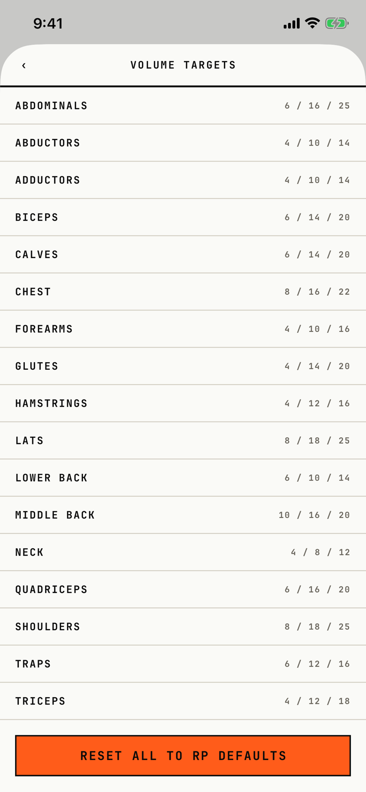

The lifter reads and tunes the weekly set landmarks (MEV, MAV and MRV) for each of the 17 muscles.

## Entry points

| From | Tap | Kind |
|---|---|---|
| [settings](settings.md) | The Volume Targets row ("17 MUSCLES ›") | push |

## Exits

| Control | Goes to | Kind | Closes with |
|---|---|---|---|
| ‹ (VoiceOver "Back") | [settings](settings.md) | push | back |
| RESET ALL TO RP DEFAULTS | [dialog-reset-volume-targets](dialog-reset-volume-targets.md) | dialog | none |
| A muscle row | this screen, with that row open to its target steppers | none | none |

A tap on a muscle row opens it under the row, and opening another row closes the first.
Nothing on a row shows that it opens.
The open row holds the shared muscle target stepper, which uses the stock iOS stepper.
The legend "MEV / MAV / MRV - weekly working sets. Seeded from RP volume landmarks." sits under the reset button, below the fold.

## States

| State | How to reach it | Screenshot |
|---|---|---|
| All rows closed | Settings > Volume Targets on a fresh store | [main](img/17e-default-light-volume-targets.png) |
| AX3 | The title moves above a bare ‹, the numbers stay on the right, and "ABDOMINALS" and "HAMSTRINGS" break inside the word ("ABDOMINAL / S", "HAMSTRING / S") | [ax3](img/17e-ax3-light-volume-targets.png) |
| A row open | Tap a muscle row; not captured, because the tour goes straight to the reset button | not captured |
| "No muscles found" | An empty muscle catalog; not reachable, because the muscles are seeded on first launch | not captured |
| "No persisted target row for ..." | A muscle with no target row; not reachable from the app | not captured |
| Pro Max | Same as the main state, on the Pro Max; the MEV / MAV / MRV legend under the reset button shows above the fold | [Pro Max](img/17promax-default-light-volume-targets.png) |
| Pro Max, AX3 | Same as the AX3 state, on the Pro Max; every muscle name stays whole, and "MIDDLE BACK" ends close to its numbers | [Pro Max AX3](img/17promax-ax3-light-volume-targets.png) |

Dark mode changes only colour: [dark](img/17e-default-dark-volume-targets.png).

## Compared with the mock-up

No mock-up was drawn for this screen; the May Settings mock-up only names its row, "MEV / MAV / MRV thresholds".

## VoiceOver order

1. Back
2. Volume Targets
3. ABDOMINALS, 6 / 16 / 25
4. ABDUCTORS, 4 / 10 / 14
5. TRICEPS, 4 / 12 / 18
6. Reset All to RP Defaults
7. MEV / MAV / MRV - weekly working sets. Seeded from RP volume landmarks.

Gaps:

- Each row is read as a button with three bare numbers; it does not say what they are or that the row opens.
- The muscle rows measure 390 by 38.7 pt at default text, under 44 pt.
- The back control shows only "‹".

## Findings

- Major: [D-05](../audit.md#d-05).
- Minor: [D-108](../audit.md#d-108), [D-167](../audit.md#d-167), [D-168](../audit.md#d-168), [D-169](../audit.md#d-169), [D-170](../audit.md#d-170).
- Polish: [D-347](../audit.md#d-347).
