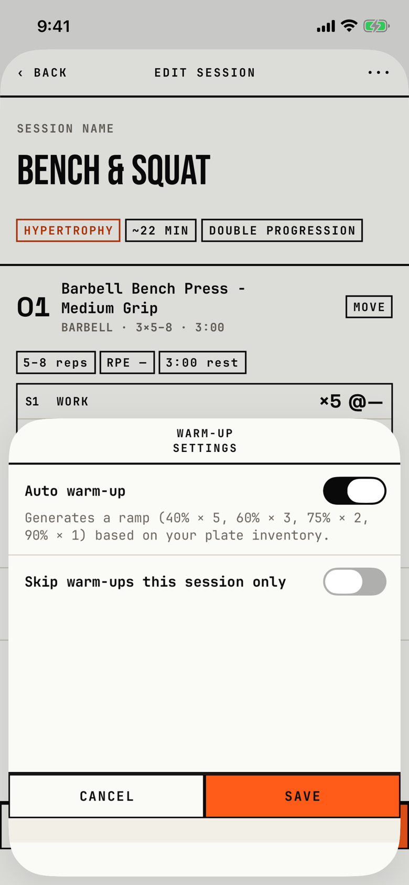

The lifter turns one exercise's automatic warm-up ramp on or off, or skips it for the next workout only.

## Entry points

| From | Tap | Kind |
|---|---|---|
| [session-editor](session-editor.md) | a long press on an exercise's title row, then Edit warm-up… | sheet |

## Exits

| Control | Goes to | Kind | Closes with |
|---|---|---|---|
| CANCEL | [session-editor](session-editor.md), unchanged | sheet | cancel |
| SAVE | [session-editor](session-editor.md); the change joins the session's unsaved draft | sheet | verb |
| A swipe down | [session-editor](session-editor.md), unchanged | sheet | cancel |

The sheet has one half-height detent and no control in its header.
SAVE writes only to the draft, so the change is kept only when the session itself is saved.

## States

| State | How to reach it | Screenshot |
|---|---|---|
| Defaults: auto warm-up on, skip off | W13 progress seed: Bench & Squat's editor, a long press on the bench press, Edit warm-up… | [main](img/17e-default-light-warmup-config.png) |
| Auto warm-up off | not captured: the tour cancels without toggling; the help then reads "No warm-up sets will be generated for this exercise." | - |
| AX3 | The title fits one line, the ramp help is cut to one line ending in "…", and the skip label wraps over three lines | [ax3](img/17e-ax3-light-warmup-config.png) |
| Pro Max | Same as the main state; the title fits one line | [Pro Max](img/17promax-default-light-warmup-config.png) |
| Pro Max, AX3 | Same walk at AX3; the whole ramp help shows over four lines, with no "…", and the skip label wraps over two lines | [Pro Max AX3](img/17promax-ax3-light-warmup-config.png) |

Dark mode changes only colour and size: [dark](img/17e-default-dark-warmup-config.png).
At default text on the 17e the title wraps to two lines, "WARM-UP" over "SETTINGS", inside the half-height sheet.
The tour skips this sheet at AX3 when the first exercise sits below the fold, because the editor must not be scrolled there (T115); in this run it was on screen.

## Compared with the mock-up

No mock-up was drawn for this sheet; its copy comes from the UI-SPEC named in the file header.

## VoiceOver order

1. WARM-UP SETTINGS
2. Auto warm-up
3. switch, value 1
4. Generates a ramp (40% × 5, 60% × 3, 75% × 2, 90% × 1) based on your plate inventory.
5. Skip warm-ups this session only
6. switch, value 0
7. CANCEL, SAVE

Gaps:

- Both switches have no label, so VoiceOver reads only "switch, on" or "switch, off"; each sits in the tree twice.
- CANCEL and SAVE measure 187 by 42.2 pt at default text, under 44 pt.
- The title, CANCEL and SAVE are typed in capitals in the source, so VoiceOver may read them as letters.
- The title is not marked as a header.

## Findings

<!-- findings are linked after the audit -->
