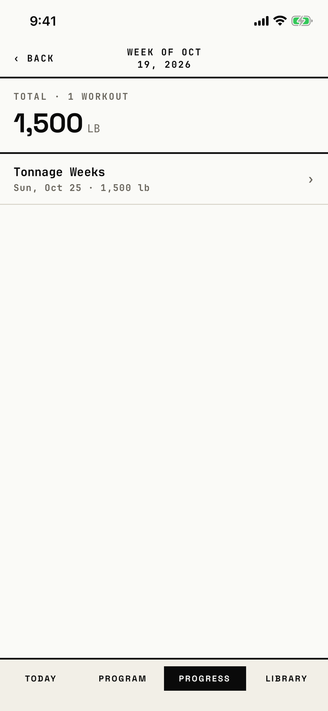

The lifter sees one week's tonnage total and the workouts it came from.
The header names the week, such as "Week of Oct 19, 2026".

## Entry points

| From | Tap | Kind |
|---|---|---|
| [weekly-tonnage](weekly-tonnage.md) | a bar or a week slot of the chart | push |

## Exits

| Control | Goes to | Kind | Closes with |
|---|---|---|---|
| ‹ BACK | [weekly-tonnage](weekly-tonnage.md) | push | back |

A workout row draws "›" but opens nothing (T118).

## States

| State | How to reach it | Screenshot |
|---|---|---|
| One workout | W14 seed, Weekly Tonnage > the newest bar | [main](img/17e-default-light-week-detail.png) |
| After a tap on the row | the "Tonnage Weeks" row: nothing opens, so it matches the main state | [row-tapped](img/17e-default-light-week-detail--row-tapped.png) |
| AX3 | The header stacks the title over ‹ BACK, and the row's date line wraps | [ax3](img/17e-ax3-light-week-detail.png) |
| An empty week | not captured: a tap on an empty week slot shows "No workouts in this week" | none |
| Sets with no workout | not captured: no seed logs a set outside a workout; the row reads "Unnamed workout" | none |
| Pro Max, AX3 | same as the main state; the title "WEEK OF OCT 19, 2026" stays on one line above ‹ BACK, where the 17e at AX3 wraps it over two | [Pro Max, AX3](img/17promax-ax3-light-week-detail.png) |

Dark mode and the Pro Max at default text change only colour and size: [dark](img/17e-default-dark-week-detail.png), [Pro Max](img/17promax-default-light-week-detail.png).

## Compared with the mock-up

No mock-up was drawn for this screen.

## VoiceOver order

1. "Back" (button)
2. "Week of Oct 19, 2026" (header)
3. "TOTAL · 1 WORKOUT", "1,500", "LB"
4. "Tonnage Weeks"
5. "Sun, Oct 25 · 1,500 lb"
6. "›"

Gaps: the row is three loose texts and not a button, and the "›" glyph is read out.

## Findings

- Minor: [D-175](../audit.md#d-175).
- Polish: [D-352](../audit.md#d-352), [D-353](../audit.md#d-353).
