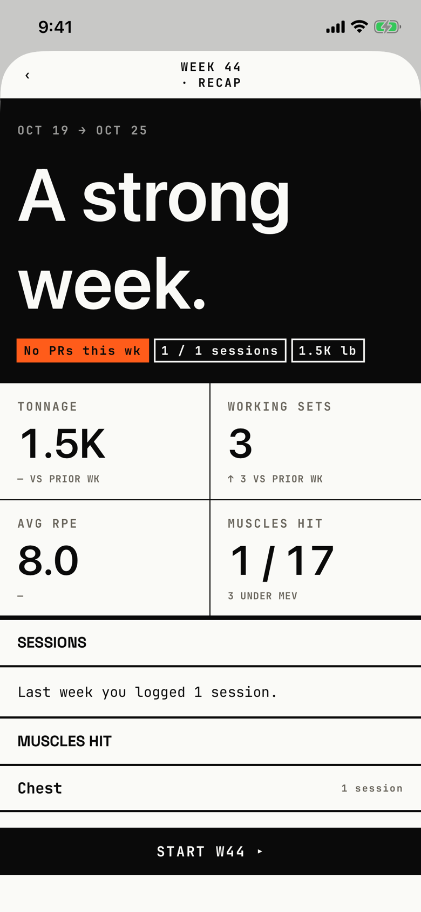

The lifter reads how last week went: tonnage, working sets, effort, muscles hit and muscles under target.
The header names the week, such as "Week 44 · recap".

## Entry points

| From | Tap | Kind |
|---|---|---|
| [today](today.md) | nothing; it opens on its own on the first visit to Today in a new week, after any block review closes | sheet |

## Exits

| Control | Goes to | Kind | Closes with |
|---|---|---|---|
| ‹ (header, left) | [today](today.md) | sheet | back |
| Start W44 ▸ (footer) | [today](today.md) | sheet | verb |

Both controls only close the sheet.

## States

| State | How to reach it | Screenshot |
|---|---|---|
| One workout last week | main tour, ended-block-recap seed, close the block review | [main](img/17e-default-light-weekly-recap.png) |
| Scrolled to Progress and notes | W07, scroll down | [lower](img/17e-default-light-weekly-recap--lower.png) |
| A workout with no sets in the week | W07, recap-with-empty seed | [with-empty](img/17e-default-light-weekly-recap--with-empty.png) |
| Records broken | not captured: no seed sets a record in the previous week | none |
| AX3 | Same as the main state at AX3; on both phones the title sits on its own line above the "‹", the hero chips break inside words ("1 / 1 sessio / ns") and wrap to uneven heights, and the stat cells stay two across with their labels wrapping, so values and rules no longer line up across the columns | [ax3](img/17e-ax3-light-weekly-recap.png), [Pro Max AX3](img/17promax-ax3-light-weekly-recap.png) |
| Pro Max, every state | Same as each state above, on the Pro Max; the title "WEEK 44 · RECAP" fits one line, and the main state shows UNDER-TRAINED above START W44 | [Pro Max](img/17promax-default-light-weekly-recap.png), [Pro Max lower](img/17promax-default-light-weekly-recap--lower.png), [Pro Max with-empty](img/17promax-default-light-weekly-recap--with-empty.png) |

Dark mode changes only colour: [dark](img/17e-default-dark-weekly-recap.png).

## Compared with the mock-up

| In the mock-up | In the app | Difference |
|---|---|---|
| Header "WEEK 3 · RECAP" on one line with SHARE on the right | "WEEK 44 / · RECAP" wraps to two lines; no SHARE | No share action; the title wraps |
| Hero "A STRONG WEEK." with "MAY 15 → MAY 21 · INTENSIFICATION" | Same hero line with dates only | The app drops the phase name from the hero line |
| Chips "★ 3 PRS", "4 / 4 SESSIONS", "21,510 LB" | "No PRs this wk" filled orange, "1 / 1 sessions", "1.5K lb" | The empty PR chip keeps the orange fill |
| AVG RPE "8.2" with "TARGET 8.5" | "8.0" with "-" | No target under the RPE |
| MUSCLES HIT "8 / 11" | "1 / 17" | The app counts all 17 muscles |
| RECORDS BROKEN then UNDER-TRAINED | Sessions, Muscles Hit, Records broken, Under-Trained, Progress, notes | The app adds Sessions, Muscles Hit and Progress sections |
| No footer button | "Start W44 ▸" footer button | Added in the app |

## VoiceOver order

1. "Back" (button)
2. "Week 44 · recap"
3. "OCT 19 → OCT 25"
4. "No PRs this wk"
5. "1 / 1 sessions"
6. "TONNAGE", "1.5K", "- VS PRIOR WK"
7. "AVG RPE", "8.0", "-"
8. "Last week you logged 1 session."

Gaps: each metric cell is read as three loose texts, not one element.
The "-" under AVG RPE is read out as a dash with nothing to say.
The section heads are read as plain text, not headings.

## Findings

- Major: [D-27](../audit.md#d-27).
- Minor: [D-34](../audit.md#d-34), [D-176](../audit.md#d-176), [D-177](../audit.md#d-177), [D-178](../audit.md#d-178), [D-179](../audit.md#d-179).
- Polish: [D-354](../audit.md#d-354), [D-355](../audit.md#d-355), [D-356](../audit.md#d-356), [D-357](../audit.md#d-357), [D-358](../audit.md#d-358).
