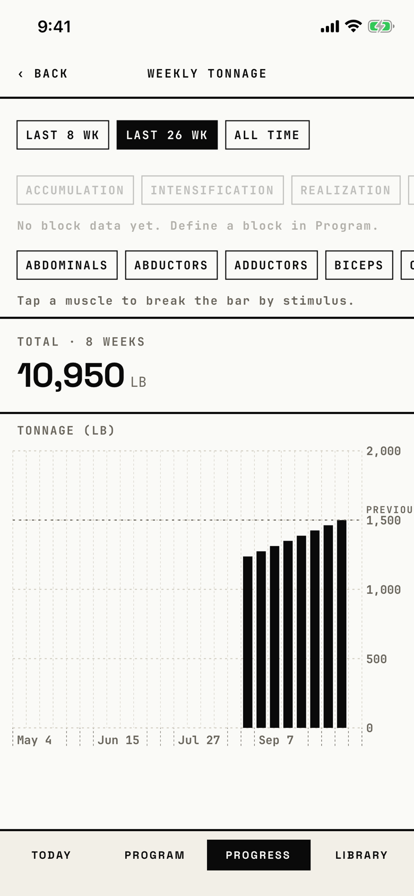

The lifter reads the total weight moved each week, filtered by range and muscle, and taps a bar to open that week.

## Entry points

| From | Tap | Kind |
|---|---|---|
| [progress](progress.md) | Weekly Tonnage | push |

## Exits

| Control | Goes to | Kind | Closes with |
|---|---|---|---|
| ‹ BACK | [progress](progress.md) | push | back |
| A bar, or any week slot of the chart | [week-detail](week-detail.md) | push | back |
| LAST 8 WK, LAST 26 WK and ALL TIME; the muscle chips | this screen, refiltered | none | none |

## States

| State | How to reach it | Screenshot |
|---|---|---|
| Last 26 weeks, eight weekly workouts | W14 seed, Progress > Weekly Tonnage | [main](img/17e-default-light-weekly-tonnage.png) |
| All time | the ALL TIME chip: the axis starts at the oldest week | [all-time](img/17e-default-light-weekly-tonnage--all-time.png) |
| A tap on a disabled phase chip | LAST 26 WK, then Accumulation: nothing happens, and the caption "No block data yet. Define a block in Program." stays, so it matches the main state | [block-phase-empty](img/17e-default-light-weekly-tonnage--block-phase-empty.png) |
| Last 8 weeks | the LAST 8 WK chip: seven bars and this week's empty slot | [last-8-wk](img/17e-default-light-weekly-tonnage--last-8-wk.png) |
| One muscle | the CHEST chip: the bars turn system blue with a "Chest" legend, and the muscle caption hides | [muscle](img/17e-default-light-weekly-tonnage--muscle.png) |
| One week | W03 demo seed: one bar, "TOTAL · 1 WEEK", no previous-best line | [one-week](img/17e-default-light-weekly-tonnage--one-week.png) |
| AX3 | On both phones the header stacks, the chip rows grow, the range row runs off screen, and the chart starts at the bottom of the first screen; on the Pro Max its top edge shows, with axis labels at AX3 size and "PREVIOU" running into "1,500" | [ax3](img/17e-ax3-light-weekly-tonnage.png), [Pro Max, AX3](img/17promax-ax3-light-weekly-tonnage.png) |
| A phase chip on | not captured: the phase chips are enabled only when a block exists, and the tonnage seed makes none; even then they filter nothing | none |
| Empty | not captured: "Not enough data" and "Log one week of training to see tonnage." need a range with no sets | none |

Dark mode and the Pro Max at default text change only colour and size; in dark mode the bars turn paper-white: [dark](img/17e-default-dark-weekly-tonnage.png), [Pro Max](img/17promax-default-light-weekly-tonnage.png).

## Compared with the mock-up

No mock-up was drawn for this screen; the May mock-up `phase-2--history.png` shows only the eight-bar tonnage card on History.

## VoiceOver order

1. "Back" (button)
2. "Weekly Tonnage" (header)
3. "Last 8 weeks", value "hidden"; "Last 26 weeks", value "selected"; "All time" (buttons)
4. "Accumulation" and the other phases (dimmed buttons), then their caption
5. "Abdominals" and the other muscles (buttons), then "Tap a muscle to break the bar by stimulus."
6. "TOTAL · 8 WEEKS", "10,950", "LB"
7. "TONNAGE (LB)"
8. "Week of Aug 31, 2026", value "1,238 lb" (button), then each week

Gaps: chips read "hidden" when not selected; the chips are 26.7 pt tall, under 44 pt; the total and its unit are read apart; each week button is 12.7 pt wide in this range.

## Findings

- Major: [D-28](../audit.md#d-28).
- Minor: [D-175](../audit.md#d-175), [D-180](../audit.md#d-180), [D-181](../audit.md#d-181), [D-182](../audit.md#d-182), [D-183](../audit.md#d-183), [D-184](../audit.md#d-184), [D-185](../audit.md#d-185), [D-186](../audit.md#d-186).
- Polish: [D-359](../audit.md#d-359).
