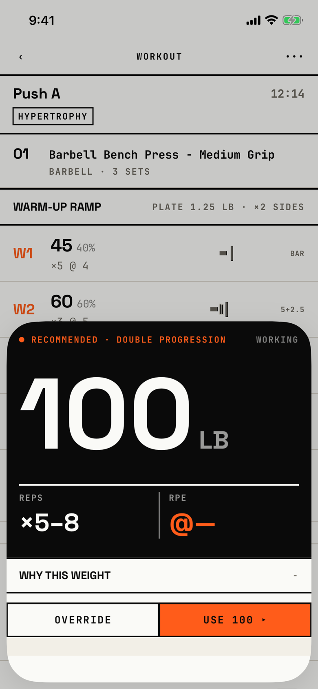

The lifter sees the weight the app recommends for a set and how it got there, then uses it or types their own.

## Entry points

| From | Tap | Kind |
|---|---|---|
| [logger](logger.md) | WHY (Why this weight) under a working set | sheet |

## Exits

| Control | Goes to | Kind | Closes with |
|---|---|---|---|
| USE 100 ▸ | [logger](logger.md), with the recommended weight put in the set | sheet | verb |
| OVERRIDE | [logger](logger.md), with the weight field focused for typing | sheet | verb |
| A swipe down | [logger](logger.md), with nothing changed | sheet | none |

The sheet has no header and no close button.
It opens at half height only and cannot be dragged taller (`fitbod/Sessions/PrescriptionWeightCell.swift:197`).
A black hero slab shows "● RECOMMENDED · DOUBLE PROGRESSION", the set type, the weight at about 150 pt, then REPS and RPE.
Below it, a "WHY THIS WEIGHT" head with a "−" at the right leads to three numbered steps: 01 Last session, 02 the progression rule, 03 Rounded to plate.
At half height the steps sit under the OVERRIDE and USE footer, so the lifter sees the head and must scroll inside the sheet to read why.

## States

| State | How to reach it | Screenshot |
|---|---|---|
| Double progression | W03 demo: Today, RESUME, WHY on set 1; RPE reads "@" and a long dash, because this rule sets no RPE | [main](img/17e-default-light-why-this-weight.png) |
| RPE autoregulation | W05 calibrating: WHY on set 1; the head reads "RPE AUTOREGULATION" and RPE reads "@8" in signal red | [calibrating](img/17e-default-light-why-this-weight--calibrating.png) |
| No earlier data | Not captured: step 01 reads "No prior data - starting fresh." and the weight may be a prompt to choose a start | - |
| Recommended weight of 0 | Not captured: no seed recommends 0 | - |
| AX3 | The hero weight is clipped to "10" at the right edge, and the footer and slab fill the half sheet | [ax3](img/17e-ax3-light-why-this-weight.png) |
| Pro Max | Same as the main state; the taller half sheet shows the head of step 01, "LAST SESSION" and its first line, with the next line cut by the OVERRIDE and USE footer, where the 17e shows no step at all | [Pro Max](img/17promax-default-light-why-this-weight.png), [Pro Max calibrating](img/17promax-default-light-why-this-weight--calibrating.png) |
| Pro Max, AX3 | Same as the main state; the hero "100 LB" fits whole, but the slab's head wraps over three lines, so the hero, the footer and the slab fill the sheet and REPS, RPE and the steps sit below the fold | [Pro Max ax3](img/17promax-ax3-light-why-this-weight.png) |

Dark mode changes only colour: [dark](img/17e-default-dark-why-this-weight.png).

## Compared with the mock-up

| In the mock-up | In the app | Difference |
|---|---|---|
| A header "‹ PUSH A / BENCH · SET 5 / EDIT" | No header; the sheet starts at the hero slab | The set and exercise are not named |
| The three explanation steps are in view under the hero | The steps are below the half-height fold | The reason is hidden on open |
| The weight hero with a calibrating card and the warm-up ramp below | The hero only; calibrating shows only in the head's rule name | No calibrating card or ramp |
| OVERRIDE and a signal USE ▸ footer | The same | Matches |

## VoiceOver order

1. Recommended weight 100 lb, reps 5 to 8, RPE not applicable, Working
2. Why this weight
3. −
4. 01, Last session, 100 lb × 5 @ RPE 8.0 (Oct 28), You had ~2 reps in reserve.
5. 02, Double progression, Weight holds.
6. 03, Rounded to plate 2.5 lb, 100
7. Override
8. Use 100 ▸

Gaps:

- The "−" at the right of the section head is static text read as "minus"; it does not collapse anything (`fitbod/Sessions/WhyThisWeightSheet.swift:120`).
- The section head has no header trait in the tree.
- Use 100 ▸ is read with the arrow glyph.

## Findings

- Major: [D-29](../audit.md#d-29), [D-30](../audit.md#d-30).
- Polish: [D-360](../audit.md#d-360), [D-361](../audit.md#d-361).
