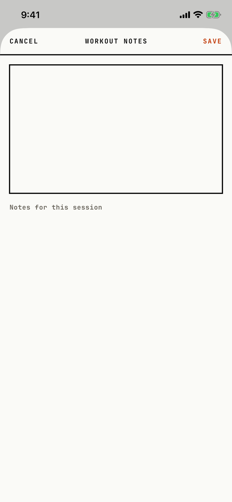

The lifter writes a note about the whole workout.

## Entry points

| From | Tap | Kind |
|---|---|---|
| [dialog-workout-menu](dialog-workout-menu.md) | Workout notes | sheet |

## Exits

| Control | Goes to | Kind | Closes with |
|---|---|---|---|
| CANCEL | [logger](logger.md), with any typed text thrown away and no question asked | sheet | cancel |
| SAVE | [logger](logger.md), with the note saved on the workout | sheet | verb |
| A swipe down | [logger](logger.md), with any typed text thrown away, as CANCEL | sheet | cancel |

The sheet is full height: a CANCEL, title, SAVE header, a ruled text box, and a muted hint under the box that reads "Notes for this session".
SAVE stores empty text as no note.

## States

| State | How to reach it | Screenshot |
|---|---|---|
| Empty | W03 demo: Today, RESUME, •••, Workout notes | [main](img/17e-default-light-workout-notes.png) |
| With a note | Not captured: the demo workout has no note | - |
| AX3 | On both phones the header puts the title above CANCEL and SAVE; the hint wraps to two lines under the box on the 17e, while on the Pro Max "Notes for this session" fits on one line | [ax3](img/17e-ax3-light-workout-notes.png), [Pro Max ax3](img/17promax-ax3-light-workout-notes.png) |

Dark mode and the Pro Max at default text change only colour and size: [dark](img/17e-default-dark-workout-notes.png), [Pro Max](img/17promax-default-light-workout-notes.png).

## Compared with the mock-up

No mock-up exists for this sheet.

## VoiceOver order

1. CANCEL
2. WORKOUT NOTES
3. SAVE
4. The text box
5. Notes for this session

Gaps:

- CANCEL, SAVE and the title are strings typed in capitals and are read as written.
- The hint under the box is a separate text, not the text box's label or placeholder, so VoiceOver reads the box with no name first.
- The header is drawn in a safe-area inset and comes last in the tree.

## Findings

<!-- findings are linked after the audit -->
