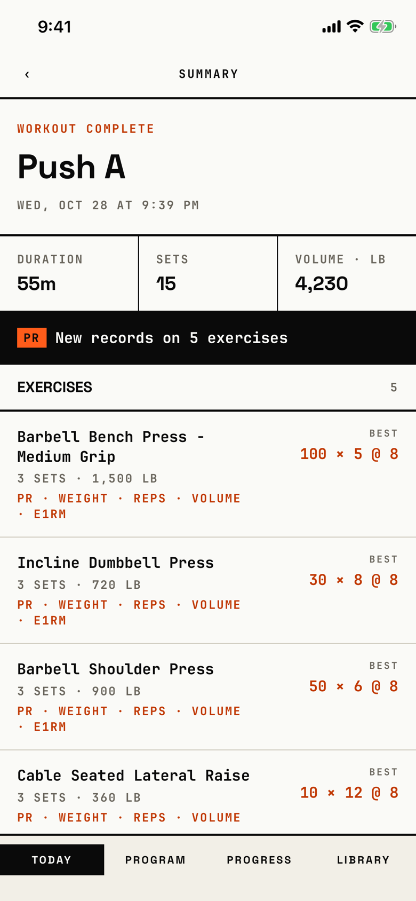

The lifter reviews one finished workout: duration, sets, volume, records and each exercise's best set.

## Entry points

| From | Tap | Kind |
|---|---|---|
| [history](history.md) | a workout row | push |
| [logger](logger.md) | Finish in the ••• menu, then confirm | cover |

## Exits

| Control | Goes to | Kind | Closes with |
|---|---|---|---|
| ‹ (header, left; when pushed) | [history](history.md) | push | back |
| DONE (bottom; after Finish) | [today](today.md) | cover | done |

Exercise rows are not tappable.

## States

| State | How to reach it | Screenshot |
|---|---|---|
| Pushed from History | main tour, demo seed, Today, SESSIONS, the row | [main](img/17e-default-light-workout-summary.png) |
| Right after Finish | W03a, demo seed, logger, ••• Finish: no "‹", DONE at the bottom | [after-finish](img/17e-default-light-workout-summary--after-finish.png) |
| Workout with no sets | W06, empty-between seed, History, the empty row | [empty](img/17e-default-light-workout-summary--empty.png) |
| Workout not found | not captured: only when the workout is deleted while open; shows "Workout not found" | none |
| AX3 | On both phones the header title sits above the "‹"; the date wraps; stats stack one per row | [ax3](img/17e-ax3-light-workout-summary.png), [Pro Max AX3](img/17promax-ax3-light-workout-summary.png) |
| Pro Max, every state | Same as each state above, on the Pro Max; exercise names and the record kinds ("PR · WEIGHT · REPS · VOLUME · E1RM") fit one line, so all five exercises show above the tab bar | [Pro Max](img/17promax-default-light-workout-summary.png), [Pro Max after-finish](img/17promax-default-light-workout-summary--after-finish.png), [Pro Max empty](img/17promax-default-light-workout-summary--empty.png) |

Dark mode changes only colour: [dark](img/17e-default-dark-workout-summary.png).

## Compared with the mock-up

No mock-up was drawn for the workout summary.

## VoiceOver order

1. "Back" (button)
2. "Summary"
3. "WORKOUT COMPLETE"
4. "Push A"
5. "Wed, Oct 28 at 9:39 PM"
6. "Duration", value "55m"
7. "New records on 5 exercises"
8. "Barbell Bench Press - Medium Grip, 3 sets · 1,500 lb, PR · Weight · Reps · Volume · e1RM, BEST, 100 × 5 @ 8"

Gaps: the back button is a bare "‹" glyph on screen.
Each exercise row is read once as a whole and again as its parts.
The "PR" badge before the records line is read as its own text.

## Findings

- Blocker: [D-04](../audit.md#d-04).
- Minor: [D-188](../audit.md#d-188).
- Polish: [D-363](../audit.md#d-363), [D-364](../audit.md#d-364), [D-365](../audit.md#d-365).
