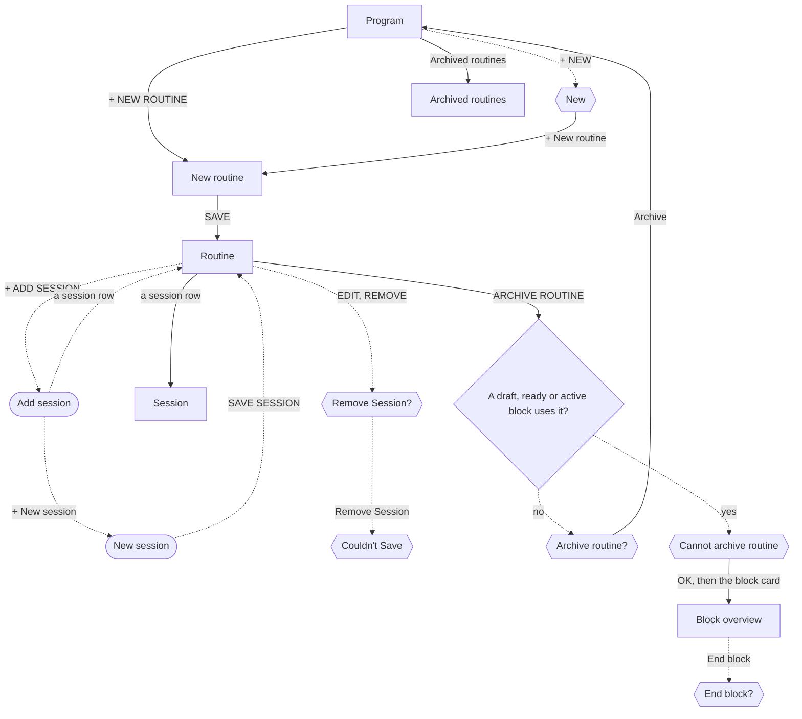

# Build a routine

The lifter builds a routine so that a block can run its sessions in a fixed rotation, and Today can say which session is next.

## Steps

1. On [Program](../screens/program.md), the lifter taps + NEW ROUTINE under ROUTINES, or + NEW in the header and then + New routine in [the New menu](../screens/dialog-program-new.md).
2. On [New routine](../screens/new-routine.md), the keyboard is already up; they type a name such as "Upper Lower" and tap SAVE.
   SAVE stays disabled until the name has a letter in it.
3. [Routine](../screens/routine-editor.md) replaces the name screen and shows "NO SESSIONS YET" with + ADD SESSION.
4. They tap + ADD SESSION, which opens [Add session](../screens/slot-picker.md) at half height.
5. In [Add session](../screens/slot-picker.md), they tap a saved session under EXISTING SESSIONS (its row reads "+ ADD"), and the sheet closes with the session added at the end; or they tap + New session and build one in [New session](../screens/session-editor.md), which is the job in [Build a session and its prescription](build-a-session-and-its-prescription.md).
6. They repeat steps 4 and 5 for each session, one session per trip; the header line counts them, as in "3 SESSIONS · ROTATES IN ORDER".
7. To change the order, they tap EDIT in the header and use ▲ and ▼ on each row, then tap DONE; or, out of edit mode, they press and hold a row for a quarter second and drag it.
   Each move saves at once.
8. To rename the routine, they tap the name and type; the name saves when the field loses focus.
9. A tap on a session row opens [Session](../screens/session-template-detail.md), where EDIT opens the session editor; ‹ BACK returns to the routine.

**Removing a session**

1. On [Routine](../screens/routine-editor.md), the lifter taps EDIT, then REMOVE on the session's row.
2. [Remove Session?](../screens/dialog-remove-session.md) opens; they tap Remove Session.
3. The row disappears and the count drops, but [Couldn't Save](../screens/dialog-couldnt-save.md) shows at once; they tap OK.
4. The store still holds the session in the routine, so after a relaunch the row is back, and Today's rotation and Program's count still include it.
5. Until the relaunch every later save fails too: a reorder, a rename, ARCHIVE ROUTINE, a new routine's SAVE, and SAVE SESSION in the session editor.

**Archiving the routine**

1. At the foot of [Routine](../screens/routine-editor.md), the lifter taps ARCHIVE ROUTINE.
2. When no draft, ready or active block uses the routine, [Archive routine?](../screens/dialog-archive-routine.md) opens; Archive closes the routine screen and returns to [Program](../screens/program.md), where an Archived routines row now shows under ROUTINES.
3. When a block still uses it, [Cannot archive routine](../screens/dialog-cannot-archive-routine.md) shows with only OK.
4. To bring the routine back, they tap Archived routines on [Program](../screens/program.md), then RESTORE on its row in [Archived routines](../screens/archived-routines.md).

**Starting from Today**

1. When Today shows "No workout scheduled", its + NEW ROUTINE opens the same [New routine](../screens/new-routine.md), and the rest of the job is the same inside the Today tab.

## Flow

## Tap count

| Path | Taps | Taps in order |
|---|---|---|
| Fewest: a routine with one saved session | 5 | + NEW ROUTINE, name field, SAVE, + ADD SESSION, session row |
| Typical: three saved sessions, the last moved up one place | 12 | + NEW ROUTINE, name field, SAVE, + ADD SESSION, Push, + ADD SESSION, Legs, + ADD SESSION, Pull, EDIT, ▲ on Pull, DONE |
| Through the New menu | 6 | + NEW, + New routine, name field, SAVE, + ADD SESSION, session row |
| Remove a session (fails) | 4 | EDIT, REMOVE, Remove Session, OK on Couldn't Save |
| Archive, from the routine screen | 2 | ARCHIVE ROUTINE, Archive |
| Restore, from Program | 2 | Archived routines, RESTORE |

## Dead ends

- Remove Session never works: the save fails, [Couldn't Save](../screens/dialog-couldnt-save.md) shows, and the session stays in the routine although the screen shows it gone ([dialog-remove-session](../screens/dialog-remove-session.md), [image](../screens/img/17e-default-light-dialog-couldnt-save.png), `fitbod/Periodization/SplitDetailView.swift:503`).
  The lifter cannot take a dropped session out of a routine at all.
- After that failure, every other save in the job fails until a relaunch, so the lifter also cannot reorder, rename or archive the routine, and a session added in [Add session](../screens/slot-picker.md) looks added but is gone after the relaunch (`fitbod/Periodization/SplitDetailView.swift:877`).
- Because the session never leaves the routine, archiving the session from its editor always shows "Session is in use", so a dropped session cannot be archived either ([dialog-session-in-use](../screens/dialog-session-in-use.md)).
- [Cannot archive routine](../screens/dialog-cannot-archive-routine.md) tells the lifter to end or complete the block, but a draft or ready block cannot be ended, and the alert offers only OK.

## Detours

- To take a session out of rotation, the only working route is to build a new routine without it and use that routine for the next block, then archive the old one once its block has ended, after a relaunch if Remove Session was tried first.
- To archive a routine an active block uses, the lifter must leave the routine, open the block on [Program](../screens/program.md), end it in [Block overview](../screens/block-overview.md) with [End block?](../screens/dialog-end-block.md), and come back.
- A draft or ready block that uses the routine must be deleted or given another routine in New Block before the archive works; nothing on the alert says so.
- To see what an archived routine holds before restoring it, the lifter must restore it, because a row in [Archived routines](../screens/archived-routines.md) cannot be opened.

## No clear way back

- [The New menu](../screens/dialog-program-new.md) has no Cancel; only a tap on the scrim closes it.
- [New routine](../screens/new-routine.md): ‹ BACK drops the typed name with no question.
- After a failed Remove Session, ‹ BACK leaves [Routine](../screens/routine-editor.md) showing a list the store does not hold, and nothing on the screen says the session is still there.
- Archive closes the routine screen at once; the way back is the Archived routines row on [Program](../screens/program.md), which the dialog's message names.

## Findings

- Blocker: [D-01](../audit.md#d-01), [D-02](../audit.md#d-02).
- Major: [D-20](../audit.md#d-20).
- Minor: [D-54](../audit.md#d-54).
