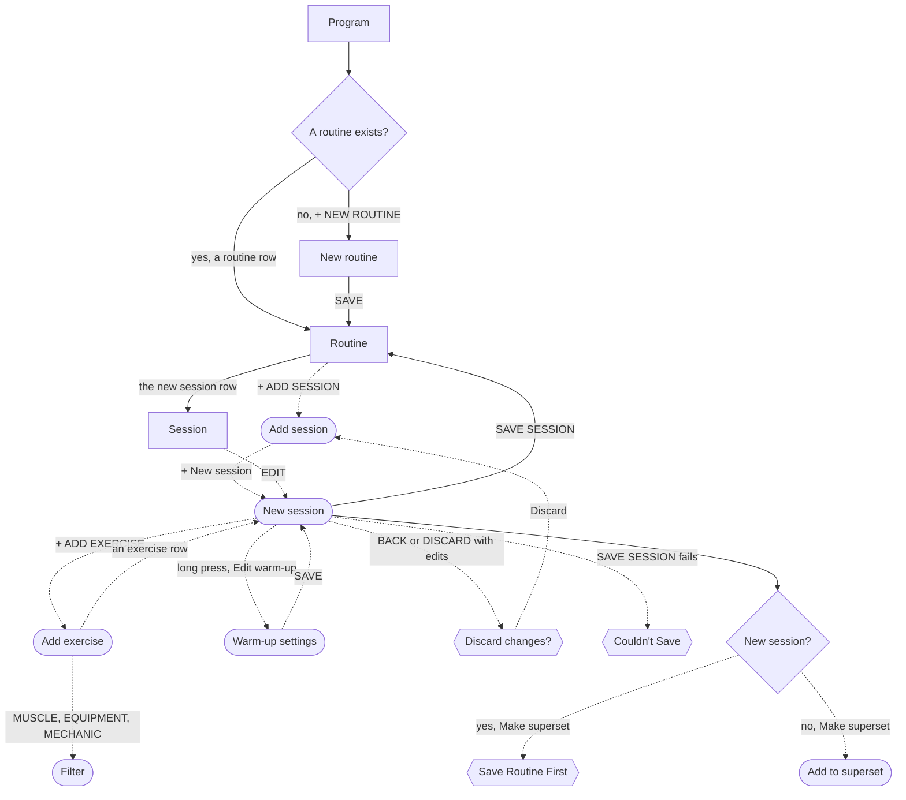

# Build a session and its prescription

The lifter writes the plan for one workout once, so every workout started from it arrives with its exercises, sets, reps, RPE and progression already set.

The job starts on [Program](../screens/program.md) and goes through a routine, because a new session can only be made from a routine's Add session sheet.
The session editor opens for a new session only from [Add session](../screens/slot-picker.md) (+ New session); its other entry, EDIT on a saved [Session](../screens/session-template-detail.md), edits a session that already exists.
Today reaches the same routine screen only through its "No workout scheduled" and fix-it actions, so Program is the start the lifter meets most often.

## Steps

1. On [Program](../screens/program.md), the lifter taps a routine row under ROUTINES, such as "Push Pull Legs".
2. On [Routine](../screens/routine-editor.md), they tap + ADD SESSION, either in the Sessions head or in the empty state.
3. In [Add session](../screens/slot-picker.md), they tap + New session.
4. In [New session](../screens/session-editor.md), they type a name such as "Push A" in the name field.
5. Still in [New session](../screens/session-editor.md), they may tap the intent chip (STRENGTH by default) and pick Strength, Hypertrophy, Power, Endurance or Technique from the menu.
6. They may tap the progression chip (DOUBLE PROGRESSION by default) and pick RPE Autoregulation or Double Progression; the menu offers only these two.
7. They tap + ADD EXERCISE ↘ FROM LIBRARY, which opens [Add exercise](../screens/library-picker.md).
8. In [Add exercise](../screens/library-picker.md), they search or use the MUSCLE, EQUIPMENT and MECHANIC chips ([filter-picker](../screens/filter-picker.md)), then tap an exercise row; the sheet closes and the exercise joins the session, folded, with a default prescription such as 3×4-6 at RPE 8 and 3:00 rest.
9. They repeat steps 7 and 8 for each exercise, one exercise per trip.
10. Back in [New session](../screens/session-editor.md), they tap an exercise's name to unfold it, then EDIT PRESCRIPTION.
11. They set Sets, Min reps and Max reps with the steppers, tap a Target RPE chip (6 to 10, or NO TARGET), and set Rest; Track tempo and Track partial reps are switches below.
12. The Auto warm-up switch in the same section is on by default, so a warm-up ramp is generated without any tap.
13. They may reorder exercises with each exercise's MOVE chip (Move up, Move down).
14. They tap SAVE SESSION ▸.
    The editor and the Add session sheet both close, and [Routine](../screens/routine-editor.md) shows the new session as the last row.

**No routine exists yet**

1. On [Program](../screens/program.md), the lifter taps + NEW ROUTINE.
2. On [New routine](../screens/new-routine.md), they type a name and tap SAVE, which opens [Routine](../screens/routine-editor.md) with "NO SESSIONS YET".
3. They continue at step 2 with the empty state's + ADD SESSION.

**Changing the warm-up for one exercise**

1. In [New session](../screens/session-editor.md), the lifter turns Auto warm-up off in EDIT PRESCRIPTION.
2. Or they long-press the exercise's title row, tap Edit warm-up…, and in [Warm-up settings](../screens/warmup-config.md) set Auto warm-up and "Skip warm-ups this session only", then tap SAVE.
   The change stays in the editor's draft until SAVE SESSION ▸.

**Making a superset**

1. In a new session, a long press on an exercise's title row and Make superset (or Move to superset…) shows [Save Routine First](../screens/dialog-save-routine-first.md), whose only button is OK.
2. The lifter taps SAVE SESSION ▸ and lands on [Routine](../screens/routine-editor.md).
3. They tap the new session's row, which opens [Session](../screens/session-template-detail.md), and tap EDIT to open [Edit session](../screens/session-editor.md).
4. They long-press the first exercise, tap Make superset, and tap + NEW SUPERSET in [Add to superset](../screens/superset-assignment.md).
5. They long-press the second exercise, tap Move to superset…, and tap the superset's row.
6. They tap SAVE SESSION ▸, which returns them to [Session](../screens/session-template-detail.md), not to the routine.

**Leaving without saving**

1. ‹ BACK or DISCARD with edits opens [Discard changes?](../screens/dialog-discard-changes-session.md); Discard drops the whole draft, and Keep editing returns to the editor.
2. The lifter is back in [Add session](../screens/slot-picker.md), and nothing joins the routine.

**A save fails**

1. SAVE SESSION ▸ shows [Couldn't save](../screens/dialog-couldnt-save.md) with the system's error text, and the editor stays open.
2. This happens every time after a Remove Session earlier in the same launch, until the app is relaunched.

## Flow

## Tap count

| Path | Taps | Taps in order |
|---|---|---|
| Fewest: a routine exists, one exercise, defaults kept | 7 | routine row, + ADD SESSION, + New session, name field, + ADD EXERCISE, exercise row, SAVE SESSION ▸ |
| Typical: one exercise found by search and fully prescribed | 17 | routine row, + ADD SESSION, + New session, name field, intent chip, Hypertrophy, progression chip, RPE Autoregulation, + ADD EXERCISE, search field, exercise row, exercise name, EDIT PRESCRIPTION, Sets +, Max reps +, Target RPE 8, SAVE SESSION ▸ |
| No routine yet | 9 | + NEW ROUTINE, name field, SAVE, + ADD SESSION, + New session, name field, + ADD EXERCISE, exercise row, SAVE SESSION ▸ |
| Each further exercise, prescribed | 7 | + ADD EXERCISE, exercise row, exercise name, EDIT PRESCRIPTION, Sets +, Max reps +, Target RPE chip |
| Superset of two exercises, after the first save | 9 | session row, EDIT, long press, Make superset, + NEW SUPERSET, long press, Move to superset…, superset row, SAVE SESSION ▸ |

A six-exercise session fully prescribed takes about 17 + 5 × 7 = 52 taps, because each exercise needs its own trip to the library and its own unfold.

## Dead ends

- In a new session, Make superset and Move to superset… open [Save Routine First](../screens/dialog-save-routine-first.md), which has only OK, so the superset cannot be made until the session is saved and reopened (`fitbod/Routines/RoutineBuilderView.swift:630`).
- The progression menu offers only RPE Autoregulation and Double Progression; Block Periodized and Hybrid need a session-to-block link that no screen sets, so the lifter cannot pick them ([session-editor](../screens/session-editor.md), `fitbod/Routines/RoutineDraft.swift:158`, `fitbod/Routines/RoutineDraft.swift:126`).
- There is no per-set intent: every set row reads WORK, so the lifter cannot mark a top set or a back-off set, which the mock-up draws ([session-editor](../screens/session-editor.md), [prescription image](../screens/img/17e-default-light-session-editor--prescription.png)).
- Per-set overrides in EDIT PRESCRIPTION accept reps and RPE for one set, but no workout uses them (T110, `fitbod/Routines/PrescriptionEditorRow.swift:295`).
- At AX3 on the 390 pt phone, scrolling the prescription hangs the editor, so the session cannot be prescribed at that size (T115).
- After a Remove Session earlier in the same launch, SAVE SESSION ▸ fails with [Couldn't save](../screens/dialog-couldnt-save.md) every time, until a relaunch, and the draft is lost with the relaunch (`fitbod/Routines/RoutineBuilderView.swift:572`).

## Detours

- With no routine, the lifter must first make one on [New routine](../screens/new-routine.md), because a new session can only be started from a routine.
- A superset needs a save, a trip through [Routine](../screens/routine-editor.md) and [Session](../screens/session-template-detail.md), and EDIT to reopen the editor; the detour costs 3 wasted taps on the alert and 9 more taps.
- Pairing two exercises takes two trips to [Add to superset](../screens/superset-assignment.md): one exercise makes the superset, and the second joins it.

## No clear way back

- [New session](../screens/session-editor.md): ‹ BACK and DISCARD with edits drop the whole draft after [Discard changes?](../screens/dialog-discard-changes-session.md); there is no way to keep a half-built session as a draft.
- After SAVE SESSION ▸ the editor and [Add session](../screens/slot-picker.md) both close, so the lifter who wanted to keep editing (for example to make a superset) must reopen the session through its row and EDIT.
- [Add to superset](../screens/superset-assignment.md): + NEW SUPERSET saves the superset at once, so a later Discard of the session leaves an empty superset behind.

## Findings

- Blocker: [D-02](../audit.md#d-02).
- Major: [D-17](../audit.md#d-17), [D-18](../audit.md#d-18).
- Minor: [D-85](../audit.md#d-85), [D-140](../audit.md#d-140), [D-142](../audit.md#d-142).
- Polish: [D-323](../audit.md#d-323).
