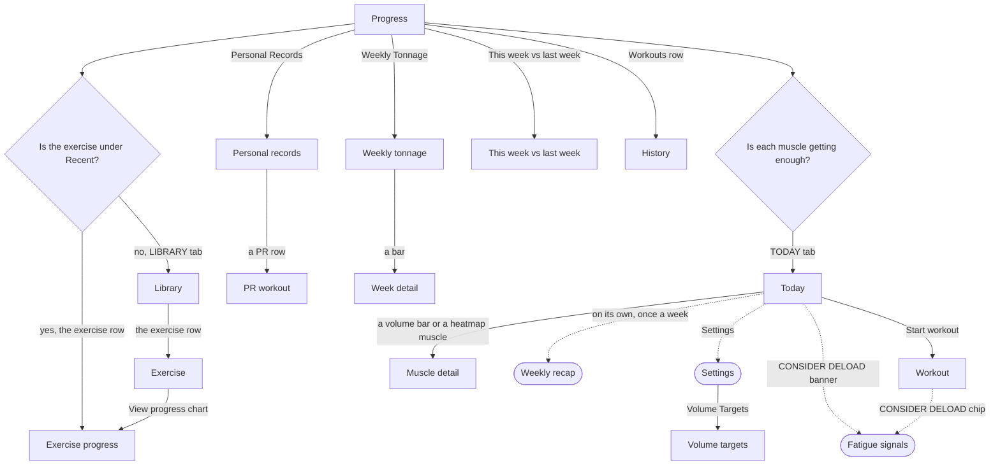

# Check whether I am getting stronger and doing enough

The lifter looks back over recent training to decide whether to push on, add volume or back off.

No single screen answers both halves of the question.
[Exercise progress](../screens/exercise-progress.md) answers "am I getting stronger" best, because it charts one lift's e1RM, top set, volume and effort over time, so it is the end of this job.
[Muscle detail](../screens/per-muscle-detail.md) answers "am I doing enough" for one muscle this week.
The [weekly recap](../screens/weekly-recap.md) is the only screen that covers both, but it shows itself once a week and cannot be opened again.

## Steps

1. On [Progress](../screens/progress.md), the lifter taps an exercise row under Recent.
2. On [Exercise progress](../screens/exercise-progress.md), they read the e1RM trend and switch the E1RM, TOP SET, VOLUME and AVG RPE chips; ‹ returns to Progress.
3. On [Progress](../screens/progress.md), they tap Personal Records.
4. On [Personal records](../screens/prs.md), they pick STRENGTH, HYPERTROPHY or ALL and read the best sets; a tap on a row opens the [PR workout](../screens/pr-session.md) placeholder, which shows only a date and has no back control, so they swipe from the left edge to return.
5. Back on [Progress](../screens/progress.md), they tap Weekly Tonnage.
6. On [Weekly tonnage](../screens/weekly-tonnage.md), they pick LAST 8 WK, LAST 26 WK or ALL TIME and a muscle chip, then tap a bar.
7. On [Week detail](../screens/week-detail.md), they read the week's total and its workouts; the rows draw "›" but open nothing, so ‹ BACK twice returns to Progress.
8. On [Progress](../screens/progress.md), they tap This week vs last week to read [the comparison](../screens/compare.md) of the newest workout's top sets with the same session's earlier workout, and can tap the Workouts row to read the per-week count on [History](../screens/history.md).
9. For muscle volume, they tap the TODAY tab and scroll past the workout card to Volume This Week on [Today](../screens/today.md), where each muscle's working sets sit on a bar marked MEV, MAV and MRV, with the body heatmap below.
10. They tap a volume bar or a heatmap muscle to open [Muscle detail](../screens/per-muscle-detail.md), which shows this week's sets, the change from last week, the contributing exercises, and Edit volume targets in place.

**The exercise is not under Recent** (Recent lists the ten most recently trained exercises, and Progress has no search):

1. The lifter taps the LIBRARY tab and searches on [Library](../screens/library.md).
2. They tap the exercise row to open [Exercise](../screens/exercise-detail.md).
3. They tap View progress chart ›, which shows only when a set is logged, to reach [Exercise progress](../screens/exercise-progress.md).

**Tuning the targets for every muscle:**

1. On [Today](../screens/today.md), the lifter taps Settings in the header.
2. In [Settings](../screens/settings.md), they tap the Volume Targets row.
3. On [Volume targets](../screens/volume-targets.md), they tap a muscle row to open its target steppers.

**Looking for plateaus:**

1. No screen outside a workout lists stalled exercises; [Exercise progress](../screens/exercise-progress.md) does not mark a stall.
2. The lifter starts a workout from [Today](../screens/today.md) and looks for the STALLED badge on each exercise card in the [workout](../screens/logger.md).
3. When three finished workouts fire a fatigue signal, Today shows "▲ CONSIDER DELOAD", whose body opens [Fatigue signals](../screens/fatigue-signals.md); the logger's CONSIDER DELOAD chip opens the same sheet.

**A new week has started:**

1. On the first visit to [Today](../screens/today.md) in a new week, the [weekly recap](../screens/weekly-recap.md) opens on its own, after any block review.
2. It shows last week's tonnage, working sets, effort, records, muscles hit and muscles under target.
3. ‹ and Start W44 ▸ both close it, and nothing opens it again.

## Flow

## Tap count

| Path | Taps | Taps in order |
|---|---|---|
| Fewest: one recent exercise's trend | 1 | an exercise row under Recent |
| An exercise not under Recent | 4 | LIBRARY tab, search field (type the name), the exercise row, View progress chart › |
| A week's tonnage and its workouts | 2 | Weekly Tonnage, a bar |
| One muscle's volume against its targets | 2 | TODAY tab, a volume bar |
| The targets for every muscle | 4 | TODAY tab, Settings, Volume Targets row, a muscle row |
| Typical check: one lift, records, last week's tonnage, then one muscle | 10 | an exercise row under Recent, ‹, Personal Records, ‹, Weekly Tonnage, a bar, ‹ BACK, ‹ BACK, TODAY tab, a volume bar |

## Dead ends

- [PR workout](../screens/pr-session.md): a PR row opens a placeholder that names only the workout's date, so the lifter cannot see the workout a record came from (`fitbod/Progress/ExercisePRsView.swift:539`).
- [Week detail](../screens/week-detail.md): each workout row draws "›" but a tap opens nothing (T118, `fitbod/Progress/WeekDetailView.swift:139`).
- [Weekly tonnage](../screens/weekly-tonnage.md): the phase chips (Accumulation, Intensification, Realization, Deload) toggle but filter nothing, so the lifter cannot compare tonnage by block phase (`fitbod/Progress/WeeklyTonnageView.swift:105`).
- [Exercise progress](../screens/exercise-progress.md): the only exit is ‹, so the lifter cannot go on to that exercise's history or its records from the chart (`fitbod/Progress/ExerciseProgressView.swift:84`).
- [Personal records](../screens/prs.md): a per-exercise record list exists in the code but nothing opens it (`fitbod/Progress/ProgressHomeView.swift:235`).
- Plateaus: no screen outside a workout lists stalled exercises; the STALLED badge appears only on an exercise card in the [workout](../screens/logger.md) (`fitbod/Sessions/SessionExerciseCard.swift:196`).
- [Weekly recap](../screens/weekly-recap.md): once closed, it cannot be opened again (`fitbod/Views/TodayView.swift:610`).
- [Muscle detail](../screens/per-muscle-detail.md): "ADD A SET" is drawn like a button but does nothing on tap (`fitbod/Fatigue/PerMuscleDetailView.swift:81`).

## Detours

- An exercise outside the ten Recent rows: the lifter leaves Progress for the Library tab, searches, opens the exercise and taps View progress chart ›.
- Muscle volume: Progress has no muscle volume, so the lifter switches to the TODAY tab and scrolls past the block band and the workout card to Volume This Week.
- All volume targets: the full list lives in the Settings sheet, opened from Today's header, not from Progress or from the volume bars.
- Plateaus: the lifter must start a workout to see which exercises are stalled, which leaves a workout in progress that they then have to finish or discard on [Today](../screens/today.md).
- An exercise's history list: from [Exercise progress](../screens/exercise-progress.md), the lifter must switch to the Library tab, find the exercise and tap View all history ›.

## No clear way back

- [PR workout](../screens/pr-session.md): there is no back control; only an edge swipe from the left returns to Personal records.
- [Weekly recap](../screens/weekly-recap.md): both ‹ and Start W44 ▸ close the sheet for good, so the way back loses the recap until next week.
- [Workout](../screens/logger.md), when opened only to look for a STALLED badge: going back leaves a workout in progress on Today, and discarding it takes a further confirmation.

## Findings

<!-- findings are linked after the audit -->
