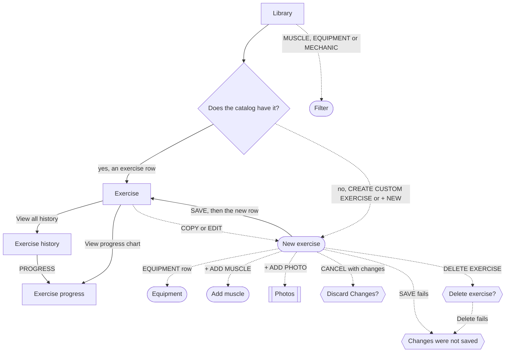

# Find and create exercises

The lifter keeps the catalog in shape so that each exercise progresses by the right step on the right bar, and adds the lifts the catalog does not have.

## Steps

1. On [Library](../screens/library.md), the lifter types a name in the search field, or taps the MUSCLE, EQUIPMENT or MECHANIC chip.
2. In [Filter](../screens/filter-picker.md), they tick one or more rows; the list behind updates at once, and DONE closes the sheet.
3. Back on [Library](../screens/library.md), the count reads "N MATCHES", and CLEAR FILTERS empties every filter; they tap an exercise row.
4. On [Exercise](../screens/exercise-detail.md), they read RECENT PERFORMANCE with its BEST SET, the muscles and the HOW TO steps.
5. They tap View all history › to read every logged workout of the exercise on [Exercise history](../screens/exercise-history.md), filter it by intent, and tap ‹ to return; PROGRESS in its header, or View progress chart › on the detail, opens [Exercise progress](../screens/exercise-progress.md).
6. Under PRESCRIPTION SETTINGS on [Exercise](../screens/exercise-detail.md), they type a SMALLEST INCREMENT and a BAR WEIGHT OVERRIDE on the number pad, and tap System default, kg or lb under WEIGHT UNIT.
7. Each value saves as it changes; there is no Save, and the number pad has no Done key, so they drag the page to close the keyboard.

**The catalog does not have the exercise:**

1. On [Library](../screens/library.md), a search that matches nothing shows CREATE CUSTOM EXERCISE, which opens [New exercise](../screens/custom-exercise.md) with the search text as the name; + NEW in the header opens it empty.
2. On [New exercise](../screens/custom-exercise.md), they type the name, tap the EQUIPMENT row and pick one row in [Equipment](../screens/equipment-picker.md), and set Compound or Isolation under MECHANIC.
3. They tap + ADD MUSCLE and pick a row in [Add muscle](../screens/muscle-picker.md); the first muscle becomes the primary and later ones are secondary, each with a weight box.
4. They tap + ADD PHOTO and pick a photo in [Photos](../screens/photos-picker.md), which closes on the pick.
5. The footer turns from "NEEDS A NAME AND A PRIMARY MUSCLE · CAN'T SAVE YET" to "VALID · 1 PRIMARY MAPPED · READY TO SAVE", and they tap SAVE.
6. The sheet closes onto [Library](../screens/library.md); from a no-match search the list now shows the new row, and from + NEW the lifter searches for it.
7. They tap the new row to open its [Exercise](../screens/exercise-detail.md) page, with a CUSTOM chip and EDIT in the header, and set its increment, bar weight and unit as above.

**Starting from a built-in exercise:**

1. On [Exercise](../screens/exercise-detail.md), COPY in the header or COPY AS CUSTOM EXERCISE at the bottom opens [New exercise](../screens/custom-exercise.md) with the built-in's name plus " (Copy)" and its muscles.
2. SAVE closes the sheet onto the built-in exercise, not the copy; the lifter goes back to the Library and searches for the copy.

**Editing or deleting a custom exercise:**

1. On a custom exercise's [Exercise](../screens/exercise-detail.md) page, EDIT opens "Edit exercise".
2. DELETE EXERCISE at the bottom opens [the delete alert](../screens/dialog-delete-exercise.md), whose Delete removes the exercise and closes the editor.

**Leaving or failing:**

1. CANCEL with changes opens [Discard Changes?](../screens/dialog-custom-exercise-discard.md); a swipe down is blocked while the form has changes.
2. A save or delete that fails shows [Changes were not saved](../screens/dialog-changes-not-saved.md), and the form keeps its values.

## Flow

## Tap count

| Path | Taps | Taps in order |
|---|---|---|
| Fewest: open an exercise from the list | 1 | an exercise row |
| Typical: search and open | 2 | search field (type the name), the exercise row |
| Filter by muscle and equipment, then open | 7 | MUSCLE, a muscle row, DONE, EQUIPMENT, an equipment row, DONE, the exercise row |
| Search, open and set increment, bar weight and unit | 5 | search field (type the name), the exercise row, SMALLEST INCREMENT (type), BAR WEIGHT OVERRIDE (type), kg or lb |
| Create from a search with no match, then open it | 6 | search field (type the name), CREATE CUSTOM EXERCISE, + ADD MUSCLE, a muscle row, SAVE, the new row |
| Create with + NEW, equipment and a photo, then open it | 11 | + NEW, name field (type), EQUIPMENT row, an equipment row, + ADD MUSCLE, a muscle row, + ADD PHOTO, a photo, SAVE, search field (type the name), the new row |

## Dead ends

- [Exercise](../screens/exercise-detail.md): a photo added in the editor never shows on the exercise's page, so the lifter cannot see the result of the photo step outside the editor (`fitbod/ExerciseLibrary/ExerciseDetailView.swift:80`).
- [Exercise history](../screens/exercise-history.md): the workout rows have no action, so the lifter cannot open the workout a row came from.
- [Library](../screens/library.md): a search and filters that together match nothing offer only CREATE CUSTOM EXERCISE, with no way to clear the filters from the empty state (`fitbod/ExerciseLibrary/EmptyLibraryView.swift:108`).
- [Add muscle](../screens/muscle-picker.md): a muscle already on the exercise is still listed, and a tap on it closes the sheet without adding anything or saying why.

## Detours

- After SAVE on a new exercise made with + NEW, the sheet closes onto the full list, so the lifter must search for the exercise they just made to set its increment.
- After SAVE on a copy, the sheet closes onto the built-in exercise, so the lifter must go back to the Library and search for "(Copy)".
- To reach an exercise's page from anywhere but the Library tab, such as from its chart on Progress, the lifter must switch to the Library tab and search; the exercise picker in a workout adds the exercise instead of opening it.

## No clear way back

- [Exercise](../screens/exercise-detail.md): the number pad for SMALLEST INCREMENT and BAR WEIGHT OVERRIDE has no Done key, and the tab bar hides while it is up, so the only way out of the field is a drag on the page.
- [Exercise](../screens/exercise-detail.md): the WEIGHT UNIT chips apply at once with no undo, and switching one relabels every logged number for the exercise without converting it.
- [New exercise](../screens/custom-exercise.md): a swipe down is blocked while the form has changes, so the only way out without saving is CANCEL and then Discard in [Discard Changes?](../screens/dialog-custom-exercise-discard.md).
- After Delete in [the delete alert](../screens/dialog-delete-exercise.md), the editor closes onto the page of the exercise that was just deleted, not onto the Library (from code: `fitbod/ExerciseLibrary/CustomExerciseEditor.swift:532`, `fitbod/ExerciseLibrary/ExerciseDetailView.swift:139`).

## Findings

<!-- findings are linked after the audit -->
