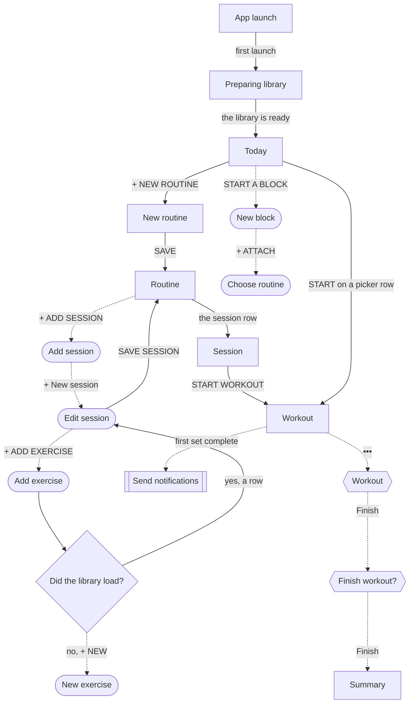

# Go from a fresh install to the first finished workout

A new lifter wants to log a real workout on the first day, and the app can only start a workout from a saved session inside a routine.

## Steps

1. The app opens on [Preparing library](../screens/preparing-library.md) while the exercise library is copied into the store.
   From the code, this is a centred spinner with "Preparing library…" and no tab bar (`fitbod/App/RootView.swift:151`); in practice the white launch screen stays up about 0.7 s and then Today appears, so the lifter never sees it.
2. [Today](../screens/today.md) shows zero in DAY STREAK, SESSIONS and THIS WEEK, then START A WORKOUT with "Build your first routine" and the orange + NEW ROUTINE button, then "No active block." with START A BLOCK.
   There is no way to start a workout here yet, because the picker lists only sessions that sit in a routine.
3. The lifter taps + NEW ROUTINE, which pushes [New routine](../screens/new-routine.md) with the keyboard up, types a name such as "Push Pull Legs" and taps SAVE.
4. [Routine](../screens/routine-editor.md) opens in the name step's place with no sessions; the lifter taps + ADD SESSION.
5. [Add session](../screens/slot-picker.md) opens at half height with only + New session, because no session exists; the lifter taps it.
6. [Edit session](../screens/session-editor.md) opens as "New session"; the lifter types a name in NAME THIS SESSION and taps + ADD EXERCISE ↘ FROM LIBRARY.
7. [Add exercise](../screens/library-picker.md) lists all 702 exercises from A to Z; the lifter taps a row, or searches first, and the sheet closes with the exercise added to the draft.
   The lifter can tap the exercise to open its prescription, or keep the defaults, and adds more exercises the same way.
8. Back in [Edit session](../screens/session-editor.md), the lifter taps SAVE SESSION ▸.
   The sheet and the picker close, and the session is now Session 1 of the routine.
9. On [Routine](../screens/routine-editor.md) the lifter taps the session row, which pushes [Session](../screens/session-template-detail.md) with "Not done yet", and taps START WORKOUT ▸.
   The other way is ‹ BACK to Today, where START A WORKOUT now lists the routine's sessions, and START ▸ on the row.
10. The [Workout](../screens/logger.md) logger opens with the tab bar hidden.
    On a first workout every working set starts at weight 0 with empty reps, and every PREVIOUS cell reads a dash.
11. The lifter types the weight and the reps in set S1 and taps the set square; it stays disabled until the reps are above zero and, for a loaded exercise, the weight is above zero.
12. The first completed set starts the rest dock, and iOS shows [Send notifications](../screens/notification-permission.md) over it once per install; the lifter taps Allow or Don't Allow.
    The first logged set of each exercise is also its first record, so the PR banner slides over the top.
13. The lifter logs the remaining sets the same way, then taps ••• and Finish in [Workout](../screens/dialog-workout-menu.md), and Finish again in [Finish workout?](../screens/dialog-finish-workout.md).
14. [Summary](../screens/workout-summary.md) opens as a full-screen cover with WORKOUT COMPLETE, the duration, sets, volume and the new records; DONE closes it and the logger.

**The library failed to load**

1. If seeding fails, the app still leaves the splash and shows the tabs, with no message.
2. [Add exercise](../screens/library-picker.md) then has nothing to pick, so the lifter must tap + NEW and make each exercise in [New exercise](../screens/custom-exercise.md) before the session can be saved.

**The lifter tries START A BLOCK first**

1. On [Today](../screens/today.md), START A BLOCK opens [New block](../screens/new-block.md) with "< TODAY".
2. + ATTACH ▸ opens [Choose routine](../screens/new-block-split-picker.md), which is a blank page on a fresh store, with no way to make a routine and no close button.
3. The lifter swipes the picker down and taps < TODAY or CANCEL to leave, and starts again with + NEW ROUTINE.

**The lifter leaves the session editor before saving**

1. ‹ BACK or DISCARD with a name or exercise typed opens [Discard changes?](../screens/dialog-discard-changes-session.md), which throws the draft away.
2. A failed save on New routine or Edit session shows [Couldn't save](../screens/dialog-couldnt-save.md).

## Flow

## Tap count

| Path | Taps | Taps in order |
|---|---|---|
| Fewest: one bodyweight set | 17 | + NEW ROUTINE, routine name, SAVE, + ADD SESSION, + New session, session name, + ADD EXERCISE ↘ FROM LIBRARY, the 3/4 Sit-Up row (the first row, bodyweight, so weight 0 is valid), SAVE SESSION ▸, the session row, START WORKOUT ▸, S1 reps, the set square, Allow, •••, Finish, Finish |
| Typical: one barbell lift, three sets | 25 | the same up to + ADD EXERCISE, then the search field, the Barbell Bench Press row, SAVE SESSION ▸, the session row, START WORKOUT ▸, S1 weight, S1 reps, the set square, Allow, S2 weight, S2 reps, the set square, S3 weight, S3 reps, the set square, •••, Finish, Finish |

The weight typed in S1 is not copied to S2 and S3 on a first workout, so the lifter types the same weight three times.
Going ‹ BACK to Today and tapping START ▸ on the picker row costs the same two taps as the session row and START WORKOUT ▸.

## Dead ends

- [Today](../screens/today.md) offers no workout at all on a fresh store: the START A WORKOUT section holds only "Build your first routine", so a lifter who wants to log right away must build a routine and a session first (`fitbod/Views/TodaySessionPicker.swift:107`, `screens/img/17e-default-light-today--empty.png`).
- START A BLOCK on [Today](../screens/today.md) leads to [Choose routine](../screens/new-block-split-picker.md), a blank page with no routine to pick and no way to make one (`screens/img/17e-default-light-new-block-split-picker--fresh.png`).
- In [Workout](../screens/logger.md), the set square stays disabled on a first workout until weight and reps are typed, and only the VoiceOver hint says why (`fitbod/Sessions/SetRow.swift:235`).

## Detours

- The weight unit is pounds by default (`fitbod/Models/Enums/WeightUnit.swift:20`); a lifter who trains in kilograms must open [Settings](../screens/settings.md) from Today's header before the first workout, because units relabel numbers and never convert them.
- A lifter who wants several sessions in the routine returns to [Add session](../screens/slot-picker.md) once per session before starting.
- If the library failed to load, the lifter makes each exercise in [New exercise](../screens/custom-exercise.md) before the session can be saved.

## No clear way back

- [Choose routine](../screens/new-block-split-picker.md) has no close button; a swipe down is the only way out.
- [Preparing library](../screens/preparing-library.md) has no control at all, which is right for a loading screen.
- [Summary](../screens/workout-summary.md) after Finish has only DONE at the bottom and no "‹", which is the intended way out.
- In [Edit session](../screens/session-editor.md), ‹ BACK and DISCARD throw away the whole new session after one confirmation, and a swipe down is blocked while it has changes.

## Findings

<!-- findings are linked after the audit -->
