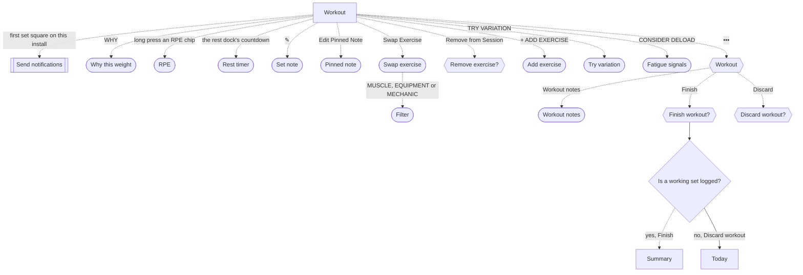

# Log a whole workout

The lifter records what each set really was, so the next prescription, the records and the volume counts build on true numbers.

## Steps

1. The [Workout](../screens/logger.md) logger opens with the header "WORKOUT", ‹ and •••, then the session name, the elapsed time and the intent chip, and every exercise in one scrolling list.
2. Above the first lift's working sets, the WARM-UP RAMP lists rows W1 to W4 with weight, percentage, reps, RPE and the plates per side, and "WORK SETS BEGIN AT" the working weight.
   The ramp rows are a guide with no completion control, so the lifter does the warm-ups and scrolls past them; SKIP WARM-UPS folds the ramp into "Warm-ups skipped" with UNDO.
3. Each working set row shows S1, PREVIOUS (last time's weight × reps @ RPE), WEIGHT, REPS, ✎ and the set square, with WHY and the RPE chips 6 to 10 under it.
   The weight starts at last time's weight for the same intent, or 0 on a first workout; the reps start empty.
4. The lifter types the reps, changes the weight if needed, taps an RPE chip, and taps the set square.
   A long press on an RPE chip opens [RPE](../screens/decimal-rpe-picker.md) for half steps such as 8.5, closed with Done.
   WHY opens [Why this weight](../screens/why-this-weight.md), where USE puts the recommended weight in the set and OVERRIDE focuses the weight field.
5. The set square fills, the weight and reps turn signal red, and the rest dock appears at the bottom with RESTING, the countdown, -15s, +15s and SKIP.
   On the first rest after install, iOS shows [Send notifications](../screens/notification-permission.md) once; the lifter taps Allow or Don't Allow.
   A new record slides the PR banner over the top of the screen.
6. While resting, the lifter can tap the dock's countdown to open [Rest timer](../screens/rest-timer.md) in large type, closed with DONE; when the rest ends, the dock reads REST COMPLETE, counts up in red, and SKIP becomes DONE.
7. The lifter repeats steps 4 and 5 for each set, scrolling down to each next set; + ADD SET adds a set, a swipe left on a set deletes it, and the S1 label opens the set-type menu (Working, Warm-up, Drop Set, To Failure, Rest-Pause).
8. To leave a note on one set, the lifter taps ✎, writes in [Set note](../screens/per-set-note.md) and taps SAVE.
9. When all lifts are done, the lifter taps ••• and Finish in [Workout](../screens/dialog-workout-menu.md), and Finish in [Finish workout?](../screens/dialog-finish-workout.md), which shows "n sets logged · elapsed time".
10. [Summary](../screens/workout-summary.md) opens as a full-screen cover; DONE closes it and the logger together.

**Swap an exercise**

1. A long press on the exercise name opens a menu with Swap Exercise…, Edit Pinned Note and Remove from Session; nothing on screen hints at the long press.
2. Swap Exercise… opens [Swap exercise](../screens/swap-exercise.md), the library list with search and the MUSCLE, EQUIPMENT and MECHANIC chips, which open [Filter](../screens/filter-picker.md).
3. A tap on a row swaps the exercise at once for this workout only, and rebuilds its sets and warm-up ramp.
4. Remove from Session opens [Remove exercise](../screens/dialog-remove-exercise.md), whose Remove deletes the exercise and its logged sets.
5. + ADD EXERCISE ↘ FROM LIBRARY under the last exercise opens [Add exercise](../screens/library-picker.md), which adds the picked exercise with three sets.

**Notes**

1. Edit Pinned Note in the long-press menu, or a tap on the pinned note capsule, opens [Pinned note](../screens/pinned-note.md) for a note that stays with the exercise.
2. Workout notes in the ••• menu opens [Workout notes](../screens/workout-notes.md) for the whole workout.
3. All three note sheets save with SAVE; CANCEL and a swipe down throw the typed text away without asking.

**A stalled exercise**

1. An exercise that has stopped progressing shows a STALLED badge with one suggestion chip above its set table.
2. ADD VOLUME adds a set at once; DROP INTENSITY lowers the working sets at once.
3. TRY VARIATION opens [Try variation](../screens/try-variation.md), but picking a variation changes nothing, so the lifter must use Swap Exercise… instead.
4. CONSIDER DELOAD opens [Fatigue signals](../screens/fatigue-signals.md), closed with DONE.

**Nothing logged yet**

1. With no working set logged, the ••• menu also offers Discard, which opens [Discard workout?](../screens/dialog-discard-workout.md).
2. Finish in that state opens Finish workout? with only Discard workout and Keep logging, so the workout cannot reach the summary.

**Leaving and coming back**

1. ‹ leaves the logger with the workout still in progress; Today's RESUME ▸ slab or Program's banner brings the lifter back, as in the [Today workflow](today.md).

## Flow

## Tap count

| Path | Taps | Taps in order |
|---|---|---|
| Fewest: one set at last time's weight | 5 | S1 reps, the set square, •••, Finish, Finish |
| Typical: one lift, three sets with RPE, first rest on this install | 13 | S1 reps, RPE 8, the set square, Allow, S2 reps, RPE 8, the set square, S3 reps, RPE 9, the set square, •••, Finish, Finish |
| Swap one exercise first | +3 | a long press on the name, Swap Exercise…, the new exercise's row |

Each working set costs at least two taps, reps and the set square, because the reps start empty; a new weight or an RPE adds one tap each.
At AX3 on the 17e not one whole set row fits between the header and the rest dock, so the lifter scrolls more, but the taps stay the same.

## Dead ends

- TRY VARIATION opens [Try variation](../screens/try-variation.md), where a picked variation and "View all similar exercises in library" only close the sheet (`fitbod/Sessions/SessionExerciseCard.swift:338`).
- The plate stack under a working set never opens, because the weight cell's own tap wins (see [Workout](../screens/logger.md)).
- With nothing logged, [Finish workout?](../screens/dialog-finish-workout.md) offers only Discard workout, so a workout with no logged set cannot be finished.
- Warm-up ramp rows cannot be marked done, so warm-ups leave no record and start no rest.

## Detours

- Swap, pinned note and remove sit behind a long press on the exercise name, which the lifter must discover.
- Finish sits in the ••• menu, not on the page, and asks twice.
- A lifter who refused notifications must leave the app for iOS Settings to get rest alerts in the background; the app does not say so.

## No clear way back

- Once a working set is logged, the ••• menu drops Discard, so the logger has no way to throw the workout away; only Today's DISCARD or Program's banner can.
- CANCEL or a swipe down on [Set note](../screens/per-set-note.md), [Pinned note](../screens/pinned-note.md) and [Workout notes](../screens/workout-notes.md) throws the typed text away without asking.
- A tap on a [Swap exercise](../screens/swap-exercise.md) row replaces the exercise at once with no undo; swapping back means finding the old exercise in the list.
- Remove in [Remove exercise](../screens/dialog-remove-exercise.md) deletes the exercise's logged sets with no undo.
- [Why this weight](../screens/why-this-weight.md) has no close button; a swipe down is the only way out without changing the weight.

## Findings

<!-- findings are linked after the audit -->
