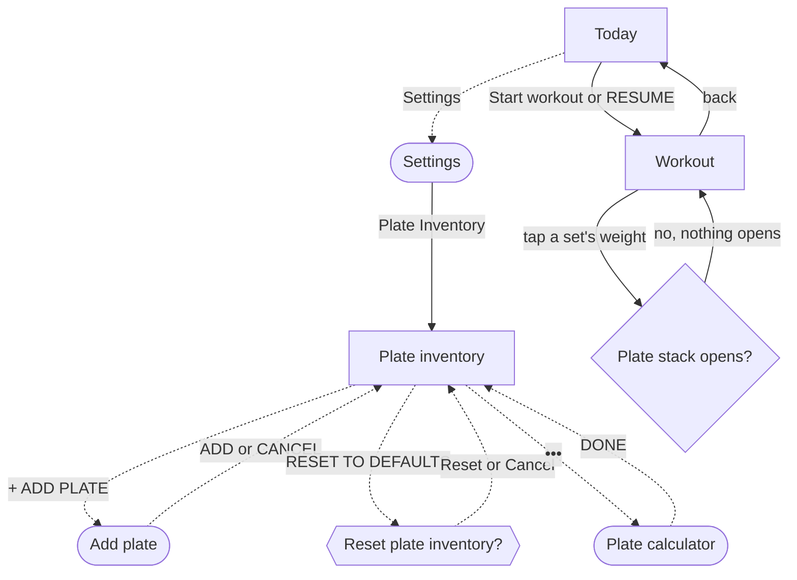

# Set up my plates and load a bar with the plate calculator

The lifter tells the app which bar and plates they own, so the calculator and the warm-up ramp only suggest loads they can actually build.

## Steps

1. On [Today](../screens/today.md), tap Settings at the left of the header.
2. On [Settings](../screens/settings.md), tap the Plate Inventory row under Units & Calibration.
3. On [Plate inventory](../screens/plate-inventory.md), pick the equipment tab: BARBELL, DUMBBELLS, EZ-BAR or TRAP BAR.
   The BARBELL tab is open when the screen opens.
4. Tap the bar weight on the BAR WEIGHT row and type the bar's weight on the decimal pad.
   The pad has no DONE key.
5. Tap a tally box on a plate row to set how many of that plate the lifter owns per side, from 0 to 4.
   Each change saves as it is made; there is no save button.
6. To add a plate size, tap + ADD PLATE under the plate rows.
7. On [Add plate](../screens/add-plate.md), tap the weight field, type the weight, and tap ADD.
   The plate joins the list at 2 per side, and the sheet closes.
   CANCEL, or a swipe down, closes the sheet without adding.
8. To remove a plate size, swipe its row left on [Plate inventory](../screens/plate-inventory.md) and tap Delete.
9. To start again, tap RESET TO DEFAULTS under the plate list, then Reset in [Reset plate inventory?](../screens/dialog-reset-plate-inventory.md).
   It resets only the open tab, plates and bar weight together, to the default set in the current unit.
10. Tap ••• at the right of the header to open the [Plate calculator](../screens/plate-calculator.md) for the open tab.
11. On the calculator, tap −5, −2.5, +2.5 or +5 until TARGET shows the weight to load; it always starts at 60.
    PER SIDE draws the plates for one side of the bar.
12. Tap DONE, or swipe the sheet down, to return to Plate inventory; then ‹ BACK or DONE ▸ to return to Settings, and Close to return to Today.

**A lifter who trains in kg, on a fresh install:**

1. The first launch fills all four tabs with the lb set (a 45 lb bar and 45, 35, 25, 10, 5, 2.5 and 1.25 plates).
2. Tapping kg on [Settings](../screens/settings.md) relabels these numbers without converting them, so Plate inventory then reads a 45 kg bar and 45 kg plates.
3. To get a kg set, the lifter taps RESET TO DEFAULTS and Reset on each of the four tabs in turn, because a reset changes only the open tab.

**From inside a workout:**

1. On [Today](../screens/today.md), tap Start workout ▸ (or RESUME) to open the [Workout](../screens/logger.md) logger.
2. The warm-up ramp shows each warm-up's plates per side, such as "10+10+2.5", worked out from the plate inventory.
3. Tap a working set's weight, or the row around it, to show its plate stack.
   The stack never opens, because the weight cell takes the tap; nothing in the logger opens the calculator ([the tour's attempt](../screens/img/17e-default-light-logger--plate-stack.png)).
4. To get the plates, tap ‹ to go back to Today; the workout stays in progress.
5. Follow steps 1, 2 and 10 above, then step the calculator from 60 to the set's weight with the chips.
6. Tap DONE, ‹ BACK and Close, then RESUME on Today's workout-in-progress slab to return to the set.

## Flow

## Tap count

| Path | Taps | Taps in order |
|---|---|---|
| Fewest: open the calculator | 3 | Settings, Plate Inventory, ••• |
| Typical: set a count, add a plate, load 135 lb | 22 | Settings, Plate Inventory, a tally box, + ADD PLATE, weight field, ADD, •••, +5 fifteen times |
| Reset one tab, then open the calculator | 5 | Settings, Plate Inventory, RESET TO DEFAULTS, Reset, ••• |
| kg lifter on a fresh install: kg plates on all four tabs | 16 | Settings, kg, Plate Inventory, RESET TO DEFAULTS, Reset, DUMBBELLS, RESET TO DEFAULTS, Reset, EZ-BAR, RESET TO DEFAULTS, Reset, TRAP BAR, RESET TO DEFAULTS, Reset, BARBELL, ••• |
| In a workout: plates for a 225 lb set, from Today | 39 | Start workout ▸, the set's weight (nothing opens), ‹, Settings, Plate Inventory, •••, +5 thirty-three times |
| In a workout: back to the set afterwards | 4 | DONE, ‹ BACK, Close, RESUME |

The calculator's target cannot be typed, so every path pays one tap per 5 lb between 60 and the weight to load.

## Dead ends

- [Workout](../screens/logger.md): a tap on a set's weight, or on the row around it, never opens the plate stack, so the lifter cannot see the plates for a set inside the workout (`fitbod/Sessions/PrescriptionWeightCell.swift:167`, `fitbod/Sessions/SetRow.swift:156`).
  No control in the logger opens the plate calculator either; the only way in is ••• on Plate inventory (`fitbod/Settings/PlateInventoryEditor.swift:65`).
- [Plate calculator](../screens/plate-calculator.md): the EQUIPMENT head says "TAP TO CHANGE", but the BAR and INVENTORY cells do nothing, so a lifter who opened it on the wrong tab must close it, change tab on Plate inventory and open it again (`fitbod/Settings/PlateCalculatorSheet.swift:388`, `screens/img/17e-default-light-plate-calculator.png`).
- [Plate calculator](../screens/plate-calculator.md): the PLATES AVAILABLE rows look like Plate inventory's tally rows but ignore taps, so counts cannot be fixed from the calculator (`fitbod/Settings/PlateCalculatorSheet.swift:459`).
- [Add plate](../screens/add-plate.md): ADD is enabled for a weight of 0, but the tap does nothing and the sheet stays open with no message (`fitbod/Settings/PlateInventoryEditor.swift:480`).

## Detours

- From a workout, the lifter must leave the logger with ‹, open Settings from Today, go to Plate inventory and open the calculator, then come back the same way and tap RESUME; that costs 7 taps on top of the chip taps.
- A lifter who trains in kg must change Units on Settings first, then reset each equipment tab on Plate inventory, before the plates and bar match what they own.
- A lifter who wants the calculator for dumbbells, the EZ-bar or the trap bar must pick that tab on Plate inventory before tapping •••, because the calculator always uses the open tab.

## No clear way back

- [Plate inventory](../screens/plate-inventory.md): the bar weight's decimal pad has no DONE key, so the keyboard stays up over the list until the lifter leaves the screen or scrolls it away.
- [Add plate](../screens/add-plate.md): the header has no close control; CANCEL sits under the field, and a swipe down also cancels.
- [Plate inventory](../screens/plate-inventory.md): RESET TO DEFAULTS replaces the tab's plates and bar weight at once, and the edits it replaces cannot be brought back.

## Findings

- Major: [D-11](../audit.md#d-11), [D-12](../audit.md#d-12).
- Minor: [D-114](../audit.md#d-114), [D-115](../audit.md#d-115), [D-121](../audit.md#d-121).
- Polish: [D-189](../audit.md#d-189).
