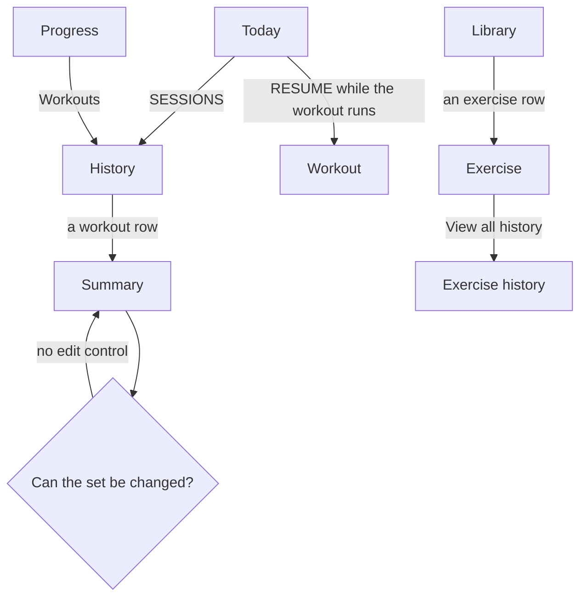

# Review a workout and correct its history

The lifter's records, progression and volume all come from logged sets, so a wrong weight, a missed set or a workout on the wrong day makes every number after it wrong until it is corrected.

## Steps

1. On [Today](../screens/today.md), the lifter taps the SESSIONS stat, which counts every logged workout and ends with ›.
2. [History](../screens/history.md) lists past workouts, newest first, under 30-day totals and an 8-week tonnage chart; the lifter taps a workout row.
3. The [Summary](../screens/workout-summary.md) shows the date, duration, sets, volume, records, and for each exercise its working-set count, its volume and its best set.
4. The lifter looks for the wrong set, but the Summary shows only each exercise's best set, and its exercise rows cannot be tapped.
5. The lifter wants to fix the weight, the reps, a missed set or the date, but the Summary has no edit, add or delete control, and History rows have no swipe actions.
   The job ends here, with the history still wrong.

**From Progress**

1. The lifter taps the PROGRESS tab, then the Workouts row on [Progress](../screens/progress.md).
2. The same [History](../screens/history.md) opens, and the steps above follow.

**The workout is still in progress**

1. Today shows the workout-in-progress slab instead of the start controls; RESUME opens the [Workout](../screens/logger.md) screen.
2. A logged set's weight and reps can still be changed, + ADD SET adds a missed set, and a swipe left deletes a set (from code).
3. This is the only time a workout can be corrected; once Finish is confirmed, it cannot be reopened.

**The lifter wants to see every set of one lift**

1. The lifter taps the LIBRARY tab, finds the exercise and taps its row on [Library](../screens/library.md).
2. View all history › on [Exercise](../screens/exercise-detail.md) opens [Exercise history](../screens/exercise-history.md), which lists each completed working set by workout.
3. Those rows cannot be tapped either, so they do not lead to a fix.

## Flow

## Tap count

| Path | Taps | Taps in order |
|---|---|---|
| Fewest, from Today | 2 | SESSIONS, the workout row |
| From Progress | 3 | PROGRESS, Workouts, the workout row |
| Seeing every set of one lift | 3 plus the search | LIBRARY, the exercise row, View all history › |
| Correcting the workout | not possible | the app has no control for it |

## Dead ends

- The [Summary](../screens/workout-summary.md) has no way to change a logged set, add a missed set, delete a set, change the date or delete the workout; it offers only ‹ (`fitbod/Sessions/SessionDetailView.swift:75`).
- [History](../screens/history.md) rows only open the Summary; they have no swipe or menu actions (`fitbod/Sessions/SessionHistoryView.swift:35`).
- A workout's date is the moment the lifter tapped Start, and no screen can change it (`fitbod/Sessions/SessionFactory.swift:149`).
- The Summary shows only each exercise's best set, so the lifter cannot even find which set holds the wrong weight from the workout itself (`fitbod/Sessions/SessionDetailView.swift:176`).
- The Summary's exercise rows and [Exercise history](../screens/exercise-history.md)'s rows cannot be tapped, so neither leads anywhere.

## Detours

- To see every set of a lift, the lifter leaves History for the LIBRARY tab, searches for the exercise, and opens [Exercise history](../screens/exercise-history.md); it shows one lift at a time, not the whole workout.

## No clear way back

- Finish in [Finish workout?](../screens/dialog-finish-workout.md) is final: a finished workout cannot be reopened in the [Workout](../screens/logger.md) screen, so a mistake noticed on the Summary after Finish stays in the history.

## Findings

<!-- findings are linked after the audit -->
