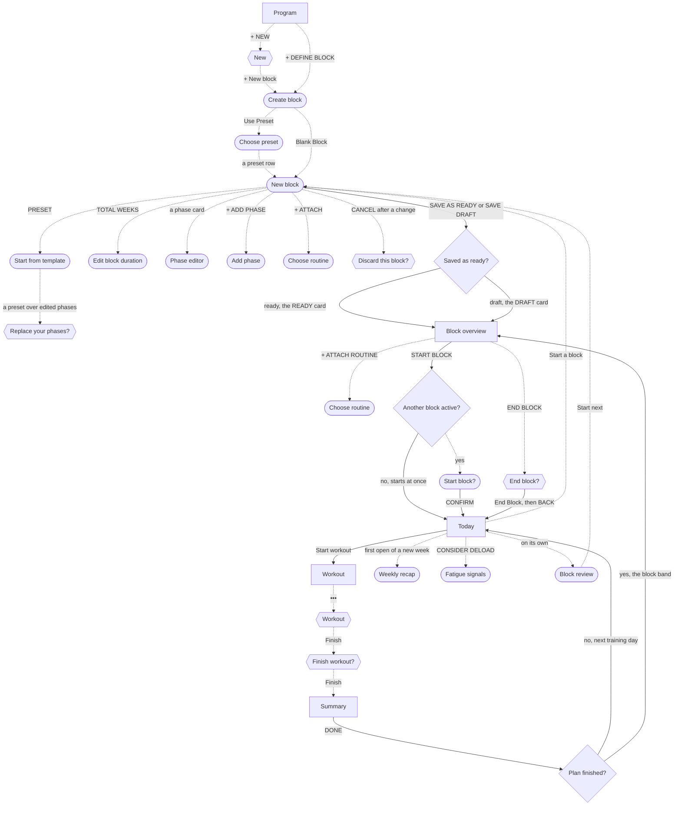

# Run a block from plan to review

The lifter trains in blocks of weeks with set phases, so a block is the frame for every workout in it, from the first accumulation week to the deload and the review that sets up the next block.

## Steps

1. On [Program](../screens/program.md), the lifter taps + NEW in the header, then + New block in the [New](../screens/dialog-program-new.md) popover.
   Before any block exists, + DEFINE BLOCK ▶ under "No blocks yet." opens the next sheet in one tap.
2. On [Create block](../screens/start-choice.md), the lifter picks Blank Block or Use Preset.
   Blank Block opens New Block with three phases already filled in (Accumulation 2, Intensification 2, Deload 1) and no name.
3. With Use Preset, the lifter picks a preset on [Choose preset](../screens/preset-picker.md), such as HYPERTROPHY MESO, which fills the name and the phases.
4. On [New block](../screens/new-block.md), the lifter names the block if it has no name.
5. The lifter shapes the phases on New block:
   1. PRESET ▾ opens [Start from template](../screens/new-block-template.md) to swap in another preset; over edited phases it asks [Replace your phases?](../screens/dialog-replace-phases.md).
   2. The TOTAL WEEKS cell opens [Edit block duration](../screens/new-block-duration.md), with weeks per phase; Done closes it.
   3. A phase card opens the [Phase editor](../screens/new-block-phase-editor.md) for its weeks, volume and intensity; Done closes it.
   4. + ADD PHASE opens [Add phase](../screens/new-block-add-phase-type.md), and a row adds that phase last.
   5. A swipe left on a phase card and Delete removes it, with an UNDO toast for 4 seconds.
6. The lifter taps + ATTACH ▸ in the Routine band and picks a routine on [Choose routine](../screens/new-block-split-picker.md).
7. The lifter leaves ROTATION on, or taps FIXED WEEKLY and picks as many weekday chips as the routine has sessions.
8. The lifter taps SAVE AS READY ▸ at the bottom, and New block closes back to Program with a READY card.
   SAVE DRAFT at the top right saves a DRAFT card instead, which needs a name only.
9. On Program, the lifter taps the READY card to open [Block overview](../screens/block-overview.md) and taps START BLOCK ▸.
   With no other block active, the block starts at once and the page turns active.
10. The lifter switches to the TODAY tab, where [Today](../screens/today.md) shows the block band with the phase, the week cells and today's session.
11. Each training day, the lifter taps Start workout ▸ on Today, logs the sets in the [Workout](../screens/logger.md) screen, taps •••, then Finish in the [Workout](../screens/dialog-workout-menu.md) menu and Finish in [Finish workout?](../screens/dialog-finish-workout.md).
12. The [Summary](../screens/workout-summary.md) opens; DONE returns to Today.
13. On the first open of each new week, the [Weekly recap](../screens/weekly-recap.md) opens on Today by itself; ‹ or Start W44 ▸ closes it.
14. The phase changes by the calendar: the phase chip and the week cells on Today move on as the weeks pass, whatever was logged.
15. In the deload week, Today shows the DELOAD WEEK banner ("Deload week - recover, don't load.") and a DL badge on the week cell, and the prescriptions cut the working sets.
16. When the plan is done, the lifter opens Block overview from Today's block band, taps END BLOCK, and confirms with End Block in [End block?](../screens/dialog-end-block.md).
17. The lifter taps ‹ BACK, and [Block review](../screens/block-review.md) opens on Today by itself, with workouts logged, tonnage, records and e1RM movement.
18. Start next ▸ marks the block reviewed and opens New block over the review, filled with the recommended preset and no routine; from there the job starts again at step 4.

**A block is already active when the new one starts**

1. START BLOCK ▸ on the ready block opens [Start block?](../screens/swap-confirm.md) instead of starting at once.
2. CONFIRM ends the active block and starts this one in one save.
3. The next time Today appears, the review of the block that just ended opens.

**The block was saved as a draft**

1. The DRAFT card opens a Block overview with + ATTACH ROUTINE ▸ and no START BLOCK ▸.
2. + ATTACH ROUTINE ▸ opens [Choose routine](../screens/split-picker.md); a pick makes the block ready, and START BLOCK ▸ appears.

**The lifter starts from Today with no block**

1. Start a block in Today's No active block band opens New block as a sheet, with the name BLANK BLOCK and no phases at all.
2. The lifter adds phases with PRESET ▾ or + ADD PHASE before the routine.

**Fatigue builds up before the deload**

1. After three finished workouts with a fatigue signal, Today shows a ▲ CONSIDER DELOAD banner, and the logger shows a CONSIDER DELOAD chip on a stalled exercise.
2. Either opens [Fatigue signals](../screens/fatigue-signals.md); DONE closes it.
   The banner only advises; the block's own schedule still decides when the deload week comes.

**The lifter changes the plan mid-block**

1. EDIT in the Block overview header, or EDIT BLOCK ▸, opens New block as Edit block, with SAVE CHANGES.
2. An active block hides SWAP ▸ on its routine, so its routine cannot change while it runs.

**The lifter leaves New block with changes**

1. < PROGRAM, < TODAY or CANCEL asks [Discard this block?](../screens/dialog-discard-block.md); Discard drops the draft and Keep editing stays.

## Flow

## Tap count

| Path | Taps | Taps in order |
|---|---|---|
| Fewest: no block yet, a routine with sessions, no workouts logged | 11 | + DEFINE BLOCK ▶, Use Preset, HYPERTROPHY MESO, + ATTACH ▸, the routine row, SAVE AS READY ▸, the READY card, START BLOCK ▸, END BLOCK, End Block, TODAY (the review opens) |
| Set-up while another block is active | 11 to start | + NEW, + New block, Use Preset, a preset, + ATTACH ▸, the routine row, SAVE AS READY ▸, the READY card, START BLOCK ▸, CONFIRM, TODAY, then training |
| Each workout | 5 plus one per set | Start workout ▸, a tap per set to mark it done, •••, Finish, Finish, DONE |
| Each new week | 1 | ‹ on the weekly recap |
| Ending from Today | 4 | the block band, END BLOCK, End Block, ‹ BACK (the review opens) |
| Typical: an 8-week preset, 4 workouts a week of about 15 sets | about 670 | 11 to set up, 32 workouts of about 20 taps, 7 recaps, 4 to end |

## Dead ends

- Plan custom on [Block review](../screens/block-review.md) only closes the sheet and saves nothing, so the review opens again each time Today appears (`fitbod/Periodization/BlockReviewView.swift:333`).
- EXPORT in the [Block review](../screens/block-review.md) header is plain text and does nothing (`fitbod/Periodization/BlockReviewView.swift:46`).
- With no routines, [Choose routine](../screens/new-block-split-picker.md) in New block is a blank page with no message and no way to make a routine, so SAVE AS READY ▸ stays as PICK A ROUTINE (`fitbod/Periodization/BlockBuilderView.swift:2787`).
- A tap on a gate button on [New block](../screens/new-block.md), such as NAME FIRST or PICK A ROUTINE, does nothing and does not show the missing piece.
- On [Today](../screens/today.md), with a ready block and none active, the No active block band offers only Start a block, which opens a new blank block; it does not start the ready one (`fitbod/Views/TodayView.swift:202`).
- When the plan is over, the block stays active, Today reads "W1 / 4" with no week cell lit, and nothing asks the lifter to end it ([plan-complete](../screens/img/17e-default-light-today--plan-complete.png)).
- On [Start block?](../screens/swap-confirm.md) at AX3, the message is cut to "Ends Spring Block…", so the lifter cannot read that CONFIRM ends the active block.

## Detours

- A lifter with no routine must leave New block, build a routine on [Program](../screens/program.md) with + NEW ROUTINE, and come back; a block with no name cannot be saved even as a draft, so the work is lost unless it was named first.
- A block saved as ready from Today or from Start next ▸ must be started from Program: the PROGRAM tab, the READY card, START BLOCK ▸.
- The block review opens only when Today appears, so a block ended from Program's Block overview needs a switch to the TODAY tab before the review shows.
  The End block? message sends the lifter to "the Routines tab", which does not exist (T34).
- Start next ▸ opens New block without the ended block's routine, so the lifter attaches the routine again with + ATTACH ▸ ([from-review](../screens/img/17e-default-light-new-block--from-review.png), `fitbod/Periodization/BlockReviewView.swift:71`).
- Deleting a phase covers New block with the "Phase deleted" toast for 4 seconds, so the lifter waits before the next change (T120).

## No clear way back

- [Create block](../screens/start-choice.md), [Choose preset](../screens/preset-picker.md), [Choose routine](../screens/new-block-split-picker.md) in New block and [Choose routine](../screens/split-picker.md) on the overview have no CANCEL or close; a swipe down is the only way out.
- [Phase editor](../screens/new-block-phase-editor.md) and [Edit block duration](../screens/new-block-duration.md) apply every step at once and have no cancel, so a wrong change must be stepped back by hand.
- [Start block?](../screens/swap-confirm.md) and [End block?](../screens/dialog-end-block.md) cannot be undone: an ended block cannot be made active again.
- After Start next ▸, the review is marked as seen; once it closes, nothing in the app opens it again, and a completed block's [Block overview](../screens/block-overview.md) has no link to it.

## Findings

- Major: [D-05](../audit.md#d-05), [D-06](../audit.md#d-06), [D-19](../audit.md#d-19), [D-23](../audit.md#d-23), [D-25](../audit.md#d-25).
- Minor: [D-34](../audit.md#d-34), [D-45](../audit.md#d-45), [D-47](../audit.md#d-47), [D-97](../audit.md#d-97), [D-162](../audit.md#d-162), [D-166](../audit.md#d-166).
