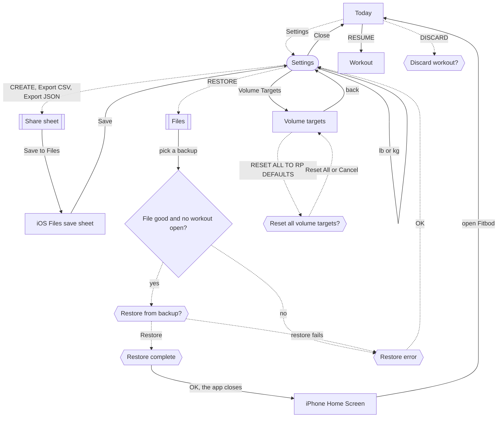

# Change units, back up, restore, export and reset volume targets

The lifter keeps the app's labels in the unit they train in, and keeps a copy of their training history safe outside the phone.

## Steps

1. On [Today](../screens/today.md), tap Settings at the left of the header; [Settings](../screens/settings.md) opens as a sheet.

**Change units:**

1. On [Settings](../screens/settings.md), tap lb or kg on the Units row under Units & Calibration.
2. Every weight label in the app switches to the new unit at once, and the numbers stay as they were: 100 lb becomes 100 kg, and the Default increment of 2.5 lb becomes 2.5 kg.
   The help text under the section says so: "Units change weight labels, not saved numbers. Existing loads are not converted. An exercise's unit override takes priority."
3. An exercise whose own unit is set on its detail screen keeps that unit, whatever Settings says.

**Create a backup:**

1. On [Settings](../screens/settings.md), scroll to Backup and tap CREATE.
2. The [Share sheet](../screens/share-sheet.md) opens with one file, `fitbod-backup-<date>.fitbodbackup`.
3. Tap Save to Files, pick a folder in iOS's Files save sheet and tap Save; the lifter is back on Settings.
4. The backup card still reads "No backup yet" afterwards, so Settings does not confirm that the backup exists.
5. The backup holds exercises, sessions, blocks, logged workouts and settings, but no routines (T41).

**Export CSV or JSON:**

1. On [Settings](../screens/settings.md), under Export, tap the CSV card ("Export CSV", one row per set) or the JSON card ("Export JSON").
2. The [Share sheet](../screens/share-sheet.md) opens with `fitbod-export-<date>.csv` or `.json`; tap Save to Files, then Save, or send it to another app.
3. If building the file fails, the sheet stops and Settings shows "Couldn't prepare export. Try again." under the cards.

**Restore from a backup:**

1. On [Settings](../screens/settings.md), tap RESTORE in the Backup panel.
2. In [Files](../screens/file-importer.md), tap a `.fitbodbackup` file; other files cannot be picked, and ✕ goes back to Settings.
3. The app checks the file.
   A bad file, or a workout still in progress, shows an error such as [Finish your session first](../screens/dialog-restore-error.md); OK closes it and nothing changes.
4. A good file shows [Restore from backup?](../screens/dialog-restore-confirm.md); tap Restore, or Cancel to stop.
5. [Restore complete](../screens/dialog-restore-complete.md) says "Fitbod will restart to load your data."; tap OK.
6. The app closes and the lifter lands on the iPhone Home Screen; they open Fitbod again, which starts on Today with the backup's data and no routines.

**Restore while a workout is in progress:**

1. The lifter goes through RESTORE and picks the file, then gets "Finish your session first".
2. They tap OK, then Close on Settings.
3. On [Today](../screens/today.md), they tap RESUME and finish the workout in the [Workout](../screens/logger.md) logger, or tap DISCARD and Discard in [Discard workout?](../screens/dialog-discard-workout-slab.md).
4. They open Settings again and repeat RESTORE and the file pick.

**Reset volume targets:**

1. On [Settings](../screens/settings.md), tap the Volume Targets row ("17 MUSCLES ›").
2. On [Volume targets](../screens/volume-targets.md), scroll to the bottom and tap RESET ALL TO RP DEFAULTS.
3. In [Reset all volume targets?](../screens/dialog-reset-volume-targets.md), tap Reset All, or Cancel to stop.
4. Tap ‹ to return to Settings, then Close to return to Today.

## Flow

## Tap count

| Path | Taps | Taps in order |
|---|---|---|
| Fewest: change units | 2 | Settings, kg |
| Create a backup and save it to Files | 4 | Settings, CREATE, Save to Files, Save |
| Export CSV or JSON to Files | 4 | Settings, Export CSV (or Export JSON), Save to Files, Save |
| Restore a backup | 5, then reopen the app | Settings, RESTORE, the backup file, Restore, OK |
| Restore with a workout in progress, discarding it | 12, then reopen the app | Settings, RESTORE, the backup file, OK, Close, DISCARD, Discard, Settings, RESTORE, the backup file, Restore, OK |
| Reset volume targets | 5 | Settings, Volume Targets, RESET ALL TO RP DEFAULTS, Reset All, ‹ |

Saving to Files may add taps to pick a folder; the counts above save in the folder Files offers.

## Dead ends

- [Restore complete](../screens/dialog-restore-complete.md): OK ends the app's process instead of restarting it, so the restore never returns to Settings; the lifter lands on the Home Screen and must open Fitbod again (`fitbod/Backup/BackupRestorer.swift:282`).
- [Settings](../screens/settings.md): after a backup or a restore, the backup card still reads "No backup yet" and "Create a backup to protect your data", so the lifter cannot tell from the app that a backup exists (`fitbod/Settings/SettingsView.swift:460`).
- [Settings](../screens/settings.md): a restored backup brings back no routines, so the lifter cannot get a whole training setup back from a backup (T41).

## Detours

- [Finish your session first](../screens/dialog-restore-error.md): a workout in progress blocks a restore, but the app says so only after the lifter has opened Files and picked the backup (`fitbod/Backup/BackupRestorer.swift:151`).
  The lifter must close Settings, finish or discard the workout on Today, then open Settings and pick the file again.
- After changing Units, a lifter who trains in the new unit must also reset the plate inventory and check each exercise's own unit, because nothing was converted; see [plates-and-the-calculator](plates-and-the-calculator.md).

## No clear way back

- [Share sheet](../screens/share-sheet.md): the sheet has no close button; a tap outside it or a swipe down closes it.
- [Restore complete](../screens/dialog-restore-complete.md): OK is the only button, and it closes the app.
- [Restore from backup?](../screens/dialog-restore-confirm.md): Restore replaces every workout, block and setting with the backup's and cannot be undone; routines already in the app are not part of the backup (T41).
- [Reset all volume targets?](../screens/dialog-reset-volume-targets.md): Reset All replaces every muscle's custom targets at once, and the old values cannot be brought back.
- [Settings](../screens/settings.md): changing Units has no confirmation and no undo, but tapping the other unit puts every label back, because no number was changed.

## Findings

- Blocker: [D-03](../audit.md#d-03).
- Minor: [D-60](../audit.md#d-60), [D-121](../audit.md#d-121), [D-145](../audit.md#d-145), [D-146](../audit.md#d-146).
