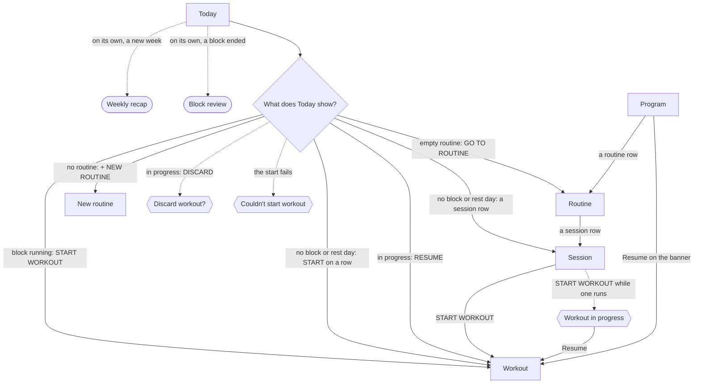

# Start or resume today's workout

The lifter opens Today to see what the plan asks for and to get into the logger with as little thought as possible.

## Steps

1. The lifter opens the app on [Today](../screens/today.md).
   On the first open of a new week, [Weekly recap](../screens/weekly-recap.md) slides up on its own; after a block has ended, [Block review](../screens/block-review.md) slides up first and the recap follows it.
   The lifter closes each with "‹".
2. Today shows the stat strip, then, with a block running, the block band (block name, phase chip and week cells) and the black NEXT slab with the scheduled session, its "n exercises · n sets · ~n MIN" line and START WORKOUT ▸.
3. The lifter taps START WORKOUT ▸, and the [Workout](../screens/logger.md) logger opens on a new workout of that session.
   A workout started here counts as that day's slot, so in a rotation block the next open of Today shows the next session.

**No active block**

1. [Today](../screens/today.md) shows START A WORKOUT, with each routine's name as a small head and its sessions as rows, each with an orange START ▸; "No active block." with START A BLOCK follows it.
2. START ▸ on a row opens the [Workout](../screens/logger.md) logger at once.
3. A tap on the row's name instead pushes [Session](../screens/session-template-detail.md), where the lifter reads the exercises and taps START WORKOUT ▸.
4. With no routine that holds a session, the section shows "Build your first routine" instead, and + NEW ROUTINE pushes [New routine](../screens/new-routine.md); the [first-launch workflow](first-launch-to-first-workout.md) covers that path.

**A rest day or a missed day**

1. On a block scheduled by weekday, a day that is not a training day shows "No workout scheduled" with "Build a routine or pick one from your library." and a + NEW ROUTINE link.
2. The START A WORKOUT picker follows it, so the lifter can still tap START ▸ on any session; that workout is not tied to the block's schedule.
3. There is no skip control.
   On a rotation block, a day the lifter does not train simply leaves the same session waiting as NEXT.
   On a weekday block, a missed training day's session is not offered again; the next training day shows its own session.
4. On a block whose routine has no sessions, Today shows a repair message and GO TO ROUTINE ▸, which pushes [Routine](../screens/routine-editor.md).

**A workout already in progress**

1. Today replaces the NEXT slab, the block band, the picker and the block card with the black RESUME slab: the session name, the elapsed time, "n sets logged", an orange RESUME ▸ and DISCARD.
2. RESUME ▸ opens the [Workout](../screens/logger.md) logger on that workout, with its sets and any running rest kept, also after a relaunch.
3. DISCARD opens [Discard workout?](../screens/dialog-discard-workout-slab.md), whose Discard deletes the workout and its sets.
4. From [Program](../screens/program.md), the resume banner's Resume ▸ opens the same logger.
5. Started from [Session](../screens/session-template-detail.md) while a workout runs, START WORKOUT ▸ shows [Workout in progress](../screens/dialog-workout-in-progress.md), whose Resume button opens the running workout.

**Another session while a block is running**

1. Today hides the START A WORKOUT picker while a session is scheduled, so the lifter cannot pick a different session here.
2. The lifter taps PROGRAM, a routine row to open [Routine](../screens/routine-editor.md), a session row to open [Session](../screens/session-template-detail.md), and START WORKOUT ▸.
3. That workout carries no slot, so it does not move the rotation on, even when it is the scheduled session.

**The start fails**

1. If the workout cannot be built, [Couldn't start workout](../screens/dialog-couldnt-start-workout.md) shows the error, and OK leaves the lifter on Today with nothing created.

## Flow

## Tap count

| Path | Taps | Taps in order |
|---|---|---|
| Fewest: the planned workout | 1 | START WORKOUT ▸ |
| Planned workout on the first open of a week | 2 | "‹" on the weekly recap, START WORKOUT ▸ |
| No block, or a rest day, from the picker | 1 | START ▸ on the session row |
| No block, reading the session first | 2 | the session row, START WORKOUT ▸ |
| Resume a workout in progress | 1 | RESUME ▸ |
| Resume from Program | 2 | PROGRAM, Resume ▸ on the banner |
| Another session while a block runs | 4 | PROGRAM, the routine row, the session row, START WORKOUT ▸ |

## Dead ends

- On a running block, Today offers only the scheduled session; the picker is hidden (`fitbod/Views/TodayView.swift:192`), so choosing another session or skipping today's needs the Program detour.
- Today's own Workout in progress alert can never show, because Today hides its start controls while a workout runs (`fitbod/Views/TodayView.swift:340`); the reachable copy is on [Session](../screens/session-template-detail.md).
- A [Block review](../screens/block-review.md) closed with Plan custom saves nothing, so it slides up again on the next visit to Today and stands between the lifter and START WORKOUT ▸ each time.
- Tapping the rest timer's Live Activity sends the app a link it does not handle (`FitbodWidgets/RestTimerLiveActivity.swift:119`), so the lifter lands on whatever screen was last open, not on the workout.

## Detours

- [Weekly recap](../screens/weekly-recap.md) and [Block review](../screens/block-review.md) open on their own and must be closed before Today can be used.
- Another session while a block runs goes through [Program](../screens/program.md), [Routine](../screens/routine-editor.md) and [Session](../screens/session-template-detail.md).
- A block whose routine has no sessions sends the lifter to [Routine](../screens/routine-editor.md) to add one before anything can be started.

## No clear way back

- DISCARD on the RESUME slab deletes the workout with all its logged sets after one alert; nothing can bring it back.
- After a workout is finished, Today has no "done for today" state: a weekday block shows the same session's START WORKOUT ▸ again the same day (`fitbod/Periodization/TodayResolver.swift:166`), and a rotation block shows the next session as NEXT at once.

## Findings

<!-- findings are linked after the audit -->
